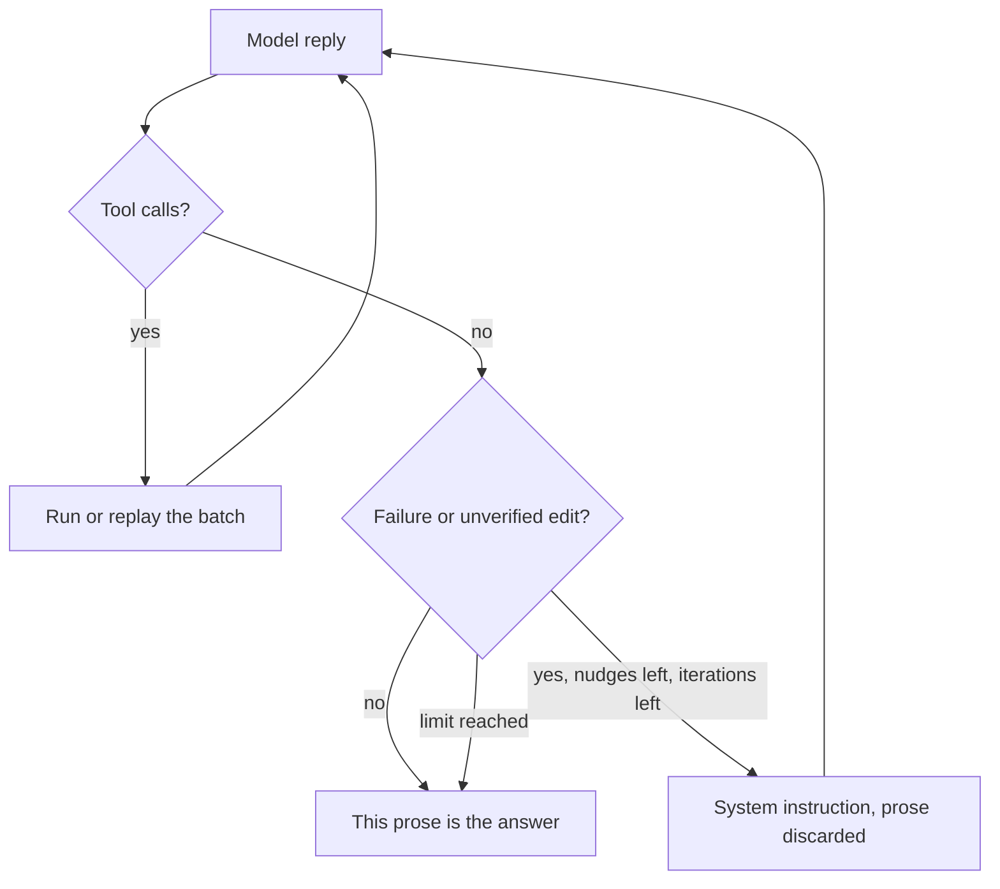

# Agent loop

The loop described here is in the code (`services/agent/tool_loop.py`).
Tickets AL-1 to AL-11 are done: see [Tickets](../notes/verification/agent-loop-tickets.md).
`CONTRACTS.md` is the shipped contract. This page describes the behavior. If
the code and this page disagree, one of them is wrong: fix one or the
other in the same change.

The goal is the cycle of one message in Cursor: the model reads, edits,
verifies, reads the error again, and stops only when that cycle is closed.

The named tools the model can call come in two families. The arguments do
not change with the loop.

| Family | Names | Destination |
| --- | --- | --- |
| HTTP (`services/common/tool_models.py`) | `build`, `build_step`, `compile_file`, `test`, `lint_clang_tidy`, `format_check`, `static_analysis`, `git_log`, `git_blame`, `git_diff`, `git_show`, `svn_status`, `svn_diff`, `svn_log`, `lsp_calls`, `lsp_types` (16) | `tools` |
| Serena sidecar (`services/agent/serena_named_tools.py`) | read: `find_symbol`, `find_declaration`, `find_referencing_symbols`, `find_implementations`, `get_symbols_overview`, `get_diagnostics_for_file`, `get_diagnostics_for_symbol`, `restart_language_server`, `read_file`, `list_dir`, `find_file`, `search_for_pattern` (12). Write: `rename_symbol`, `replace_symbol_body`, `insert_before_symbol`, `insert_after_symbol`, `safe_delete_symbol`, `replace_content`, `replace_in_files`, `replace_lines`, `insert_at_line`, `delete_lines`, `create_text_file` (11) | `serena`, over MCP (see [Overview](overview.md#the-serena-sidecar)) |

That makes 39 names. `begin_plan`, `edit` and `apply`,
`lsp_definition`, `lsp_references`, `lsp_hover`, `lsp_symbols`,
`lsp_outline`, `list_files` and `search` are no longer offered to the model:
a call to any of them is an unknown name, hence a malformed batch.

`POST /chat` with tools enabled is the only path concerned. The
`GET /ui` page talks to this path. MCP `ask` remains a short answer
without tools (`tools: false`, at most 400 tokens). The loop does not run
there. The gate's `direct` path has no tools either.

No shell. No commit. No push. No sub-agent. The only
writer the model can name is Serena: the write tools
above, on a writable mount. `tools` and `agent` keep the checkout
read-only.

## What the loop decides, and what it does not

The loop extends a cycle that is already open. It does not guess that a
question called for a change. With no open failure and no
executed write that is not followed by an executed, successful `build_step`,
prose is the answer, except the first prose of a turn (tools enabled)
that has not yet executed or replayed any tool: that one is refused
once (`no_tool`). The next one, still without a tool, is the answer. A
14B that then describes a fix in text, without writing,
stops. The prompt advises against it. The harness does not choose
the diff for it.

Four situations extend the turn:

| Situation | Observed fact | Instruction sent back to the model |
| --- | --- | --- |
| Failed tool | A failure is still open (see below). A successful read does not close a verification failure. | The name, `open_detail` and `repair` of **that** failure. Follow `repair` if present. |
| Unverified edit | An executed Serena write has `ok: true`, and no executed `build_step` has `ok: true` after it. A replay does not count. | Call `build_step` once. Do not answer. |
| Repeated batch or malformed call | See the limits below, and the § Local model for a call written in the prose or cut off by `length`. | The already known result, or the pydantic error. The tools remain offered. |
| No tool | A prose, and no tool executed or replayed in the turn. At most once. | Call a tool if the question is about the repository, otherwise answer. |

A question ("what does this function do?") followed by successful
reads ends as soon as the model writes without a tool. The last
call is `ok: true` and the phase is `idle`.

## Turn state

Everything lives in `run_tool_loop` (object `_Turn`) and in the editing phase
(`edit_policy.PHASE`, a `ContextVar` reset to `idle` at the start of
`run_tool_loop`). Nothing is written to disk. At the start of the turn, before
any call, the phase is `idle` and there is no open failure.

| Field | Role |
| --- | --- |
| `PHASE` (`edit_policy.py`) | `idle` or `editing`, according to the transitions below. Nothing else changes it. |
| `open_name` | Name of the open failure, or absent |
| `open_detail` | Log excerpt defined in § Local model. Absent without an open failure. |
| `open_repair` | `repair` field of that failure, otherwise absent |
| `nudges` | Nudges already sent |
| `no_tool_sent` | The `no_tool` nudge has already gone out |
| `tools_touched` | At least one call executed **or replayed** in the turn |
| `consecutive_malformed` | Malformed batches in a row. Reset to 0 by a batch in which every call is accepted. |
| `identical_batches`, `batch_identity` | Already accepted occurrences of the current batch identity. A different identity resets it to zero. A malformed batch does not change this counter. |
| `cache` | `ok: true` results, key = name + sorted JSON defined in § Repetition |
| `summaries`, `iterations` | Calls that came back (returned in `tool_calls`), and number of model completions |

The phase is decided here, not in an external service.

- An **executed** Serena write (not a replay) with `ok: true` moves the phase to `editing`.
- An **executed** `build_step` with `ok: true` moves it to `idle`.
- Any other result does not change it. A replay does not change the phase. A failed `build_step` therefore leaves `editing`. A failed write does not open `editing`.

`editing` means exactly: an executed Serena write has `ok: true`,
and no executed `build_step` has had `ok: true` since that write. A
replay counts neither as a write nor as a build. If the variable and this
sentence disagree, the sentence wins and the implementation is wrong.

The open failure is the most recent `ok: false` result, excluding the
refusal of `build`, `test` and `compile_file` during `editing`, until
a later result has closed it. A replay closes nothing
and opens nothing. Only **executed** successes close:

| Open failure | Closed by a later `ok: true` from |
| --- | --- |
| `build`, `build_step`, `test`, `compile_file`, `lint_clang_tidy`, `format_check`, `static_analysis` | **the same** tool name. A green `lint_clang_tidy` does not close a red `test`. |
| a Serena write | any Serena write |
| a Serena read, `git_*`, `svn_*`, `lsp_calls`, `lsp_types` | any tool |

Only `ok: false` opens a failure. A missing `ok` or `ok: true` does not
open one. A more recent failure **replaces** the open failure, even if it comes
from a read. The old one no longer triggers a nudge. Its `tool` message stays in the
turn until the budget has shortened it.

During `editing`, `build`, `test` and `compile_file` are not
executed (`edit_policy.gate_tool`). The result returned to the model is
`ok: false`, `exit_code: 2`, `stderr` exactly
`Edits are in progress. Call build_step once. Do not compile each file, and do not commit.`
This refusal does not become the open failure and does not replace the one
already there. It does not change the phase. It goes into the trace.
`build_step` during `editing` runs.

A successful read, search or symbol lookup does not close a red
`build_step`. The nudge looks at the open failure first, then at the
unverified edit. The model receives the log of the open failure
with the instruction to call `build_step`. Required case: failed `build_step`,
then successful `read_file`, then a prose. The instruction is
`tool_failed`, with the line and the `repair` of that `build_step`.

A successful `build_step`, then a new successful Serena write, then a
prose: the prose is refused, instruction `needs_build`. The previous green
build does not cover the new write.

## Turn exit



`enable_tools` false: none of these tests, nor those of
§ Local model. The first prose is the answer. This is the path
of `ask` and of the `direct` route.

`enable_tools` true: a disguised call or a `finish_reason` equal to
`length` is a malformed batch, handled before this scheme. The scheme
applies to the prose that remains. `no_tool` is the third nudge,
after the open failure and the unverified edit.

A refused prose is not added to the turn history. Only the system
instruction is. The model does not see itself as having already answered.
The tokens of that prose may have gone out over SSE. The `nudge` event
tells the page to clear the draft. The `done` event remains the
retained answer.

The nudge happens only if `nudges < AGENT_LOOP_NUDGES` and if
the current iteration is not the last. Otherwise the prose is kept.
Each nudge consumes one iteration of
`AGENT_TOOL_LOOP_MAX_ITERATIONS`. It does not add a separate budget.
The code default is 8 (variable absent). `compose.yaml` passes the
variable through without a default value: the shipped service takes the value from
`.env`, that is 48 in `.env.example`.

If the last allowed iteration still contains tool
calls, the batch is handled according to its rules, then a completion
without tools is requested (`outcome: max_iterations`). The 4th identical batch
and a malformed batch are not executed, including on that last
iteration. That completion is not nudged. If there is no iteration left to send a malformed
batch back to the model, the same completion
without tools is requested right away, without a correction turn.

Text of the instruction, fixed by the code, plus the log line:

- Failure: `A tool failed and is still open. Follow repair if it is present. After you change a file, call build_step again. Do not resend a call whose result was unchanged.` followed by `open_name`, `open_detail`, and `open_repair` if present.
- Open edit: `Edits are written and not verified. Call build_step once. Do not answer yet.`
- No tool: `You have not called a tool yet. If this is about the repository, call one now. If you can answer without a tool, answer.` This instruction goes out at most once per turn, and only if no tool has been executed or replayed. It counts in `nudges`. The next prose, still without a tool, is the answer.

The completion that follows this nudge is a normal iteration. The
completion without tools at the repetition limit, the malformed limit or the
iteration limit is not nudged, even if a failure is still open: its
prose is the answer. It additionally receives a system instruction
(`Tool calling is unavailable for this turn. …`) that asks it to answer
in text and to say that nothing could be verified. If this prose is empty
or contains only tool calls, the answer is the fixed sentence
`Could not finish the tool loop.` The tool calls of this completion
are ignored. If the model is unreachable at that point, the answer is
`I was unable to reach the language model service to answer this request.`

`AGENT_LOOP_NUDGES` is 3 (code, compose and `.env.example`). The
fourth prose, in the same situation, is the answer.

Other turn exits, with their `outcome` (returned by `run_tool_loop`,
counted by the metrics):

| `outcome` | Case |
| --- | --- |
| `ok` | Prose accepted, or prose kept at the nudge limit |
| `malformed_giveup` | 3 malformed batches in a row, or no iteration left to correct |
| `repeated_tool` | 4th occurrence of the same batch |
| `max_iterations` | Iterations exhausted |
| `context_overflow` | The server rejects the request after compression to half the budget: fixed answer that invites the user to open a new conversation |
| `llm_unreachable` | The model does not respond: fixed answer |

## Repetition

A batch is the list of keys of one reply, internal duplicates counted
once. The key is the name, a slash, then the arguments
**after** pydantic validation, serialized by
`json.dumps(args, sort_keys=True, separators=(",", ":"), ensure_ascii=False)`.
Field order does not matter. Whitespace does not matter. No
Unicode normalization. The value used is that of the validated model,
not the raw text from the model: `1` and `1.0` are the same key only if
that model produced the same JSON. Only the fields supplied by the model
enter the key (`model_dump(exclude_unset=True)`). The identity of a
batch is the sorted list of these keys. `[build, test]` and `[test, build]` are
the same batch for the counter. Execution, however, follows the order of the
reply. The first instance of a key in the batch is processed. The
following ones receive the same result, without a second call, even if that
result is a failure.

| Occurrence of the same batch | Success already in cache | Failure, or success evicted from the cache |
| --- | --- | --- |
| 1 to 3 | Result returned, no call | Call executed |
| 4 | No call to `tools` or `serena`. A completion without tools, whose prose is the answer. | Same |

`AGENT_LOOP_REPEAT_LIMIT=3` is the number of accepted occurrences.
The counter increases when the batch is parsed and is not malformed,
before the call. The 4th occurrence of the same identity calls nothing.
Alternating two different identities resets the counter to zero each
time: that is not the repetition limit. That turn stops at the
configured number of iterations, or on an accepted answer.

The cache keeps only `ok: true` results. A refused Serena write
(for example `replace_content` whose searched text is not
unique) is therefore executed again: the model may have re-read the file in the meantime.
Three identical failures, then giving up at the fourth batch, bound this
re-execution.

An **executed**, successful Serena write removes all keys from the cache,
then puts back **only** that write. The same write a
second time is a replay: no second write, no second
flush, no phase change. A following read or `build_step`
is no longer in the cache: it sees the written checkout. Replaying
a successful build whose sources have not changed avoids a second
multi-hour `cmake`. The verification tools (`build`,
`build_step`, `test`, `compile_file`, `lint_clang_tidy`,
`format_check`, `static_analysis`) follow the same rule as
reads: cached as long as no write has succeeded since.

The replay message is the JSON of the result, with a line in front:
`Same arguments as an earlier call. The result is unchanged.`

Tests: `test_repeated_identical_tool_call_is_not_executed_again` (a single
`/build`, the turn continues with the tools) and
`test_duplicate_calls_in_one_reply_are_not_executed` (two identical
calls in one batch: the first goes out, the second is replayed) in
`tests/agent/test_tool_loop.py`.

## Malformed call

A call is malformed in these cases: invalid JSON, unknown name (the
instruction lists the 39 names), arguments rejected by the pydantic model.
If **one** call of the batch is malformed, **no** call of the batch is
executed, including those that were valid. A valid write must not
go through while its neighbor is rejected. The instruction cites each
pydantic or JSON error, and the name of the valid calls not executed. The
model must resend them. This batch counts as one in
`consecutive_malformed`. The tools stay in the next request. A
batch is valid, and resets the counter to zero, only when every call
has been accepted.

| Malformed in a row | Outcome |
| --- | --- |
| 1 or 2 | Correction, tools still offered |
| 3 | A completion without tools ends the turn (`malformed_giveup`) |

`AGENT_LOOP_MALFORMED_LIMIT=3`. A valid batch resets the counter to 0.
Two errors, a valid call, then two errors do not end the
turn. Test: `test_malformed_twice_does_not_drop_tools`, with cases for
three in a row and for reset to zero in the same file.

## Conversation and trace

`ConversationStore` (`services/agent/conversations.py`) keeps, per
`conversation_id`, the question, the prose and a short trace of the calls of
each turn:

| Field | Content |
| --- | --- |
| `user` | The question, unchanged |
| `assistant` | The final prose, unchanged |
| `trace` | At most 12 calls. The latest are kept. The turn's last verification failure is never dropped: if it is older, it takes the place of the oldest kept call. |

A trace entry: `name`, `ok`, `line`, and the arguments whose
key is in this list (`TRACE_ARG_KEYS`): `path`, `pattern`, `preset`,
`target`, `filter`, `query`, `symbol`, `name`, `start_line`, `end_line`,
`glob`, `ref`, `ref_a`, `ref_b`, `max_results`, `regex`, `line`,
`character`. `line` is the same excerpt as `open_detail` for that call
(§ Local model). An argument value longer than 120 characters is
stored as its first 119 characters plus `…`. A shorter value is stored
as is. Each trace line starts with `- `,
then the name, then the kept arguments in the order of the list
above in the form `key=value`, then ` ok=true` or ` ok=false`, then
`: `, then `line`. The other keys are not stored. A replay goes
into the trace like the executed call: same `ok`, same `line`, without the
phrase "result is unchanged". The next turn re-reads the file.

!!! warning "Known limitation: Serena tool arguments"
    The list above predates the Serena names. Their arguments
    (`relative_path`, `name_path`, `name_path_pattern`, `substring_pattern`,
    `file_mask`, `needle`, …) are not part of it. A Serena call
    trace therefore carries the name, `ok` and `line`, but not the targeted path
    or symbol. The HTTP tools (`build_step target=…`, `git_*`, …) are
    complete.

`history()` injects, between the question and the prose of that turn, a
`system` message:

```
Tools used for the previous question. Re-read a file for its current text.
- replace_content ok=false: <first line of stderr of the refused write>
- replace_content ok=true: <first line of stdout>
- build_step target=pumba ok=false: error: unknown type
```

No `role: tool` messages in this history: the matching
`tool_call_id` values no longer exist. The cap is `AGENT_CONVERSATION_MAX_TURNS`
and the lifetime `AGENT_CONVERSATION_TTL_SECONDS` (30 s minimum). The
defaults differ depending on the source:

| Variable | Code default | `compose.yaml` and `.env.example` |
| --- | --- | --- |
| `AGENT_CONVERSATION_MAX_TURNS` | 8 | 24 |
| `AGENT_CONVERSATION_TTL_SECONDS` | 3600 | 28800 |

A turn evicted by this cap takes its trace with it. Still in memory,
`agent` rootfs read-only.

`STORE.remember` takes the trace in addition to the question and the prose.
`execute_turn` passes it from the turn's `tool_calls`, reduced to the
fields above.

Every exit that produces a prose calls `remember`: accepted answer,
prose at the nudge limit, completion without tools,
fixed sentence `Could not finish the tool loop.`, and the error answers
already returned when the model is unreachable or the
window does not fit. The trace is that of the calls that came back.

A turn cancelled before the final prose is still written:
question, prose `Stopped.`, trace of only the calls that **returned**.
A call that went out and has not yet returned is not in it. Before abandoning
that call, the agent sends `POST /cancel` to `tools`, with
the same `X-Request-Id`, and does not wait for the tool's HTTP call to end.
`POST /cancel` answers 204. If a process was launched for that
identifier, that process and those it launched are killed. On Linux
that is the session group (`killpg`). On Windows it is the tree
of descendants. Without a process, the answer is still
204. The agent does not wait for this 204 more than 2 seconds. The HTTP answer of
this cancellation contains that prose, these `tool_calls` and `nudges`.
The next message sees this trace and can continue.

!!! note "Cancelling a Serena call"
    `POST /cancel` is sent neither to `serena` nor to any other service than
    `tools`. For an in-flight Serena call, the agent abandons its
    own HTTP request to the sidecar (the task is cancelled). The sidecar
    is not notified.

Only one turn is active per `conversation_id`. The next one waits, in a
FIFO queue, until `remember` of the active turn has returned, then it starts
and reads that trace. It does not merge a partial state. The wait
takes the conversation lock **before** a slot of
`AGENT_MAX_CONCURRENT`, so as not to hold a slot while it
waits. If this second call is cancelled during the wait, it writes
nothing to the store and does not start. The active turn continues. Two
distinct conversations keep the slot rule: `503` when they
are taken. The second turn of the same identifier does not answer
`409`: it runs after the first, like a following message in
the same thread. `POST /chat/cancel` (body `{conversation_id}`) stops the
active turn of that conversation, model call included.

## Log kept in the window

Before each model call, `apply_budget` (`services/agent/token_budget.py`)
counts the tokens (`POST /tokenize` of `llama-server`, otherwise `len/4`) and
compares them to the cap `min(AGENT_CONTEXT_BUDGET_TOKENS, LLM_CTX_SIZE, 1024 -
3200)`: 1,024 tokens reserved for the answer, 3,200 for the chat template and
the tool schemas. The defaults are 28,544 and 32,768. It runs before
the first call, then at each iteration. If the server still rejects
the request (context overflow), compression is redone at half
the cap, only once.

The `tool` message carries a `name` field in the agent's list.
`llm_client.api_messages` does not send it to `llama-server`: the request
keeps only `role`, `content`, `tool_calls`, `tool_call_id`.

Protected tools: `build`, `build_step`, `test`, `compile_file`,
`lint_clang_tidy`, `format_check`, `static_analysis` (`journal.VERIFY_TOOLS`).
"The last protected one" is the last `tool` message whose name is in
this set.

Order, recounting the tokens after each shortening:

1. The unprotected `tool` messages, from oldest to most recent, whose content exceeds 160 characters, are replaced by `tool result collapsed (ok): ` or `tool result collapsed (failed): `, then the first 120 characters of `stderr`, or of `stdout` if `stderr` is empty.
2. The protected ones older than the last one, same reduction.
3. The last protected one, if it exceeds 2,000 characters. First `ok` and `repair` are kept (the `repair` JSON is cut to 200 characters). The log is `stderr`, or `stdout` if it is empty. The budget remaining up to 2,000 characters in total is three quarters for the head of this log and one quarter for its tail, in integer division, the remainder going to the head. The assembled text does not exceed 2,000 characters. If it is shorter, it is kept whole.
4. The middle of the conversation (everything except the system prompt and the last question) is folded into a note. The loaded model summarizes it (prompt: paths, symbols, decisions, errors, last trace line; 700 tokens at most). If this request fails, `compress_messages` shortens each message to 220 characters. This summary is a request to the model. The observation that proves the step is step 3: the last protected log is still there after the reads have been shortened. A line missing from the summary does not fail this test.

A message without `name` (old tests) is treated as unprotected.
The SSE `context` event (`used`, `window`, `ratio`, `compressed`) feeds
the page's gauge.

## Contract

Variables, in `CONTRACTS.md`, `.env.example` and the `agent` service of
`compose.yaml`:

```
AGENT_LOOP_NUDGES=3
AGENT_LOOP_MALFORMED_LIMIT=3
AGENT_LOOP_REPEAT_LIMIT=3
```

`POST /chat` returns `nudges` (integer), omitted when it is 0, on the
same principle as `reflection`. The `tool_calls` array does not change:
`name`, `arguments`, `result_summary`.

SSE `nudge` event:

```json
{ "reason": "tool_failed", "tool": "build_step", "remaining": 2 }
```

`reason` is `tool_failed`, `needs_build` or `no_tool`. `tool` is
`open_name` if `tool_failed`, the string `build_step` if
`needs_build`, and absent if `no_tool`. `remaining` is the number of
nudges still possible after this one: 2, then 1, then 0. The page, in
`services/agent/ui/index.html`, adds a line to the progress log and
clears `state.draft`. `done` then overwrites the displayed answer.

A sentence in the prompt (`services/agent/prompts.py`, Workflow
block): after a failed tool, follow `repair`; after a write,
call `build_step` once before answering; a call written in
the answer text does not run. The harness nudge remains
necessary. The prompt alone does not extend the turn.

## Where it is in the code

| File | Role |
| --- | --- |
| `services/agent/tool_loop.py` | Loop, nudges, malformed, repetition, cache, dispatch (`serena` or `tools`), `nudges` in the return value |
| `services/agent/edit_policy.py` | Phase transitions of this document, refusal of `build` / `test` / `compile_file` during `editing` |
| `services/agent/journal.py` | `VERIFY_TOOLS`, log excerpt (`open_detail`, `line`) |
| `services/agent/serena_named_tools.py`, `serena_policy.py`, `serena_transport.py` | Serena tool schema, checks before the call, sidecar MCP client |
| `services/agent/llm_client.py` | Removes `name` before the SDK call. Exposes `finish_reason`. |
| `services/agent/token_budget.py` | Compression order and 2,000-character cap on the last log |
| `services/agent/conversations.py` | Trace per turn, injection into `history()` |
| `services/agent/turns.py` | One active turn per conversation, cancellation |
| `services/agent/main.py` | Queue per conversation, passes the trace to `remember`, returns `nudges`, cancellation guard, `POST /cancel` to `tools` |
| `services/tools/main.py` | `POST /cancel` answers 204 and kills the process of the `X-Request-Id` along with those it launched |
| `services/agent/prompts.py` | The workflow sentence |
| `services/agent/ui/index.html` | `nudge` line, draft cleared |
| `tests/agent/test_tool_loop.py`, `test_edit_policy.py`, `test_journal.py`, `test_conversations.py`, `test_turns.py`, `test_token_budget.py` | Coverage of this document |

The tickets and their dependencies: [Tickets](../notes/verification/agent-loop-tickets.md).

## Local model

A locally served model often writes the call in the prose. This call
runs when its JSON `name` and `arguments` is complete and valid.
It also stops after the context is found, and receives the first
line of a CMake log that does not contain the error. These last two
cases are nudges, not an answer.

Before treating a prose as an answer, and only if
`enable_tools` is true and there is no structured call:

1. A JSON object `name` + `arguments` found in the prose is the call.
   The first JSON object of the whole text, of the body of a block between triple
   backticks, or of the body of a `<tool_call>`, `<tools>` or
   `<function>` tag is examined. `name` must be a known tool (among the 39)
   and `arguments` an object (or a JSON string that decodes to one).
   The arguments go through the same validation as a structured call.
   If they are valid, the call runs. Otherwise the batch is malformed and
   nothing runs: the instruction is the validation error.
2. Otherwise the prose is a disguised call if the text, once leading and
   trailing whitespace is removed, parses as JSON and a string in that value is
   exactly a known tool name, or if a line, with leading and trailing whitespace
   removed, starts with a known tool name followed by `(`, `{` or `:`,
   or if one of those blocks parses as JSON and contains a known tool
   name without being a `name` + `arguments` call. Nothing is executed.
   The instruction is
   `Emit a structured tool call. A tool call written in the answer text does not run.`
3. If the `finish_reason` of this choice is `length` and there is no valid
   structured call, it is a malformed batch. The instruction is
   `The reply was cut off. Send a shorter tool call or a shorter answer.`
   `llm_client.finish_reason` reads this field. If it is absent, this
   rule does not apply.
4. Otherwise the `tool_failed`, `needs_build`, then `no_tool` nudges,
   in that order.

`open_detail`, and `line` in the trace, are:

- for `build`, `build_step`, `test`, `compile_file`, `lint_clang_tidy`, `format_check`, `static_analysis`: the last 200 characters of `stderr`, or of `stdout` if `stderr` is empty, with leading and trailing whitespace removed;
- for any other tool: the first non-empty line of `stderr`, otherwise of `stdout`, truncated to 200 characters.

This way the nudge and the next turn show the compile error,
not the `[1/2] Building` line.

The trace kept for the next message contains at most 12 calls,
the latest. If the turn's last verification failure
(`ok: false` of a tool in the first list) is not in it, it replaces
the oldest of the 12. The next message still sees this error.

## Accepted limit

The harness prevents stopping too early and prevents an infinite loop. It
does not choose the next diff. After `AGENT_LOOP_NUDGES` nudges
(default 3), or at `AGENT_TOOL_LOOP_MAX_ITERATIONS` (code default 8,
48 in `.env.example`), the model's prose is the answer, even if
`build_step` is still red. The log of that failure is in the trace,
so the user's next message can tell it to continue.
