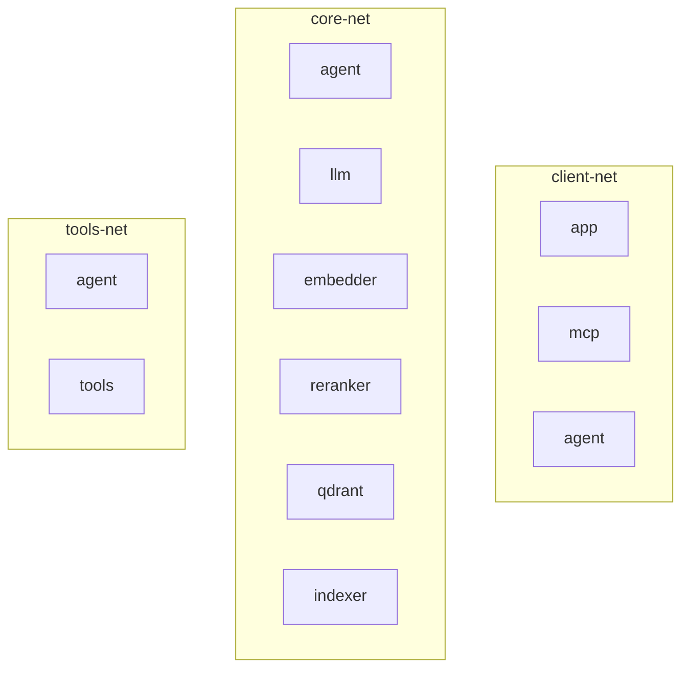

# Networking

Three internal Podman networks give defense-in-depth: even if one service
were fully compromised, it can only reach what its network segment allows.

`agent` is one container. It is drawn three times so each network shows
the attachment it actually has.

## `client-net`

Only `app`, `mcp`, and `agent`. This is the boundary between "whoever is
asking questions" and everything that actually does the work. `app` and
`mcp` cannot reach `llm`, `embedder`, `qdrant`, or `tools` directly - they
can only ask `agent`. `mcp` is published on `127.0.0.1:8092` so a host IDE
can speak Streamable HTTP without joining `core-net`.

## `core-net`

`agent`, `llm`, `embedder`, `reranker`, `qdrant`, `indexer`. This is where retrieval and
generation happen. Notably, `tools` is **never** on this network - even if
`llm` or `embedder` were compromised, neither can reach the service that can
run build/test/lint commands.

## `tools-net`

Only `agent` and `tools`. Symmetrically, none of `llm`/`embedder`/`qdrant`
are on this network - they have no path to the sandboxed tool-execution
service at all.

## Why `agent` is the only multi-homed service

`agent` is the trust boundary by design: it's the one piece of code that
decides what an LLM-initiated tool call is allowed to do (bounded iteration
count, malformed-call handling - see
[Tool calling](../concepts/tool-calling.md)). Every other service only ever
talks to the small set of peers it actually needs, enforced at the network
layer, not just by application logic.

## What's *not* on any of these networks

- **`docs`** is standalone with its port published to the host - it's just
  serving static-ish documentation, not part of the trust-sensitive runtime
  path.
- **`devtools`** and **`fetch-models`** (the `setup` profile) get the
  default, non-internal bridge network - `fetch-models` specifically
  *needs* real internet access to download model weights, which is the one
  deliberate exception to "fully offline." `devtools` doesn't need internet
  at runtime, but there's no benefit to isolating a container that's never
  part of the serving stack and always has the whole repo bind-mounted
  read-write anyway.
- **`smoke-test`** (the `test` profile) is attached to all three internal
  networks, so `tests/integration/test_smoke.py` can probe `llm`,
  `embedder`, `qdrant`, and `tools` health directly as well as go through
  `agent`. It exists only under the `test` profile and is never part of
  the production security boundary - see `compose.yaml`'s comment on that
  service.

## All three are `internal: true`

None of `client-net`/`core-net`/`tools-net` have a route to the outside
world at all - this is what "offline" actually means in this project, not
just "we don't call out to an LLM API." The only container with real
internet access, ever, is `fetch-models`, and only while that specific
one-off job is running. `ui-proxy` is on `publish-net` (no outbound route) so
the engine will bind `127.0.0.1:8090`; it only forwards that port to `agent`.
`llm` and `mcp` are also on `publish-net` so the host can reach
`127.0.0.1:8080` and `127.0.0.1:8092`. Embedder and Qdrant stay off that network.
