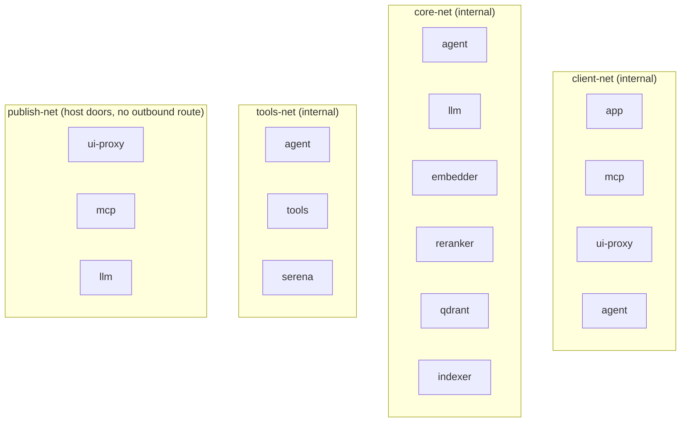

# Networking

Three internal networks give defense-in-depth: even if one service were
fully compromised, the services it shares a segment with are the only ones it
can reach. A fourth network, `publish-net`, exists only so the host can reach
a few loopback ports. What each service does is on the
[Architecture overview](overview.md).

`agent` is one container. It is drawn once per network so each segment shows
the attachment it actually has. `serena` is drawn next to
`tools`: see [The Serena sidecar](overview.md#the-serena-sidecar).

| Service | `client-net` | `core-net` | `tools-net` | `publish-net` | Host port |
| --- | :-: | :-: | :-: | :-: | --- |
| `agent` | x | x | x | only with `config/compose/host-llm.yaml` (`evo-x5`) | none |
| `app` | x | | | | none |
| `mcp` | x | | | x | `127.0.0.1:8092` |
| `ui-proxy` | x | | | x | `127.0.0.1:8090` |
| `llm` | | x | | x | `127.0.0.1:8080` |
| `embedder`, `reranker`, `qdrant`, `indexer` | | x | | | none |
| `tools`, `serena` | | | x | | none |

Services started only under a compose profile (`smoke-test`, `prometheus`)
are described in the last sections.

## `client-net`

`app`, `mcp`, `ui-proxy`, and `agent`. This is the boundary between "whoever
is asking questions" and everything that actually does the work. `app` and
`mcp` have no route to `embedder`, `qdrant`, `tools`, or `serena`:
they can only ask `agent`. `mcp` is published on `127.0.0.1:8092` so a host IDE
can speak Streamable HTTP without joining `core-net`.

## `core-net`

`agent`, `llm`, `embedder`, `reranker`, `qdrant`, `indexer`. This is where
retrieval and generation happen. Notably, `tools` and `serena` are
**never** on this network, even if `llm` or `embedder` were compromised,
neither can reach a service that can build, test, or write sources.

## `tools-net`

`agent`, `tools`, and `serena`. None of `llm`, `embedder`,
`reranker`, `qdrant` are on this network. They have no path to the tool
services at all. `serena` has no `ports:` entry and only `agent` calls it.

Inside this segment the network does not separate `tools` and
`serena` from each other: nothing blocks a connection between them, and
none of their code makes one. The only thing they share on purpose is the
`cmake-cache` named volume (`tools` writes it, `serena` mounts it read-only).
The writer of the checkout is `serena`; `tools` and `agent` mount it read-only.

## Why `agent` is the only service on all three

`agent` is the trust boundary by design: it's the one piece of code that
decides what an LLM-initiated tool call is allowed to do (bounded iteration
count, malformed-call handling, path checks before a Serena call. See
[Tool calling](../concepts/tool-calling.md) and [Agent loop](agent-loop.md)).
Every other service only ever talks to the small set of peers it actually
needs, enforced at the network layer where the segments allow it, and by
application code where they do not (next section).

## `publish-net`: the host doors

Docker Desktop does not publish a host port for a container that sits only on
an internal network. `ui-proxy`, `mcp` and `llm` therefore also join
`publish-net`, which is not `internal: true` so the engine will bind the
loopback ports (`127.0.0.1:8090`, `8092`, `8080`). It must not become an exit:
the runtime overlay closes outbound traffic, with
`config/compose/docker.yaml` (IP masquerade off) or
`config/compose/podman.yaml` (no default route). Podman rejects the Docker
option, hence two files. `deploy.py` adds the one that matches the engine.

Consequence to know: `ui-proxy`, `mcp` and `llm` share a segment, and
`ui-proxy` and `mcp` also share `client-net`. At the network layer `mcp` can
therefore open `llm:8080`, and `ui-proxy` can open `mcp`. Isolation between
them holds by application code (`ui-proxy` forwards only to `agent:8090`,
`mcp` calls only `agent`), not by segment.

On `evo-x5`, `config/compose/host-llm.yaml` also puts `agent` on
`publish-net`: the chat model is the host process on `0.0.0.0:8080`
(`host.containers.internal`), and that network still has no default route.
Embedder and Qdrant stay off that network.

## All three internal networks are `internal: true`

None of `client-net`/`core-net`/`tools-net` have a route to the outside
world at all. This is what "offline" actually means in this project, not
just "we don't call out to an LLM API." The only container with real
internet access, ever, is `fetch-models`, and only while that specific
one-off job is running.

## What's *not* on the internal networks

- **`docs`** (profile `docs`) is standalone with its port published to the
  host (`8000:8000`, not bound to loopback). It's just serving documentation,
  not part of the trust-sensitive runtime path.
- **`devtools`** and **`fetch-models`** (the `dev` and `setup` profiles) get the
  default, non-internal bridge network, `fetch-models` specifically
  *needs* real internet access to download model weights, which is the one
  deliberate exception to "fully offline." `devtools` doesn't need internet
  at runtime, but there's no benefit to isolating a container that's never
  part of the serving stack and always has the whole repo bind-mounted
  read-write anyway.
- **`smoke-test`** (the `test` profile) is attached to all three internal
  networks, so `tests/integration/test_smoke.py` can probe `llm`,
  `embedder`, `qdrant`, `tools`, `mcp`, and `ui-proxy` health
  directly as well as go through `agent`. It exists only under the `test`
  profile and is never part of the production security boundary. See
  `compose.yaml`'s comment on that service. It does not probe `serena`.
- **`trainer`** (profile `train`) has no `networks:` entry either: it gets the
  default network, like `devtools`.

## Observability

With the `obs` profile (`config/compose/observability.yaml`), `prometheus`
is also attached to `core-net` and `tools-net`, plus a dedicated `obs-net`.
It only scrapes `/metrics`. `grafana` is only on `obs-net` and is published on
`127.0.0.1:3000`. See [Observability](../guides/observability.md).
