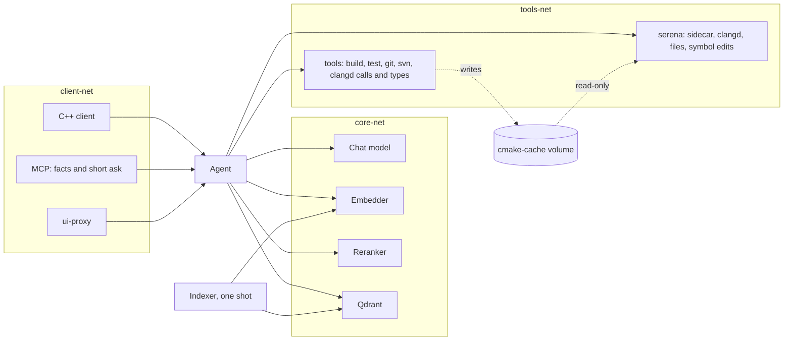

# Architecture overview

This page says what each service does. The networks are on
[Networking](networking.md). The same system, without the AI vocabulary, is
the [plain-language overview](../concepts/en-clair.md).

`agent` is the only service attached to all three internal networks
(`client-net`, `core-net`, `tools-net`). Every arrow is a call it is
allowed to make.

`proxy` is also on `publish-net`, `mcp` and `llm` too (the host-facing
doors). Neither `proxy` nor `mcp` is drawn there to keep the picture
readable. `indexer` is a one-shot job. `devtools` never runs in
production.

Status of the model-facing surface: the agent offers 39 named tools. 16 are
HTTP routes on `tools` (`services/common/tool_models.py`) and 23 are
Serena names (`services/agent/serena_named_tools.py`). The full lists are in [Agent loop](agent-loop.md).

## Each service, one paragraph each

**`llm`** runs `llama.cpp`'s OpenAI-compatible server with the chat model
(Qwen2.5-Coder-14B-Instruct, Q5_K_M by default. See `CONTRACTS.md` for why that
quantization matters for reliable tool-calling). GPU-accelerated by default,
with a CPU-only build path. With `LLM_ROUTER=1` (the default) one GGUF is
loaded at a time and the page can swap it. An optional LoRA adapter
(`LLM_LORA_PATH`) can be loaded with `--lora` after
[QLoRA fine-tuning](../guides/fine-tuning-the-codebase.md) on
`CODEBASE_PATH`; the trainer's base model is Mistral Small 4, so the adapter
does not load on the 14B Qwen.

**`embedder`** runs the same `llama.cpp` server binary, but serving a
dedicated embedding model (nomic-embed-text-v1.5) in `--embedding` mode.
CPU by default (`EMBEDDER_GPU_ARG=0`, `EMBEDDER_NGL=0`), matching `.env.example`
and the 16g profile. The 24g and 48g profiles set GPU=1 (see
[Swapping the model](../guides/swapping-the-model.md#vram-considerations)).

**`reranker`** is a second `llama-server` on the same image, loading
`bge-reranker-v2-m3` Q8 with `--pooling rank --reranking`. It stays on CPU
by default (`RERANKER_NGL=0`). `agent` asks it to reorder the 20 hybrid
hits down to 5. If the process is down, retrieval keeps the RRF order, and
`agent` does not wait on its healthcheck.

**`qdrant`** is the vector database. The default collection, `code_chunks`,
is the `CODEBASE_PATH` tree (`sample/` unless you change it). Each registered
remote gets its own collection (`repo_<hash>` in `state/workspaces.json`).
Two checkouts of the same remote URL share that collection. A point is keyed
by `(file_path, git_blob_hash, symbol_name, start_line)` and stores the
embedding plus a payload (`file_path`, `symbol_name`, line range, `language`,
`git_blob_hash`, and `checkouts` listing the working copies that hold that
blob). It is the **Index** of the glossary: the catalogue of cut chunks, not
the vector store as such.

**`indexer`** is a one-shot batch job (compose profile `index`, not a
long-running server) that walks the C++ project, chunks it structurally with
`tree-sitter` (functions, header declarations, classes, methods, plus
CMake/Markdown/YAML/JSON/TOML), embeds each new blob via `embedder`, and
upserts into `qdrant` (attaching unchanged blobs across branches without
re-embedding). See [The indexing pipeline](../concepts/indexing-pipeline.md).

**`agent`** is the orchestrator and the only service on `client-net`,
`core-net` and `tools-net` at once. A gate chooses `direct` (no index, no
tools) or `code`. On `code` it retrieves from `qdrant` (filtered by the
active `checkout_id`), overlays dirty files from the working copy, may paste
a ranked signature map when the question is about the shape of the tree,
calls `llm`, and runs a bounded loop over 39 named tools. The loop limits are
`AGENT_TOOL_LOOP_MAX_ITERATIONS` (code default 8, 48 in `.env.example` and
therefore in the shipped stack), `AGENT_LOOP_NUDGES` (3),
`AGENT_LOOP_MALFORMED_LIMIT` (3) and `AGENT_LOOP_REPEAT_LIMIT` (3). `/chat`
and `/chat/stream` are bearer-gated. The host page is `GET /ui`, reached
through `ui-proxy` at `127.0.0.1:8090`. It starts only after `llm`,
`embedder`, `qdrant`, `tools`, and `serena` are healthy (without `llm`
on `evo-x5`, where the chat model is a host process). Its rootfs is
read-only and its checkout mount is `:ro`. See
[Agent loop](agent-loop.md), [RAG, explained](../concepts/rag-explained.md) and
[Tool calling](../concepts/tool-calling.md).

**`mcp`** is the editor front on `client-net`. Facts are `lookup`, `check`,
`calls` and `types`. `ask` is a short cited judgment (`POST /chat`, no tool
schema, 400 tokens). `outline` was removed with the Serena migration (the
agent's `/lsp/outline` route still exists). Published on `127.0.0.1:8092`
only. See [MCP](../notes/contracts/mcp.md). `X-Workspace` selects a registered
checkout.

**`tools`** is a sandboxed, curated set of build/test/lint/read-only git/
read-only svn endpoints and clangd call and type hierarchy, never a generic
shell. The model reaches 16 of them by name. The other routes (`/read-file`,
`/git/status`, `/git/diff-names`, `/lsp/outline`) stay on the HTTP API; the
agent uses them itself (`/read`, working-copy overlay, `/review`), and the
model cannot name them. It is the process that configures CMake, so it writes the
`cmake-cache` volume. The checkout mount is `:ro`. It is the highest-risk
service, since an LLM decides when to call it. See
[Adding a new tool](../guides/adding-a-new-tool.md), [Tools API](../notes/contracts/tools-api.md)
and [Security](security.md).

**`serena`** is the **Sidecar**: see the next section.

**`ui-proxy`** is nginx on `client-net` and `publish-net`. Docker Desktop does
not publish a host port for a container that sits only on an internal
network, so this proxy is the loopback forwarder to `agent:8090`. `llm` and
`mcp` join `publish-net` for the same reason (`127.0.0.1:8080` and
`127.0.0.1:8092`).

**`app`** is the C++/CMake CLI (`llm-client`) that talks to `agent`'s
`/chat` and `/chat/stream` endpoints. The tree indexed by default is
`sample/` (a small calculator with known bugs), not `app/`.

**`docs`** (profile `docs`) serves this documentation site locally via
`mkdocs`. It publishes `8000:8000` without a loopback prefix. Host publishes
of the serving stack are loopback only: the page (`127.0.0.1:8090`), the chat
model (`127.0.0.1:8080`) and MCP (`127.0.0.1:8092`). On `evo-x5` the chat
model is the host process on `0.0.0.0:8080`; the page and MCP stay on
loopback. See [Deploy on the EVO-X5](../guides/evo-x5.md).

**`devtools`** is the single toolchain image (C++ compiler, CMake, linters,
Python, every service's dependencies) used for the `.devcontainer`
integration, ad hoc `podman compose run devtools ...` commands, and the
one-off `fetch-models`/`smoke-test` jobs. It never runs as part of the
serving stack. See [Networking](networking.md) for why it isn't attached to
any of the internal networks.

**`trainer`** (compose profile `train` only) runs QLoRA fine-tuning on the
mounted C++ tree and writes LoRA adapters under `./models/adapters/`. Not
part of the serving stack; invoked via `python scripts/deploy.py train`.
See [Fine-tuning the codebase](../guides/fine-tuning-the-codebase.md).

## The Serena sidecar

[ADR-0001](../adr/0001-serena-sidecar.md) decides it; `GLOSSARY.md` defines
**Sidecar** as a process beside the agent, reached over the network, upgraded
on its own cycle.

| | |
| --- | --- |
| Image | `ghcr.io/oraios/serena:2.1.0`. The tag is the upgrade. |
| Network | `tools-net` only. No `ports:`: not published, only `agent` opens it. |
| Protocol | MCP over streamable HTTP, `http://serena:9121/mcp` (`--transport streamable-http --port 9121`). The agent holds one session per process (`McpSidecar` in `services/agent/serena_transport.py`), not the editor. `SERENA_BASE_URL` overrides the address. |
| Backend and project | `--language-backend LSP`, `--agent-interface tools`, `--project /workspace/app`, dashboard off. |
| Mounts | The checkout read-write at `/workspace/app` (plus each registered checkout, read-write, from the generated `state/compose.workspaces.yaml`). `cmake-cache` read-only at `/workspace/scratch/cmake-cache`. `config/serena/serena_config.yml` is copied to the writable path Serena rewrites at start. |
| Disabled tools | `execute_shell_command`, `serena_repl`, `open_dashboard` and every JetBrains tool (`excluded_tools`). Only the 23 names in `serena_named_tools.py` are model-facing. |
| Health | Compose probes a TCP connect on 9121 when `SERENA_HEALTH_STRICT=1` (the default). A dead sidecar keeps `agent` from starting, the way a dead `tools` does. |

Division of labour:

- **Serena** owns clangd for symbols and diagnostics, file read, list and
  search, and the 11 write tools (symbol-level and line-level edits). It
  needs a `compile_commands.json`, which only `tools` produces: that is why
  the `cmake-cache` volume is shared.
- **`tools`** keeps CMake, ctest, `build_step`, clang-tidy, clang-format,
  cppcheck, read-only git and svn, and `lsp_calls` / `lsp_types` (Serena's
  clangd backend does not expose call and type hierarchy). Nothing here
  writes sources.
- **`agent`** is the policy, not Serena. Before a Serena call
  (`services/agent/serena_policy.py`) it refuses a path that passes through
  `.git`, `.svn` or `.env*`, an absolute, drive-anchored, `..` or `:`-bearing
  path, a `max_answer_chars` above 256 KiB, and an `X-Project-Root` that is
  not a direct child of `/checkouts`. For a registered checkout it also
  resolves the path and refuses one that leaves that checkout. A dead or erroring sidecar becomes an
  `ok: false` result, so the loop nudges instead of crashing.
- A successful Serena write opens **Editing** and `build`, `test` and
  `compile_file` are refused until `build_step` succeeds
  (`services/agent/edit_policy.py`). No Serena write commits or pushes.

!!! warning "What the code does not do yet"
    - The agent never tells Serena which checkout the turn selected. Calls carry
      relative paths and the sidecar starts on `--project /workspace/app`, so
      with a registered checkout Serena resolves paths in the default tree,
      while retrieval, `tools` and the working-copy overlay follow the
      checkout. The live gate (ticket 08, still open) only exercised `sample/`.
    - `scripts/host/deploy` recreates `tools`, `agent` and `ui-proxy`
      after a mount change (`_MOUNT_DEPENDENT_SERVICES`), not `serena`.
    - No `POST /cancel` goes to Serena. See [Agent loop](agent-loop.md#conversation-and-trace).

## Further reading

- [Plain-language overview](../concepts/en-clair.md), the same architecture for a reader who does not know the AI vocabulary.
- [Networking](networking.md), why the network segments exist and what each one enforces.
- [Security](security.md), the hardening checklist, service by service.
- [Agent loop](agent-loop.md), what a turn does, and when it stops.
- `CONTRACTS.md` (repo root), the exact ports/env vars/API shapes every service is built against.
