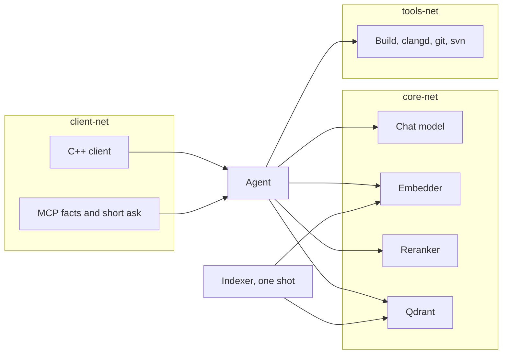

# Architecture overview

`agent` sits outside the three networks in this drawing because it is
attached to all of them. Every arrow is a call it is allowed to make.

The serving path is `llm`, `embedder`, `reranker`, `qdrant`, `agent`,
`tools`, `mcp`, and `ui-proxy` (the loopback door to the page). `indexer`
is a one-shot job. `devtools` never runs in production. A plain-language
walkthrough is [Comprendre sans bagage](../concepts/en-clair.md).

## Each service, one paragraph each

**`llm`** runs `llama.cpp`'s OpenAI-compatible server with the chat model
(Qwen2.5-Coder-14B-Instruct, Q5_K_M - see `CONTRACTS.md` for why that
quantization matters for reliable tool-calling). GPU-accelerated by default,
with a CPU-only build path. An optional LoRA adapter (`LLM_LORA_PATH`) can be
loaded with `--lora` after [QLoRA fine-tuning](../guides/fine-tuning-the-codebase.md)
on `CODEBASE_PATH`.

**`embedder`** runs the same `llama.cpp` server binary, but serving a
dedicated embedding model (nomic-embed-text-v1.5) in `--embedding` mode.
GPU-accelerated by default on 16 GB+ cards (`EMBEDDER_GPU_ARG=1`,
`EMBEDDER_NGL=999`). Set `EMBEDDER_GPU_ARG=0` in `.env` to keep it on CPU
if VRAM is tight (see [Swapping the model](../guides/swapping-the-model.md#vram-considerations)).

**`reranker`** is a second `llama-server` on the same image, loading
`bge-reranker-v2-m3` Q8 with `--pooling rank --reranking`. It stays on CPU
by default (`RERANKER_NGL=0`). `agent` asks it to reorder the 20 hybrid
hits down to 5. If the process is down, retrieval keeps the RRF order.

**`qdrant`** is the vector database. The default collection, `code_chunks`,
is the `CODEBASE_PATH` tree (`sample/` unless you change it). Each registered
remote gets its own collection (`repo_<hash>` in `state/workspaces.json`).
Two checkouts of the same remote URL share that collection. A point stores
the embedding and a payload (file path, symbol name, line range, language,
a content hash for idempotent re-indexing).

**`indexer`** is a one-shot batch job (not a long-running server) that walks
the C++ project, chunks it structurally with `tree-sitter` (functions/
classes/methods, not naive line-splitting), embeds each chunk via `embedder`,
and upserts into `qdrant`. See [The indexing pipeline](../concepts/indexing-pipeline.md).

**`agent`** is the orchestrator and the only service every other network
segment can reach. A gate chooses `direct` (no index, no tools) or `code`.
On `code` it retrieves from `qdrant`, overlays dirty files from the working
copy, may paste a ranked signature map when the question is about the shape
of the tree, calls `llm`, and runs a bounded tool loop (default 8 rounds,
23 named tools). `/chat` is bearer-gated. The host page is `GET /ui`,
reached through `ui-proxy` at `127.0.0.1:8090`. See
[RAG, explained](../concepts/rag-explained.md) and
[Tool calling](../concepts/tool-calling.md).

**`mcp`** is the editor front on `client-net`. Facts are `lookup`, `check`,
`outline`, `calls`, and `types`. `ask` is a short cited judgment (`POST /chat`,
no tool schema, 400 tokens). Published on `127.0.0.1:8092` only — see
[MCP](../reference/mcp.md). `X-Workspace` selects a registered checkout.

**`tools`** is a sandboxed, curated set of build/test/lint/search/read-file,
read-only git, read-only svn, and clangd endpoints — never a generic shell.
The highest-security-risk service, since an LLM decides when to call it. See
[Adding a new tool](../guides/adding-a-new-tool.md) and
[Security](security.md).

**`ui-proxy`** is nginx on `publish-net`. Docker Desktop does not publish a
host port for a container that sits only on an internal network, so this
proxy is the loopback forwarder to `agent:8090`. `llm` and `mcp` join
`publish-net` for the same reason (`127.0.0.1:8080` and `127.0.0.1:8092`).

**`app`** is the C++/CMake CLI (`llm-client`) that talks to `agent`'s
`/chat` endpoint. The tree indexed by default is `sample/` (a small
calculator with known bugs), not `app/`.

**`docs`** serves this documentation site locally via `mkdocs` (`:8000`).
Host publishes of the serving stack are loopback only: the page
(`127.0.0.1:8090`), the chat model (`127.0.0.1:8080`), and MCP
(`127.0.0.1:8092`).

**`devtools`** is the single toolchain image (C++ compiler, CMake, linters,
Python, every service's dependencies) used for the `.devcontainer`
integration, ad hoc `podman compose run devtools ...` commands, and the
one-off `fetch-models`/`smoke-test` jobs. It never runs as part of the
serving stack - see [Networking](networking.md) for why it isn't attached to
any of the internal networks.

**`trainer`** (compose profile `train` only) runs QLoRA fine-tuning on the
mounted C++ tree and writes LoRA adapters under `./models/adapters/`. Not
part of the serving stack; invoked via `python scripts/deploy.py train`.
See [Fine-tuning the codebase](../guides/fine-tuning-the-codebase.md).

## Further reading

- [Comprendre sans bagage](../concepts/en-clair.md) - the same architecture for a reader who does not know the AI vocabulary.
- [Networking](networking.md) - why the three network segments exist and what each one enforces.
- [Security](security.md) - the hardening checklist, service by service.
- `CONTRACTS.md` (repo root) - the exact ports/env vars/API shapes every service is built against.
