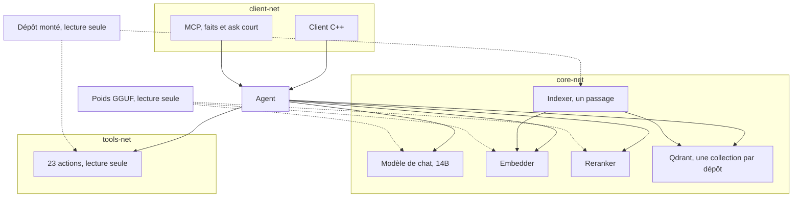
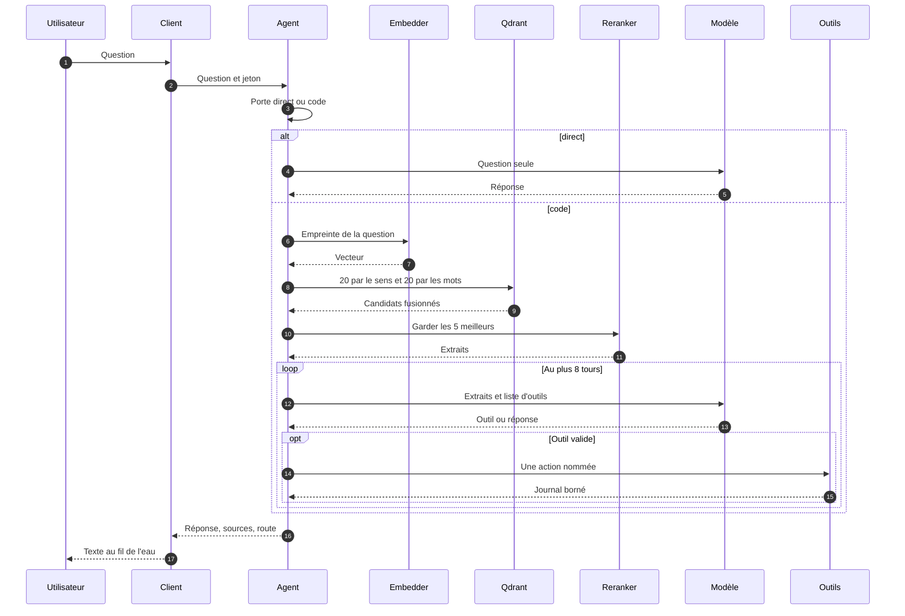
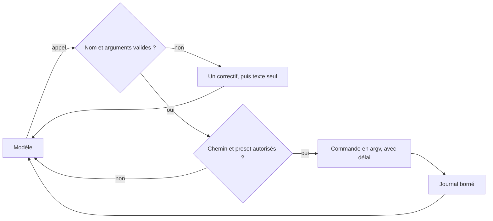
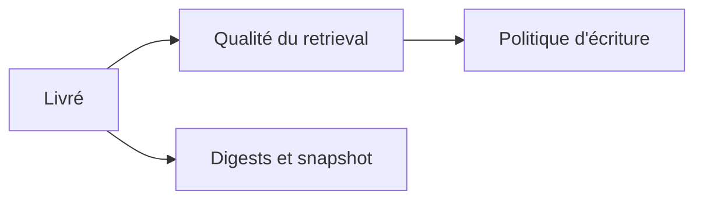
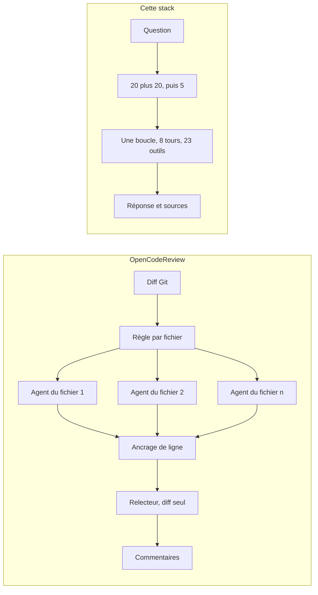
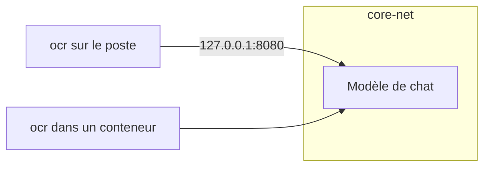

# Présentation de la stack technique

Ce document présente la stack telle qu'elle est réellement implémentée dans
ce dépôt (état au 2026-09-28), détaille l'outillage existant, liste ce qui
reste, puis compare cette approche à OpenCodeReview (`ocr`), l'outil de
revue de code d'Alibaba.

Les faits « durs » (ports, versions, schémas d'API) restent pinnés dans
`CONTRACTS.md` ; cette page en est la lecture guidée.

---

## 1. Vue d'ensemble

Un assistant de code **100 % local et hors-ligne** : un LLM de chat, un
modèle d'embedding, une base vectorielle indexant un projet C++ (et ses
fichiers CMake/Markdown/YAML/JSON/TOML), un orchestrateur RAG + tool-calling
avec mémoire multi-tour et streaming SSE, et un bac à sable d'outils
build/test/compile/git/lint. Tout tourne dans des conteneurs Podman sur
trois réseaux internes sans route vers l'extérieur.

`agent` est le seul service sur plus d'un réseau. Les flèches en pointillé
sont des fichiers montés, pas des appels.

Hors du chemin de service : profils `setup` (`fetch-models`, seul internet),
`train` (QLoRA), `test` (smoke), `dev` (`devtools`), `docs` (mkdocs `:8000`),
`obs` (`compose.observability.yaml` : Prometheus + Grafana). `mcp` est sur
`client-net`, publié en loopback (`127.0.0.1:8092`).

### Flux d'une requête

Le chemin `direct` ne consulte ni le catalogue ni les outils. Le chemin
`code` fusionne 20 voisins par le sens et 20 par les mots, puis n'en garde
que 5. Si le reranker est arrêté, ces 5 sont les premiers de la fusion.

La porte (`services/agent/gate.py`) choisit avant l'index. Les règles
envoient un calcul ou une salutation en `direct` (pas de recherche, pas
d'outils). Un fichier, un symbole, un build ou un test part en `code`.
Une suite de conversation sans signal reste en `code`. Une première
question ambiguë est classée par un appel court au modèle déjà servi
(`AGENT_GATE_CLASSIFY=1`) ; un échec ou un doute reste en `code`.

`/chat` reste pour les scripts. `/chat/stream` (SSE : `route`, `rag`,
`tool_call`, `tool_result`, `token`, `done`) est le chemin par défaut de
`llm-client`. L'événement `rag` est absent quand `route` vaut `direct`.
`conversation_id` garde l'historique **en mémoire** (TTL, plafond de
tours, pas de disque — rootfs read-only de `agent`).

---

## 2. Les couches de la stack

| Couche | Technologie | Version / pin | Rôle |
|---|---|---|---|
| Runtime conteneurs | Podman + Compose, WSL2 (distro `local-llm`) | — | Isolation, 3 réseaux `internal: true`, healthchecks, profils |
| Accès GPU | NVIDIA CDI (`nvidia.com/gpu=all`) | CUDA 12.6.3 | Offload `llm`/`embedder`/`trainer` ; fallback CPU auto via `compose.cpu.yaml` |
| Inférence | `llama.cpp` `llama-server` | tag `b10216` | Serveur OpenAI-compatible pour chat et embeddings |
| Modèle de chat | Qwen2.5-Coder-14B-Instruct | Q5_K_M (~9,8 Go) | Revue et tool-calling ; un LoRA entraîné sur le 7B ne se charge pas ici |
| Modèle d'embedding | nomic-embed-text-v1.5 | Q8_0, 768-d | Vectorisation code et requêtes (préfixes obligatoires) |
| Modèle de test | Qwen2.5-0.5B-Instruct | Q4_K_M | Smoke test CI, CPU only (profil `test`) |
| Base d'entraînement | Qwen/Qwen2.5-7B-Instruct (HF) | safetensors | QLoRA uniquement, jamais servi |
| Base vectorielle | Qdrant | `v1.19.0` | Collection `code_chunks`, cosine, upsert uuid5, skip hash, tombstones |
| Orchestrateur | Python 3.11, FastAPI 0.115, SDK `openai` 2.54, structlog, prometheus | — | `/chat` + `/chat/stream`, porte `direct`/`code`, RAG, budget tokens, mémoire TTL, relecture optionnelle, sémaphore, `/metrics` |
| Indexation | tree-sitter-cpp + `tree-sitter-language-pack`, qdrant-client, watchdog | — | C++ + CMake/Markdown/YAML/JSON/TOML ; skip `git_blob_hash` ; tombstones |
| Bac à sable outils | FastAPI, subprocess `shell=False`, Ubuntu 24.04 | gcc 13, cmake 3.28, clang-tools-18, clangd, cppcheck 2.13, ripgrep, git, subversion | 23 outils, `path_safety`, sorties bornées, cgroups, health strict |
| Client | C++20/CMake, libcurl, nlohmann_json, Catch2 v3 (apt) | — | CLI `app` : SSE par défaut, `--repl`, `--no-stream` ; 11 `TEST_CASE` ctest |
| MCP | SDK `mcp` 1.12 (`FastMCP`) | — | `lookup`, `check`, `outline`, `calls`, `types`, `ask` ; Streamable HTTP `127.0.0.1:8092/mcp` ou stdio ; `X-Workspace` choisit la copie |
| Fine-tuning | transformers, peft, trl, bitsandbytes | — | QLoRA rank 16, dataset depuis chunks tree-sitter, conversion `adapter.gguf` |
| Documentation | mkdocs-material (offline, mermaid) | — | Site local `:8000` |
| Opérations | `scripts/deploy.py` (hôte), pytest, `eval_rag.py`, `eval_tools.py`, `fetch_models.py` | — | Cycle de vie, `chat` / `ask` / `rotate-token`, diagnostics, SHA256 des modèles |

---

## 3. Outils existants

### 3.1 Outils exposés au LLM (`services/common/tool_models.py` → `tools` et `agent`)

Ce sont les **seules** actions que le modèle peut déclencher. Il n'existe
aucun `exec` générique. Le contrat d'arguments de chaque outil est un modèle
pydantic unique (`services/common/tool_models.py`) : `tools` valide ses
requêtes avec, `agent` en dérive le schéma de function-calling
(`model_json_schema()`) et valide les arguments du LLM avant l'appel HTTP.
Un test compare ce registre à l'OpenAPI de `tools` (anti-dérive).

| Nom vu par le LLM | Endpoint | Arguments | Ce que ça fait | Garde-fous |
|---|---|---|---|---|
| `build` | `POST /build` | `preset` | `cmake --preset` + build dans un scratch `mkdtemp()` jeté ensuite | preset allow-listé, timeout `TOOLS_BUILD_TIMEOUT_SECONDS` (14400 s) |
| `test` | `POST /test` | `preset`, `filter?` | build + `ctest` (`-R` si `filter`) | regex de filtre allow-listée |
| `compile_file` | `POST /compile` | `path`, `preset` | configure une fois (cache `/workspace/scratch/cmake-cache/<racine>/<preset>`, une racine par arbre monté) puis un TU | sources C/C++ seulement, `compile_commands.json` |
| `lint_clang_tidy` | `POST /lint/clang-tidy` | `paths[]` | `clang-tidy` sur les fichiers donnés | `path_safety` (pas de `..`, absolu, null byte ; symlinks résolus avant contrôle), timeout `TOOLS_BUILD_TIMEOUT_SECONDS` |
| `format_check` | `POST /format/check` | `paths[]` | `clang-format --dry-run` (ne modifie rien) | idem |
| `static_analysis` | `POST /static-analysis` | `paths[]` | `cppcheck` | idem |
| `search` | `POST /search` | `pattern`, `regex`, `max_results` | `ripgrep` sur la racine montée (jamais choisie par l'appelant) | même timeout, **≤ 100 matches**, 300 colonnes/ligne, `truncated` |
| `list_files` | `GET /list-files` | `path?`, `glob?`, `max_results?` | `rg --files` (respecte `.gitignore`), chemins triés relatifs à la racine | `path_safety`, **≤ 500 chemins**, même timeout |
| `git_log` / `git_blame` / `git_diff` / `git_show` | `POST /git/*` | path / refs / fenêtre | git lecture seule (CLI, pas de shell) | refs allow-listées, **≤ 200 lignes**, même timeout |
| `svn_status` / `svn_diff` / `svn_log` | `POST /svn/*` | path / révisions | Subversion lecture seule sur la copie montée | **≤ 200 lignes**, même timeout ; `svn log` peut joindre le serveur du dépôt |
| `lsp_definition` / `lsp_references` / `lsp_hover` | `POST /lsp/*` | `path`, `line`, `character`, `preset?` | clangd (JSON-RPC) ; `compile_commands.json` déjà dans la copie, sinon configure du preset | positions 1-based, **≤ 40** emplacements, chemins sous la racine, fichier ≤ 256 KiB |
| `lsp_symbols` | `POST /lsp/symbols` | `query`, `preset?` | `workspace/symbol` clangd | même plafond de 40 |
| `lsp_outline` | `POST /lsp/outline` | `path` | symboles d'un fichier (`name kind line`) | faits, pas de commentaire |
| `lsp_calls` / `lsp_types` | `POST /lsp/calls`, `/lsp/types` | `path`, `line`, `character`, `direction` | appelants/appelés, bases/dérivés | `name path:line`, même plafond |
| `read_file` | `GET /read-file` | `path`, `start_line?`, `end_line?` | fenêtre de lignes d'un fichier | cap 256 KiB → 413, **≤ 400 lignes/appel** avec indice de pagination, `path_safety` |

Toutes les réponses partagent la forme `{ok, stdout, stderr, exit_code}`
(`exit_code = -1` = refusé avant toute exécution). Le montage
`/workspace/app` est **en lecture seule** : le LLM ne peut rien écrire.

Un appel d'outil est refusé avant toute commande si le nom, les
arguments ou le chemin ne sont pas dans le contrat.

### 3.2 Outillage opérateur (hors LLM)

**`scripts/deploy.py`** — la commande à lancer sur l'hôte. L'implémentation est dans `scripts/host/`. Les scripts de `scripts/container/` ne se lancent que via Compose.

| Commande | Effet |
|---|---|
| `up` | fetch modèles → sondage/génération CDI NVIDIA (fallback `compose.cpu.yaml` + timeouts élargis) → build → up → attente healthy → index |
| `down [--volumes]` | arrêt (option : purge de l'index Qdrant) |
| `status` / `logs <svc>` | `podman compose ps` / `logs` |
| `index` | recrée le montage `CODEBASE_PATH` puis relance l'indexer sur la collection par défaut |
| `workspace <chemin> [--update]` | enregistre une copie (une collection par URL distante), monte toutes les copies, indexe seulement la première fois |
| `ask "..."` / `ask --file p.md` / `ask -` | question via `app` (SSE par défaut ; `llm-client --no-stream` pour JSON) |
| `chat` | REPL multi-tour (`llm-client --repl`) : réutilise `conversation_id` |
| `rotate-token` | régénère `AGENT_BEARER_TOKEN` et recreate `agent`, `app` et `mcp` |
| `train [--incremental] [--dry-run]` | dataset depuis chunks → QLoRA (profil `train`) → `adapter.gguf` → `LLM_LORA_PATH` → recreate `llm` → re-index |
| `test` | smoke test CI (profil `test`, modèle 0.5B CPU) |
| `doctor [--gpu] [--verify-checksums] [--html]` | Podman/Compose, `.env` + token, `CODEBASE_PATH`, modèles (+SHA256), base HF, adapter LoRA, commit entraîné, disque, santé des services, cohérence build GPU vs `.env`, `nvidia-smi` en conteneur |

**Autres scripts** (exécutés en conteneur) : `fetch_models.py` (téléchargement
via `huggingface_hub.hf_hub_download` — reprise, retries — + SHA256 épinglé
fatal si mismatch, `--hf-train-base`), `eval_rag.py` (questions
dorées : *le bon fichier/symbole est-il dans `sources` ?*, exit ≠ 0 en CI),
`eval_tools.py` (3 scénarios JSON : `build`, `compile_file`, `test` +
`filter`), `convert_lora.py`, `install_train_hook.py`.

**Tests** : pytest (`tests/agent`, `indexer`, `tools`, `mcp`, `trainer`,
`scripts`, `tests/integration`), 11 `ctest` C++, ruff + mypy dans
`.github/workflows/ci.yml`.

### 3.3 Sécurité appliquée

- Réseaux `internal: true`, `tools` invisible depuis `llm`/`qdrant` et réciproquement ; `agent` seul service multi-réseau.
- Tous les services : non-root, `cap_drop: ALL`, `no-new-privileges` ; `agent`, `tools` et `mcp` en rootfs read-only avec tmpfs ciblés.
- Points d'entrée : `/chat` et `/chat/stream`, bearer token (`deploy.py rotate-token`).
- Sémaphore `AGENT_MAX_CONCURRENT` (défaut 2) ; `/health` + `/metrics` sur `agent` et `tools` (`TOOLS_HEALTH_STRICT`). `POST /chat/cancel` coupe la requête modèle en cours.
- Quotas cgroup `cpu`/`memory` sur `tools` (compose) en plus des timeouts.
- Pins : images, `llama.cpp`, modèles (SHA256 issus des métadonnées LFS).

---

## 4. Ce qui manque encore

Vagues 1–2 + streaming + multi-tour sont **livrées**. Ce qui reste est classé
par couche : **trou** vs **choix de conception**. Le détail chiffré est dans
la [roadmap](../roadmap.md).

### 4.1 Outils que le LLM n'a pas

| Manque | Impact | Remarque |
|---|---|---|
| Presets sanitizers (ASan/UBSan/TSan), couverture | Le modèle ne peut pas prouver l'absence d'UB qu'il annonce | Dépend de `CMakePresets.json` du projet cible |
| `run_binary` avec arguments contrôlés | Impossible de reproduire un bug d'exécution hors de `ctest` | Sensible même avec cgroups |
| Écriture libre (`write_file`, shell) | Pas d'écriture hors d'un extrait exact | Livré autrement : `patch` (`begin_plan`, `edit`, `apply`), sans commit |
| Docs hors-ligne (cppreference, docs CMake) | Réponses de mémoire sur les API standard | Dump statique + collection Qdrant |
| Accès web / `fetch_url` | Aucun | Choix : rester hors ligne |

Déjà livrés (ne plus les traiter comme des trous) : `list_files`,
`git_log` / `blame` / `diff` / `show`, `svn_status` / `diff` / `log`,
`compile_file`, `test` + `ctest -R`, `lsp_outline`, `lsp_calls`, `lsp_types`.

### 4.2 Côté agent

- **Reranker livré** : `bge-reranker-v2-m3` Q8, 20 candidats RRF puis top 5.
  Pas de réécriture de requête (HyDE, multi-query), pas de filtres de payload.
- **Pas de planification** ni de sous-agents : une boucle plate de 8 itérations
  (`AGENT_TOOL_LOOP_MAX_ITERATIONS`).
- **Revue de diff livrée** : `POST /review` ancre chaque commentaire sur une ligne du diff.
- **Carte du dépôt livrée** : signatures tree-sitter, budget
  `AGENT_REPO_MAP_CHARS`, collée au prompt quand la question porte sur la forme de l'arbre.
- **Copies livrées** : `state/workspaces.json`, une collection par URL distante,
  en-tête `X-Workspace`, fichiers sales relus devant l'index.
- **Auth** : un seul token partagé, pas de quotas par utilisateur
  (`SECURITY.md`). Le sémaphore borne seulement la concurrence globale.

Livré côté interface : MCP (`lookup`, `check`, `outline`, `calls`, `types`,
`ask`) sur `127.0.0.1:8092`. Page `GET /ui` sur `127.0.0.1:8090` via
`ui-proxy`. Le modèle de chat est publié sur `127.0.0.1:8080`. Il n'y a pas
d'extension éditeur maison : Cursor et VS Code passent par MCP, Continue
parle au 14B directement. Voir [VS Code](../guides/vscode.md).

Livré : `conversation_id` + TTL, SSE `/chat/stream`, `POST /chat/cancel`,
budget tokens (`/tokenize` + `len/4`), validation pydantic des args avant
HTTP, relecture optionnelle `AGENT_REFLECT`, `/metrics` + overlay
Prometheus/Grafana.

### 4.3 Côté indexation

- C++ + CMake/Markdown/YAML/JSON/TOML + fenêtres texte : **livré**.
- Tombstoning + skip `git_blob_hash` : **livré**.
- **`--watch` non fiable** sur Windows → WSL2 → bind mount (inotify).
- `eval_rag.py` / `eval_tools.py` existent ; la CI GitHub lance ruff, mypy,
  pytest et ctest — le job `smoke` lance `eval_rag` hors pull request.
  Pas de gitleaks.

### 4.4 Côté runtime et modèle

- `LLM_THREADS` / `LLM_NUMA` + cgroups `tools` : **livrés**.
- Images pinnées par tag, pas encore par digest `@sha256`.
- Hot-swap d'un GGUF de chat : livré (`LLM_ROUTER=1`, un seul modèle chargé, sélecteur sur `/ui`).
- La page (`127.0.0.1:8090`) et MCP (`127.0.0.1:8092`) sont en loopback. Le conteneur `llm` aussi (`127.0.0.1:8080`), sauf sur `evo-x5` où le processus hôte écoute `0.0.0.0:8080`. L'embedder et Qdrant restent internes.

Ce qui reste, une fois le premier cercle livré. Le retrieval bloque la
qualité des réponses. L'écriture livrée est `patch` (`edit` puis
`apply`, sans commit). L'exploitation peut avancer à côté.

---

## 5. Comparaison avec OpenCodeReview (`ocr`)

[OpenCodeReview](https://github.com/alibaba/open-code-review) est l'outil de
revue de code par IA d'Alibaba, open-sourcé en mai 2026 (Apache-2.0) après
deux ans d'usage interne. C'est une CLI (`ocr`, installée via npm) qui lit un
diff Git, envoie chaque fichier modifié à un LLM configurable au travers d'un
agent à outils, et produit des **commentaires de revue ancrés à la ligne**.
Sa thèse, formalisée dans le papier
[*Determinism over Non-Determinism*](https://arxiv.org/abs/2608.09290) :
injecter du déterminisme à trois endroits précis du pipeline plutôt que
donner une liberté maximale à l'agent.

Les deux projets partagent une intuition — **pas de shell générique, un jeu
d'outils fixe et borné** — mais ne résolvent pas le même problème.

### 5.1 Deux pipelines côte à côte

OpenCodeReview part d'un diff et parallélise un agent par fichier.
Cette stack part d'une question et garde une seule boucle.

### 5.2 Ce qu'ils font, ce qu'ils ne font pas

| Axe | OpenCodeReview | Cette stack |
|---|---|---|
| **Objectif** | Trouver des défauts dans un *changement* (ou auditer des fichiers via `ocr scan`) | Répondre à une *question* sur un dépôt et vérifier la réponse |
| **Entrée** | Diff Git (workspace, `--from/--to`, `--commit`) ou fichiers entiers | Texte libre (+ historique `conversation_id`) ; `POST /review` prend `from` / `to` |
| **Sortie** | Commentaires `{fichier, ligne, texte, suggestion}` ; JSON ; viewer web | Texte libre + `sources[]` + SSE ; `/review` renvoie `{path, line, snippet, text}` |
| **Sélection du contexte** | Déterministe : règles glob par type de fichier, allow-list d'extensions, exclusion fixtures/générés, cap à 80 % de la fenêtre | Dense + BM25 (RRF, 20) puis reranker, top-5 ; règles glob (`rules/*.md`) |
| **Parallélisme** | Un SubAgent par fichier, en concurrence | Une boucle séquentielle |
| **Bornes de la boucle** | 30 itérations ; compression du contexte à 60 % / 80 % | 8 itérations ; budget tokens, compression extractive, 23 outils, caps par outil |
| **Anti-hallucination** | Relecteur indépendant, diff seul, veto si contredit | Retry ×1 tool-call + `AGENT_REFLECT` optionnel (json_schema) |
| **Exécution de code** | **Aucune** — jamais de build, test ou lint | `build`, `test`, `compile_file`, git lecture, tidy / format / cppcheck |
| **Index sémantique** | Aucun (recherche textuelle à la demande) | Qdrant + tree-sitter (C++ et docs) |
| **Règles métier** | 4 niveaux, langage naturel, par glob ; built-in NPE, thread-safety, XSS, SQLi | Fichiers `rules/*.md` résolus par glob + system prompt |
| **Modèle** | Endpoint OpenAI/Anthropic-compatible ; benchmarks avec des modèles frontière | Qwen2.5-Coder-14B Q5 local (GPU), échangeable avec les autres GGUF de `./models/` |
| **Réseau** | Tourne sur le poste dev, appelle un provider (ou délégation à Claude Code / Codex / Cursor / OpenCode) | Tout en conteneurs, réseaux `internal`, zéro egress |
| **Intégrations** | GitHub Actions, GitLab CI, Gerrit, MCP server, OpenTelemetry, session viewer | `deploy.py`, CLI SSE/`--repl`, MCP `ask`, GitHub Actions, Prometheus |
| **Évaluation** | AACR-Bench : 200 PR, 10 langages, 1 505 défauts annotés ; précision et F1 supérieurs à Claude Code pour ~1/9 des tokens, **rappel plus faible** | `eval_rag.py` + `eval_tools.py` ; CI unitaire, pas encore golden LLM |

### 5.3 Outil pour outil

Les deux jeux d'outils sont fermés et sans shell. La différence est dans ce
qu'ils bornent et ce qu'ils permettent.

| Besoin | OpenCodeReview | Cette stack |
|---|---|---|
| Lire un fichier | `file_read` — **plage de lignes**, max 500 lignes/appel | `read_file` — fenêtre, **≤ 400 lignes**, cap 256 KiB (413) |
| Trouver un fichier | `file_find` — mot-clé, max 100 résultats | `list_files` — `rg --files`, glob, **≤ 500 chemins** |
| Chercher du texte | `code_search` — max 100 matches, timeout 10 s | `search` — `rg`, timeout `TOOLS_BUILD_TIMEOUT_SECONDS`, **≤ 100 matches** |
| Voir un autre changement | `file_read_diff` — diff pré-calculé d'un autre fichier du PR | `git_diff` / `git_log` / `git_show` / `git_blame` (lecture seule) |
| Émettre un résultat structuré | `code_comment` — `{texte, existing_code, suggestion_code}` puis résolution de ligne | `POST /review` — snippet copié d'une ligne du diff, sinon `dropped` |
| Terminer explicitement | `task_done` | implicite : réponse sans `tool_calls` |
| Compiler / tester / linter | — | `build`, `test` (`-R`), `compile_file`, tidy / format / cppcheck |

Lecture : OpenCodeReview a borné la **taille de chaque observation** parce
que son problème est le « token snowball » sur de gros PR. Cette stack
borne le **type d'action** (rien d'écrit, rien de shell) *et* la taille
(400 lignes / 100 matches / 500 chemins + budget global via `/tokenize`).
`POST /review` reprend le dispatch par fichier et l'ancrage de ligne.
`ocr` garde le relecteur indépendant, le viewer et les intégrations CI.

### 5.4 Ce que cette stack peut emprunter

Caps d'outils, `list_files`, règles glob, relecture, MCP (faits + `ask`)
et le hybride dense + BM25 sont **livrés**. Cursor et VS Code passent par
cette prise. Une extension maison n'est pas le prochain chantier.

Ce qui reste, par gain pour quelqu'un qui s'en sert :

1. **Qualité du retrieval** sur un arbre de plusieurs milliers de fichiers
   (le top 5 qui préfère un `CMakePresets.json` au symbole nommé).
2. **Politique d'écriture** : le montage est en lecture seule ; qui peut
   écrire, dans quelle copie, et avec quelle relecture, n'est pas tranché.
3. **Exploitation** : digests d'images, snapshot Qdrant. L'annulation
   (`POST /chat/cancel`) est livrée.

### 5.5 Les brancher ensemble

`ocr` accepte un provider personnalisé OpenAI-compatible, et `llm` expose
exactement cette API (`/v1/chat/completions`). Il est donc possible de faire
tourner OpenCodeReview **entièrement en local** sur le modèle de cette stack,
à deux conditions.

Deux façons de joindre le même modèle. Le port loopback est déjà en
place. Le conteneur garde l'appel à l'intérieur des réseaux.

- **Réseau** : `llm` est déjà publié sur `127.0.0.1:8080` (réseau `publish-net`, loopback seulement). L'embedder et Qdrant ne le sont pas. Un `ocr` sur le poste peut donc parler à ce port. L'autre option, un conteneur `ocr` sur `core-net` avec le dépôt en lecture seule, garde l'appel à l'intérieur des conteneurs.
- **Qualité** : les chiffres d'AACR-Bench sont obtenus avec des modèles frontière. Un Qwen2.5-Coder-14B Q5_K_M tient le protocole d'outils (c'est pour ça que le Q5_K_M est pinné) et voit plus de défauts qu'un 7B, tout en restant loin d'un modèle frontière ; le relecteur indépendant limitera au moins les faux positifs. Sur la machine Xeon en CPU-only, une revue de PR à un SubAgent par fichier et 30 itérations n'est pas réaliste.

À l'inverse, OpenCodeReview ne remplacera jamais la partie « exécution » de
cette stack : il ne compile pas, ne teste pas, ne lint pas. La combinaison
naturelle est **`ocr` pour la revue du diff, cette stack pour la
vérification** (build/test/tidy des fichiers que `ocr` a commentés).

---

## 6. En résumé

- La stack est **cohérente et sûre** : offline, segmentée, lecture seule, pinnée,
  avec un bac à sable de 23 outils comme seule surface d'action du modèle.
- Le **premier cercle est livré** : caps d'outils, Git et SVN en lecture,
  clangd (définition, références, plan, appels, types), `compile_file`
  / `ctest -R`, indexation multi-fichiers, tombstones, budget tokens,
  métriques, multi-tour + SSE, annulation, règles glob, relecture optionnelle,
  registre de copies, carte de signatures, CI.
- Ce qui reste : la qualité du retrieval sur un gros arbre, la politique
  d'écriture (aujourd'hui `:ro`), et l'exploitation (digests d'images,
  snapshot Qdrant). Le détail est dans la [roadmap](../roadmap.md).
  MCP, `/ui`, le port loopback du 14B, le hybride, le reranker et
  `POST /review` sont livrés.
- Face à **OpenCodeReview**, les deux refusent le shell générique. Cette
  stack exécute build/test/lint/git/clangd et ancre les commentaires de
  `/review` sur une ligne du diff. Les deux se combinent en pointant `ocr`
  sur `llm` via un conteneur sur `core-net`.
