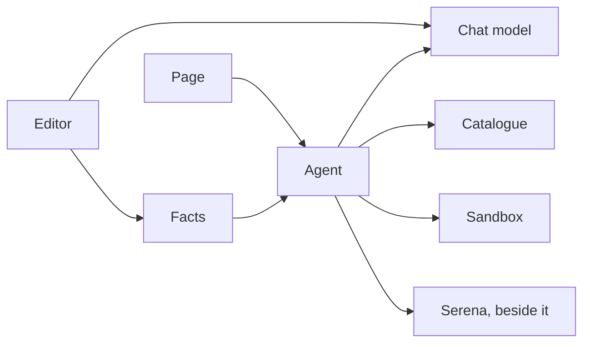
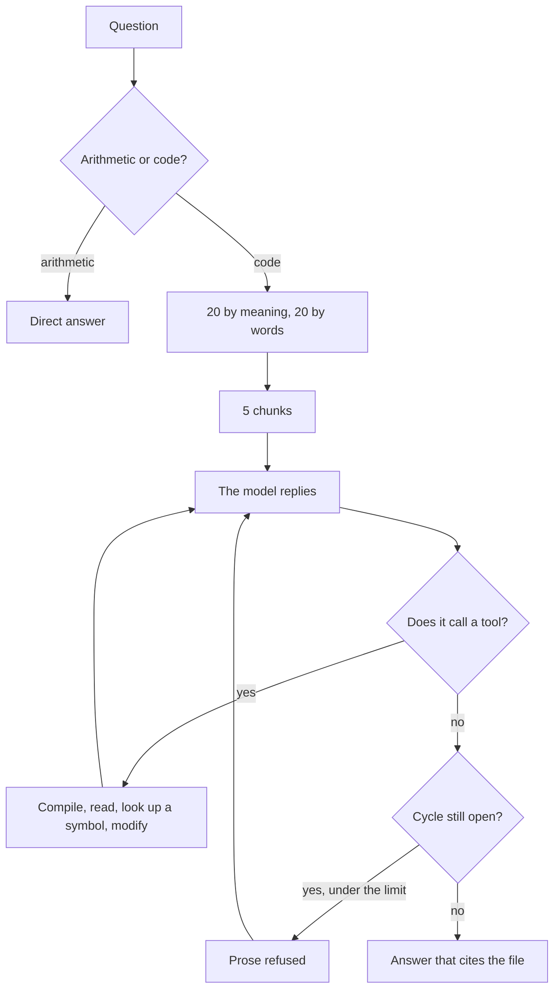

# Understanding the stack without the jargon

This page is for someone who knows a C++ and CMake project and does not
need to know how a model is trained. The same facts, in the vocabulary of
the code, are in the [overview](../architecture/overview.md). The
day-to-day guide is [Using the assistant](../guides/using-the-assistant.md).

## What it is for

You ask a question about a C++ repository that stays on the machine. The program
answers by citing files, and it can compile, run the tests or
read a symbol to verify what it claims. It does not get a terminal.
It does not send the code to an outside service.

Two constraints fixed almost every choice: the code never leaves the
workstation, and the model never has a shell.

## The words, once

| Word | Here, it means |
|---|---|
| Chat model | A program that continues a text. The one being served knows C++ in general. It does not know your files until they are shown to it in the question. |
| Window | The amount of text it can look at for one answer. 32,768 tokens on the 14B profiles, 262,144 on the EVO-X5. A few dozen files, not a tree of ten thousand. |
| Index | A catalogue of the functions, classes and sections of the repository. The whole tree is not put in the window. Only the few pieces that match the question are. |
| Embedding | A vector of numbers that summarizes a piece. Two pieces that are close in the code give close embeddings. This is what makes it possible to search "by meaning", not only by the exact word. |
| Named tool | A named, bounded action: compile this file, read these lines, list the callers. Each action has validated arguments. There is no free command. |
| Sidecar | A process placed beside the agent, reached over the network, upgraded at its own pace. Here: Serena, which knows the C++ symbols (clangd), reads and searches files, and knows how to modify a symbol. |
| MCP | A standard plug for Cursor or VS Code. The editor asks for facts (an excerpt, a test log, the callers of a symbol). It does not get an essay to rewrite. |

## The pieces

Everything runs in containers. Each one sees only the neighbors it
needs.

| Piece | Role in one sentence |
|---|---|
| Page `http://127.0.0.1:8090/ui` | You ask the local model your question. The token stays in the tab. |
| `mcp` on `127.0.0.1:8092` | Cursor or VS Code call `lookup`, `check`, `calls`, `types`, `ask`. |
| `llm` on `127.0.0.1:8080` | The chat model, plugged in directly (Continue, or a compatible client). Either the editor writes the answer, or this model does. The two do not rewrite the same answer one after the other. |
| `agent` | It classifies the question, fetches chunks, calls the named tools (39), counts tokens, returns the answer. It checks paths before any call to Serena. |
| `embedder` | Computes the embedding of a chunk or of a question. |
| `reranker` | Re-ranks the 20 candidates and keeps only 5. If it is stopped, the order of the first search is kept. |
| `qdrant` | The shelf of embeddings. One collection per remote repository, shared by the checkouts of that repository. |
| `indexer` | A single pass: it cuts up the tree, computes the embeddings, files the catalogue. It is not a server that stays running. |
| `tools` | Compiles (`build`, `build_step`, `compile_file`), tests, runs clang-tidy, clang-format and cppcheck, reads Git or Subversion, gives callers and types via clangd. Read-only mount. It never modifies the repository. |
| `serena` (sidecar) | C++ symbols, file reading and search, and the 11 tools that write into the checkout. Write mount. No commit. No port on the machine: only `agent` calls it. |

The chat model, the shelf and the sandbox do not talk to each other.
Only `agent` is on all three internal networks. A model that invents a
call cannot open a shell, nor reach the shelf, nor leave the
machine. The details of the networks are in [Networking](../architecture/networking.md),
those of each service in the [overview](../architecture/overview.md).

Who talks to whom. The page and the editor stay on the machine. The shelf
and the sandbox cannot see each other.

## One question, end to end

Arithmetic does not touch the repository. A code question goes through the
catalogue, then through the tools. Eight round trips is the default of the
code when `AGENT_TOOL_LOOP_MAX_ITERATIONS` is absent. The shipped
limit is 48 (the value in `.env.example`, which `compose.yaml` passes through).
The exact rule is in the [agent loop](../architecture/agent-loop.md).

A prose can be refused as long as the edit is not verified: after
a write, the model must call `build_step`. It can also be refused
as long as a tool is still failing, and once if the code question
has not yet called any tool. At the limit, that prose is the answer.

`agent` first chooses a path.

**Direct.** A greeting or a calculation. No search in the repository,
no tools. A single drafting pass.

**Code.** A file, a symbol, a compilation, a test, or the continuation
of a conversation already about the code. Then:

1. The question is turned into an embedding.
2. The catalogue returns 20 pieces by meaning and 20 by exact words
   (`m_bufferSize` matches the second, a paraphrase matches the first).
3. The second ranking keeps only 5 of them.
4. The modified files that are not yet committed are re-read from the checkout and
   placed in front of these chunks. They are not rewritten into the catalogue.
5. If the question is about the shape of the repository, a signature map
   (function and class names, ranked to fit in a budget)
   is pasted into the prompt.
6. The model can call a tool, within the round-trip limit given
   above. Each result comes back into the conversation. It writes the answer
   when the cycle is closed, or when the limit is reached.
7. The page shows how full the window is. If the conversation overflows, the
   old tool results are shortened, then the old turns are
   folded into a note.

A question from the editor does not follow this tool loop for
`ask`. `ask` judges chunks that were already retrieved, in 400 tokens, and cites
`path:line`. Searching, compiling or following calls is
`lookup`, `check`, `calls`, `types`.

## The choices

| Choice | Why |
|---|---|
| Everything local, networks with no route to the outside | The repository code does not go to a provider. The only container that has Internet is the one that downloads the weights, and only during that download. |
| No shell, 39 named actions | The model decides when to compile, read or modify. Its arguments are treated as untrusted input: paths revalidated, Git references filtered, outputs capped (200 lines for Git and Subversion, 40 clangd locations for `lsp_calls` and `lsp_types`, a maximum response size for Serena). The list is in the [agent loop](../architecture/agent-loop.md). |
| Search at question time, rather than retrain the model on the repository | One more commit only requires a reindex. The optional training (QLoRA) starts from a different base (Mistral Small 4) than the 14B Qwen that answers by default: the adapter does not load on that 14B. |
| Cut by function and by class, not in blocks of 50 lines | An embedding is only useful if the text is a coherent idea. A block that starts in the middle of a function and ends in the next one is hard to retrieve. |
| Two searches, then a second ranking | Meaning misses exact identifiers. Exact words miss paraphrases. The second model only reorders. |
| Two gates, a single drafting pass | From Cursor, the editor's model writes the answer from the facts. The 14B writes when it is plugged in on port 8080 or on the page. Chaining the two is what makes `ask` noisy. |
| Facts and judgment separated | `lookup` and clangd return lines. `check` returns a log. `ask` says whether the code shows it, or says that the code does not show it. |
| A single writer, never a commit | `agent` and `tools` mount the repository as `:ro`. Only Serena writes into the checkout. A successful write opens the editing state: `build`, `test` and `compile_file` are refused, and so is the answer, until `build_step` has succeeded. `.git`, `.svn` and `.env` are refused as paths. No commit and no push: reviewing the diff stays with you. |
| One collection per remote URL | Two checkouts of the same Subversion or Git repository share the catalogue. A second checkout records the path and the mount. It does not reindex. |
| Q5 quantization for the 14B | Below that, the JSON of tool calls breaks more often. The file is about 9.8 GB. On a 16 GB card, the embedder and the second ranking stay on the CPU to leave the card to the chat. |

## What it does not do

- It does not commit and does not push. It writes into the checkout only through
  Serena's write tools, never through a shell.
- It does not yet follow the checkout chosen with `workspace` in the Serena
  tools: the sidecar is launched on the default tree (see the
  [overview](../architecture/overview.md#the-serena-sidecar)).
- It does not go on the Web, and it does not ship the standard C++ documentation.
- It does not watch files reliably when the host is Windows
  and the containers go through WSL: after a change to index, you
  rerun `python scripts/deploy.py workspace --update <path>` (or
  `index` for the default tree, `sample/`).
- It does not replace a file server or a Git history server in
  the editor. Reading a whole file and Git history come from other MCP
  plugs. The working Subversion status can come from a read-only svn-mcp
  server. Jira and Confluence are a third plug,
  outside the containers, and are not indexed.

## Next

- [First run](../getting-started/first-run.md), the page, the token, the model choice.
- [Using the assistant](../guides/using-the-assistant.md), a checkout of several thousand files, the window, the limits.
- [VS Code](../guides/vscode.md), the two gates.
- [Search](rag-explained.md), [indexing](indexing-pipeline.md), and [tools](tool-calling.md).
