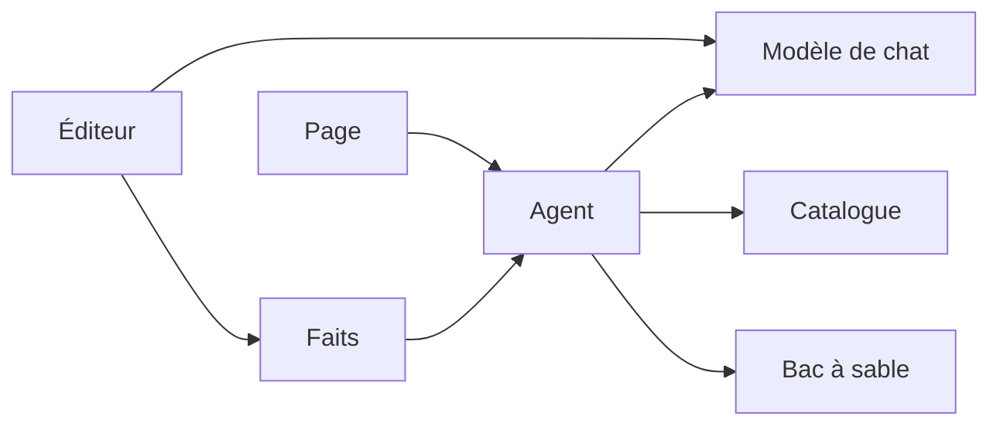
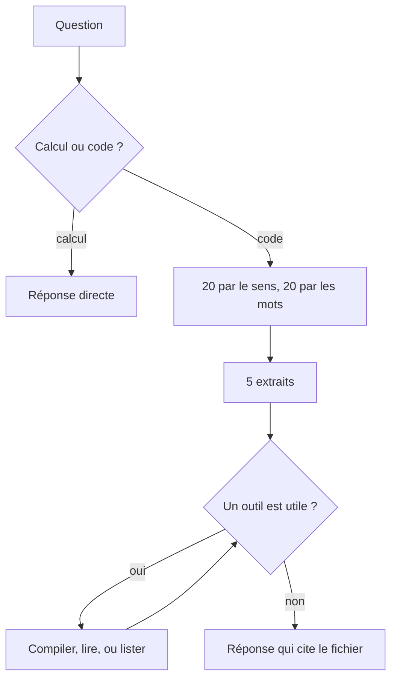

# Comprendre la stack sans bagage

Cette page est pour quelqu'un qui connaît un projet C++ et CMake, et qui
n'a pas besoin de savoir comment un modèle est entraîné. Les mêmes faits,
dans le vocabulaire du code, sont dans la
[vue d'ensemble](../architecture/overview.md). Le mode d'emploi au quotidien
est [Utiliser l'assistant](../guides/using-the-assistant.md).

## À quoi ça sert

On pose une question sur un dépôt C++ qui reste sur la machine. Le programme
répond en citant des fichiers, et il peut compiler, lancer les tests ou
lire un symbole pour vérifier ce qu'il affirme. Il ne reçoit pas un terminal.
Il n'envoie pas le code à un service extérieur.

Deux contraintes ont fixé presque tous les choix : le code ne quitte pas le
poste, et le modèle n'a jamais de shell.

## Les mots, une fois

| Mot | Ici, ça veut dire |
|---|---|
| Modèle de chat | Un programme qui continue un texte. Celui qui est servi connaît C++ en général. Il ne connaît pas vos fichiers tant qu'on ne les lui montre pas dans la question. |
| Fenêtre | La quantité de texte qu'il peut regarder pour une réponse. 32 768 jetons sur les profils 14B, 262 144 sur l'EVO-X5. Quelques dizaines de fichiers, pas un arbre de dix mille. |
| Index | Un catalogue des fonctions, classes et sections du dépôt. On ne met pas l'arbre entier dans la fenêtre. On y met les quelques morceaux qui collent à la question. |
| Empreinte | Un vecteur de nombres qui résume un morceau. Deux morceaux proches dans le code donnent des empreintes proches. C'est ce qui permet de chercher « par le sens », pas seulement par le mot exact. |
| Outil | Une action nommée et bornée : compiler ce fichier, lire ces lignes, lister les appelants. Chaque action a des arguments validés. Il n'y a pas de commande libre. |
| MCP | Une prise standard pour Cursor ou VS Code. L'éditeur demande des faits (un extrait, un log de test, une liste de symboles). Il ne reçoit pas une dissertation à réécrire. |

## Les pièces

Tout tourne dans des conteneurs. Chacun ne voit que les voisins dont il a
besoin.

| Pièce | Rôle en une phrase |
|---|---|
| Page `http://127.0.0.1:8090/ui` | Vous posez la question au modèle local. Le jeton reste dans l'onglet. |
| `mcp` sur `127.0.0.1:8092` | Cursor ou VS Code appellent `lookup`, `check`, `outline`, `calls`, `types`, `ask`. |
| `llm` sur `127.0.0.1:8080` | Le modèle de chat, branché directement (Continue, ou un client compatible). L'éditeur rédige, ou ce modèle rédige. Les deux ne réécrivent pas la même réponse l'un après l'autre. |
| `agent` | Il classe la question, va chercher des morceaux, appelle les outils, compte les jetons, renvoie la réponse. |
| `embedder` | Calcule l'empreinte d'un morceau ou d'une question. |
| `reranker` | Reclasse les 20 candidats et n'en garde que 5. S'il est arrêté, on garde l'ordre de la première recherche. |
| `qdrant` | L'étagère des empreintes. Une collection par dépôt distant, partagée par les copies de ce dépôt. |
| `indexer` | Un passage unique : il découpe l'arbre, calcule les empreintes, range le catalogue. Ce n'est pas un serveur qui reste allumé. |
| `tools` | Compile, teste, lit, cherche, interroge clangd, lit Git ou Subversion. Montage en lecture seule. |
| `patch` | Seul processus dont la copie est en écriture. `edit` renvoie un diff, `apply` l'écrit. Pas de commit. |

Le modèle de chat, l'étagère et le bac à sable ne se parlent pas entre eux.
Seul `agent` est sur les trois réseaux. Un modèle qui invente un appel ne
peut pas ouvrir un shell, ni joindre l'étagère, ni sortir de la machine.

Qui parle à qui. La page et l'éditeur restent sur la machine. L'étagère
et le bac à sable ne se voient pas.

## Une question, de bout en bout

Le calcul ne touche pas le dépôt. Une question de code passe par le
catalogue, puis au plus huit outils.

Le cycle s'arrête au huitième outil.

`agent` choisit d'abord un chemin.

**Direct.** Une salutation ou un calcul. Aucune recherche dans le dépôt,
aucun outil. Une seule rédaction.

**Code.** Un fichier, un symbole, une compilation, un test, ou la suite
d'une conversation déjà sur le code. Alors :

1. La question est transformée en empreinte.
2. Le catalogue renvoie 20 morceaux par le sens et 20 par les mots exacts
   (`m_bufferSize` matche le second, une paraphrase matche le premier).
3. Le second tri n'en garde que 5.
4. Les fichiers modifiés et pas encore commités sont relus sur la copie et
   placés devant ces extraits. Ils ne sont pas réécrits dans le catalogue.
5. Si la question porte sur la forme du dépôt, une carte de signatures
   (noms de fonctions et de classes, classés pour tenir dans un budget)
   est collée au prompt.
6. Le modèle peut appeler un outil, au plus 8 allers-retours. Chaque
   résultat revient dans la conversation. Il rédige ensuite.
7. La page affiche le remplissage de la fenêtre. Si la suite déborde, les
   vieux résultats d'outils sont raccourcis, puis les tours anciens sont
   pliés en une note.

Une question depuis l'éditeur ne suit pas cette boucle d'outils pour
`ask`. `ask` juge des extraits déjà récupérés, en 400 jetons, et cite
`chemin:ligne`. Chercher, compiler ou lister des symboles, c'est
`lookup`, `check`, `outline`, `calls`, `types`.

## Les choix

| Choix | Pourquoi |
|---|---|
| Tout en local, réseaux sans route vers l'extérieur | Le code du dépôt ne part pas chez un fournisseur. Le seul conteneur qui a Internet est celui qui télécharge les poids, et seulement pendant ce téléchargement. |
| Pas de shell, 23 actions nommées | Le modèle décide quand compiler ou lire. Ses arguments sont traités comme une entrée non fiable : chemins revalidés, références Git filtrées, sorties plafonnées (400 lignes, 100 correspondances, 40 emplacements clangd). |
| Chercher au moment de la question, plutôt que réentraîner le modèle sur le dépôt | Un commit de plus ne demande qu'une réindexation. L'entraînement optionnel (QLoRA) vise encore une base 7B ; l'adaptateur ne se charge pas sur le 14B qui répond. |
| Découper par fonction et par classe, pas par paquets de 50 lignes | Une empreinte n'est utile que si le texte est une idée cohérente. Un bloc qui commence au milieu d'une fonction et finit dans la suivante se retrouve mal. |
| Deux recherches, puis un second tri | Le sens rate les identifiants exacts. Les mots exacts ratent les paraphrases. Le second modèle ne fait que réordonner. |
| Deux portes, une seule rédaction | Depuis Cursor, le modèle de l'éditeur rédige à partir des faits. Le 14B rédige quand on le branche sur le port 8080 ou sur la page. Enchaîner les deux, c'est ce qui rend `ask` bruyant. |
| Faits et jugement séparés | `lookup` et clangd renvoient des lignes. `check` renvoie un journal. `ask` dit si le code le montre, ou dit que le code ne le montre pas. |
| Lecture seule, aujourd'hui | Le montage du dépôt est `:ro`. Une correction proposée est un diff à copier. La politique d'écriture (qui écrit, où, avec quelle relecture) n'est pas tranchée. |
| Une collection par URL distante | Deux tickets du même dépôt Subversion ou Git partagent le catalogue. Une seconde copie enregistre le chemin et le montage. Elle ne réindexe pas. |
| Quantization Q5 pour le 14B | En dessous, le JSON des appels d'outils casse plus souvent. Le fichier fait environ 9,8 Go. Sur une carte 16 Go, l'empreinte et le second tri restent sur le CPU pour laisser la carte au chat. |

## Ce que ça ne fait pas

- Ça n'écrit pas dans l'arbre, et ça ne commit pas.
- Ça ne va pas sur le Web, et ça n'embarque pas la documentation C++ standard.
- Ça ne surveille pas les fichiers de façon fiable quand l'hôte est Windows
  et les conteneurs passent par WSL : après une modification à indexer, on
  relance `python scripts/deploy.py workspace --update <chemin>` (ou
  `index` pour l'arbre par défaut, `sample/`).
- Ça ne remplace pas un serveur de fichiers ou d'historique Git dans
  l'éditeur. Lire un fichier entier et l'historique Git viennent d'autres
  prises MCP. Le statut Subversion de travail peut venir d'un serveur
  svn-mcp en lecture seule. Jira et Confluence sont une troisième prise,
  hors des conteneurs, et ne sont pas indexés.

## Ensuite

- [Premier lancement](../getting-started/first-run.md) — la page, le jeton, le choix de modèle.
- [Utiliser l'assistant](../guides/using-the-assistant.md) — une copie de plusieurs milliers de fichiers, la fenêtre, les limites.
- [VS Code](../guides/vscode.md) — les deux portes.
- [Présentation de la stack](../architecture/stack-presentation.md) — versions, outils, comparaison.
- [Recherche](rag-explained.md), [indexation](indexing-pipeline.md), [outils](tool-calling.md) — le détail des trois mécanismes.
