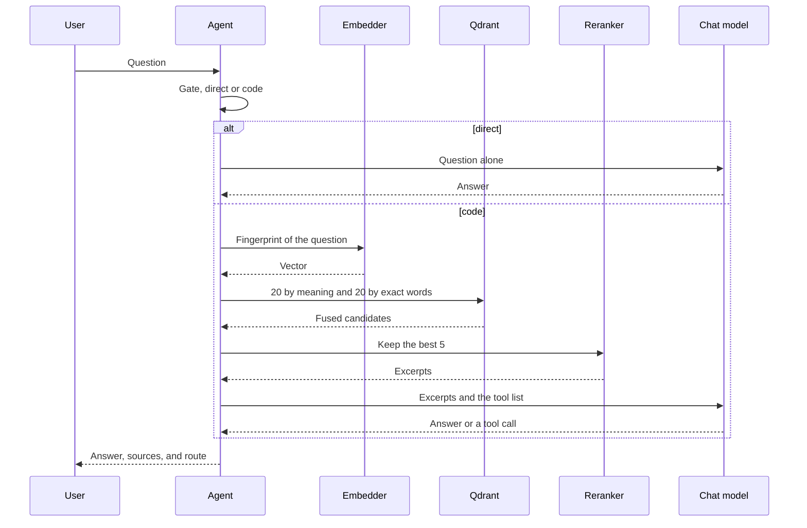

# RAG, explained

The plain-language version is [Comprendre sans bagage](en-clair.md).
This page is the mechanism.

Retrieval-Augmented Generation (RAG) is how the `agent` service answers
questions about *this specific codebase* without having been trained on it.

## The problem it solves

A language model like the one running in `llm` was trained on a huge but
frozen snapshot of text. It knows C++ and CMake in general, but it has never
seen `src/calculator.cpp` in *your* checkout, and it never will unless you show
it. Two ways to fix that:

1. **Fine-tune** the model on your codebase. Expensive, slow, and the model
   goes stale the moment you make another commit.
2. **Retrieval-augmented generation**: at query time, fetch the handful of
   code snippets that are actually relevant to the question and paste them
   into the model's context window alongside the question. No training, no
   staleness beyond "when did we last re-index" - which for this project is
   "whenever `indexer` runs" (see [Indexing pipeline](indexing-pipeline.md)).

This project uses (2). It's cheap, it updates as fast as re-indexing, and it
lets the model cite exactly which lines it's talking about.

## How it works here

A greeting skips retrieval. A code question embeds, searches both ways,
keeps five excerpts, then asks the chat model. If the reranker is down,
the fused order is truncated to five instead.



Retrieval runs only on `route: code`. A calculation or a greeting is
`direct`: the embedder and Qdrant are not called, and the answer does not
claim that the index was empty.

Concretely, `rag.py` does four things:

1. **Embed the query.** It calls `embedder`'s `POST /v1/embeddings` with the
   text prefixed `"search_query: "`. This prefix matters: the
   `nomic-embed-text-v1.5` model was trained with asymmetric prefixes -
   `search_document: ` for the things you're indexing (that's the indexer's
   job, for chunks) and `search_query: ` for the things you're searching
   with. Mixing them up doesn't error, it just silently makes retrieval
   worse, so `rag.py` hardcodes the query-side prefix as a constant rather
   than leaving it to chance.
2. **Search Qdrant.** It prefetches the top 20 chunks by cosine similarity
   (`dense`) and the top 20 by BM25 (`bm25`, IDF on the server) and fuses
   them with reciprocal rank fusion. Exact identifiers match on the sparse
   leg; paraphrases match on the dense leg. A collection that has not been
   rebuilt yet falls back to dense-only search.
3. **Rerank.** When `RERANKER_BASE_URL` is set, fusion returns 20 chunks and
   `reranker` (`POST /v1/rerank`, bge-reranker-v2-m3) keeps the top 5. If
   that call fails, the RRF order is kept and truncated to 5. An empty URL
   skips the call and asks Qdrant for 5 directly.
4. **Assemble context.** Each retrieved chunk becomes a numbered citation
   block like:

   ```text
   [1] app/src/main.cpp:12-40
   int main() {
       ...
   }
   ```

   These blocks are concatenated into a single context string that gets
   prepended to the user's question before it's sent to the LLM, and the
   same `file_path`/`start_line`/`end_line`/`symbol_name` data becomes the
   `sources` array in the `/chat` response.
5. **Degrade gracefully when there's nothing to retrieve.** This is the part
   that actually matters for reliability: if the `code_chunks` collection
   doesn't exist yet (nothing has been indexed), or it exists but the search
   comes back empty, or the embedder is unreachable, `rag.py` does **not**
   raise. It returns `used_context: false` with an empty `sources` list, and
   `main.py` tells the model explicitly that no context was found so it
   answers from general knowledge instead of hallucinating a citation.

## Why "no results" must never be an error

An index that hasn't been built yet (first run, before `indexer` has run
once) is a completely normal state, not a failure state. If retrieval
failures propagated as HTTP 500s, the very first request against a fresh
checkout would fail loudly for a reason that has nothing to do with the
user's question. Instead, `/chat` always returns `200` with a clear signal
(`used_context: false`) about whether repository-specific context was
available - see `tests/agent/test_rag.py` for the three degradation cases
this is tested against: normal retrieval, a missing collection, and an empty
collection.

On a `code` route the agent also places dirty files from `svn status` or
`git status` in front of those five chunks (marked as the working copy, not
written back into Qdrant). A question about the shape of the tree receives
a ranked signature map (`services/agent/repo_map.py`) in addition to the
chunks. A registered checkout searches that remote's collection, not
`code_chunks`.

## Further reading

- [Tool calling](tool-calling.md) - what happens to the assembled context
  and query once they reach the LLM.
- [Agent API reference](../reference/agent-api.md) - the exact `/chat`
  request/response shape, including `sources` and `used_context`.
