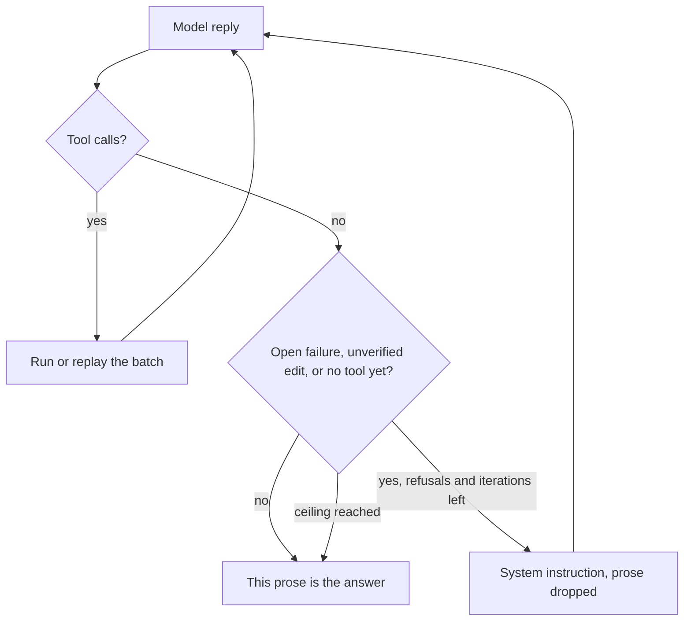

# Tool calling

The plain-language version is [Plain-language overview](en-clair.md).
This page is the loop.

The agent can act on the mounted tree through two back ends: the `tools`
service (build, test, compile one file, cached `build_step`, lint,
format-check, static-analyze, read-only git and svn, clangd callers and
types) and the Serena sidecar (read, list, search, symbol navigation,
diagnostics, and every edit). The model sees **39 named tools** and no
shell: 16 HTTP names bound to `tools`, 23 Serena names bound to the sidecar.
This page explains the bounded loop and what happens when the model
misbehaves. MCP `ask` does not receive this schema.

## When tools are offered

`services/agent/gate.py` runs before retrieval. `route: code` attaches the
tool schemas and the "verify before asserting" prompt. `route: direct`
sends the question alone, with a prompt that forbids proposing a compile
or a test.

Rules decide the obvious cases: arithmetic and greetings are `direct`; a
path, a C++ symbol, `build`, `test`, or `CMake` is `code`. A follow-up in
an existing conversation with no such signal stays on `code`. A first
message the rules do not classify is one short JSON call to the chat model
when `AGENT_GATE_CLASSIFY=1`. If that call fails or is unclear, the turn
stays on `code`.

## The named tools

`services/agent/tools_schema.py` merges two sources into one OpenAI-style
schema (`TOOLS_OPENAI_SCHEMA`, indexed by `TOOL_SPECS_BY_NAME`):

| Source | Count | Defined in | Runs on |
| --- | --- | --- | --- |
| HTTP specs (`TOOL_SPECS`) | 16 | `services/common/tool_models.py` | `tools` (mapping table near the end of this page) |
| Serena names | 23 | `services/agent/serena_named_tools.py` | the `serena` sidecar over MCP |

The Serena names:

| Kind | Names |
| --- | --- |
| Read and navigate (12) | `find_file`, `find_symbol`, `find_declaration`, `find_implementations`, `find_referencing_symbols`, `get_symbols_overview`, `get_diagnostics_for_file`, `get_diagnostics_for_symbol`, `list_dir`, `read_file`, `search_for_pattern`, `restart_language_server` |
| **Write (11)** | `rename_symbol`, `replace_symbol_body`, `insert_before_symbol`, `insert_after_symbol`, `safe_delete_symbol`, `replace_content`, `replace_in_files`, `replace_lines`, `insert_at_line`, `delete_lines`, `create_text_file` |

`begin_plan`, `edit`, `apply`, `lsp_definition`, `lsp_references`,
`lsp_hover`, `lsp_symbols`, `lsp_outline`, `list_files`, and `search` are
**not** names any more: calling one is an unknown function. Some of their
HTTP routes still exist (see the [Tools API reference](../notes/contracts/tools-api.md)),
but the model cannot reach them through a name. The
sidecar's decision record is
[ADR 0001](../adr/0001-serena-sidecar.md).

### Serena: transport and checks

- **Transport** (`services/agent/serena_transport.py`): one module-level
  client posts JSON-RPC to `<SERENA_BASE_URL>/mcp` (code default
  `http://serena:9121`): `initialize`, `notifications/initialized`, then
  `tools/call`. The session id is kept in `mcp-session-id`; a session error
  or a `404` reopens the session once. Replies can be JSON or SSE.
  `X-Request-Id` is forwarded. The timeout is `AGENT_REQUEST_TIMEOUT_SECONDS`
  (14400). The compose file does not forward `SERENA_BASE_URL` to the agent
  container, so editing it in `.env` alone changes nothing.
- **Result shape**: every reply is normalized to
  `{ok, stdout, stderr, exit_code}`. An MCP error is `ok: false`,
  `exit_code: 1`; a transport failure is `exit_code: -1`.
- **Policy** (`services/agent/serena_policy.py`) runs first. A refusal is
  `ok: false`, `exit_code: 2` and the sidecar never sees the call. It checks
  `relative_path`, `reference_file`, `paths_include_glob`, and
  `paths_exclude_glob`: no absolute or drive-anchored path, null byte, `..`,
  `:`, `.git`, `.svn`, or `.env*` segment, and, for a registered checkout,
  a path that stays under it. `max_answer_chars` above 262144 is refused.
  Without `max_answer_chars` the sidecar's own cap applies
  (`default_max_tool_answer_chars: 150000`).
- **Cancel**: stopping a turn posts `/cancel` to `tools` only.
  A Serena call in flight is abandoned client-side, not interrupted.
- **Known limitation** (from the code, not exercised live): the sidecar is
  started on `--project /workspace/app` and the agent never activates
  another project, so for a registered `workspace` the paths are checked
  against `/checkouts/<id>` while Serena itself still looks in the default
  tree.

### The editing phase

`services/agent/edit_policy.py` keeps one `editing` / `idle` flag per turn
(a `ContextVar`, reset to `idle` when the loop starts):

- A successful Serena **write** sets `editing`.
- A successful `build_step` sets `idle`.
- A failed call changes nothing.
- While `editing`, `build`, `test`, and `compile_file` are refused with
  `Edits are in progress. Call build_step once. Do not compile each file, and do not commit.`
  (`ok: false`, `exit_code: 2`). That refusal is not recorded as an open
  failure.

So a refactor is: write, write, write, then one `build_step`.

## Why bound the loop at all

An LLM given tools and told "verify your claims" will, left unchecked,
happily call tools forever: build, then re-build, then search for something
it already found, then build again. Two problems follow from that: unbounded
latency/cost per request, and, if the model ever gets stuck in a call/result
loop it can't escape, a request that never returns. `tool_loop.py` bounds
every `/chat` request:

- `AGENT_TOOL_LOOP_MAX_ITERATIONS` round-trips to the LLM. The deployed
  value is `48` (`.env.example`, forwarded by compose). The code default is
  `8` when the variable is absent.
- `AGENT_LOOP_NUDGES` refusals of a prose that arrives while a failure is
  still open, an edit is still unverified, or the turn has not used a tool
  yet. Deployed and code default: `3`. The fourth prose in that situation is the
  answer. The missing-tool refusal is sent at most once.
- `AGENT_LOOP_MALFORMED_LIMIT` consecutive malformed batches. Deployed and
  code default: `3`. The third drops the tools and asks for a plain answer.
- `AGENT_LOOP_REPEAT_LIMIT` accepted occurrences of one identical batch.
  Deployed and code default: `3`. The fourth calls neither `tools` nor the
  Serena sidecar.

## The loop, step by step

Each round sends the conversation to the model. A reply that contains tool
calls runs or replays that batch, then asks again. Plain text is the answer
when the turn has nothing still open. With tools enabled, three situations
drop the prose and append a system instruction, while a refusal and an
iteration remain:

| Situation | Instruction |
| --- | --- |
| A tool failure is still open (see [closing a failure](#closing-a-failure)). | `A tool failed and is still open. Follow repair if it is present. After you change a file, call build_step again. Do not resend a call whose result was unchanged.` Then the tool name, the journal excerpt, and `repair` when that failure carries one. |
| The turn is in the `editing` phase: a Serena write has succeeded, and no `build_step` has succeeded since. | `Edits are written and not verified. Call build_step once. Do not answer yet.` |
| This turn has neither executed nor replayed a tool. | `You have not called a tool yet. If this is about the repository, call one now. If you can answer without a tool, answer.` Once per turn. The next prose, still with no tool, is the answer. |

The open failure is checked first, then the unverified edit, then the
missing tool. `enable_tools` false is the `ask` path: none of these checks
run, and the first prose is the answer.

A reply with no structured call can still be recovered as a call or be a
malformed batch, both handled before the table: see
[Prose that contains a call](#prose-that-contains-a-call) and
[Malformed tool calls](#malformed-tool-calls).

The dropped prose is left out of the turn, so the model does not see
itself as having answered. Its tokens may already have gone out over
SSE. The `nudge` event tells the page to clear the draft. `done` remains
the answer that is kept. `reason` is `tool_failed`, `needs_build`, or
`no_tool`. `tool` is the open tool name (`tool_failed`), the string
`build_step` (`needs_build`), or absent (`no_tool`). `remaining` is the
number of refusals still possible after this one: 2, then 1, then 0.

On each iteration, `tool_loop.py`:

1. Sends the conversation so far, plus the OpenAI-style `tools` schema, to
   `llm`'s `/v1/chat/completions`. The schema is not hand-written: it is
   generated by `model_json_schema()` from the pydantic argument models in
   `services/common/tool_models.py` (the very classes the `tools` service
   validates its HTTP requests with) and in
   `services/agent/serena_named_tools.py`, so what the model is told and
   what is accepted cannot drift apart.
2. Tool calls are validated as one batch. One malformed call blocks the
   valid neighbours in that batch. A valid batch runs, or replays a success
   already stored for the same arguments. The JSON result is appended as a
   `role: tool` message, and the loop repeats.
3. With no tool calls, the table above decides. Each refusal consumes one
   iteration of `AGENT_TOOL_LOOP_MAX_ITERATIONS` and one of
   `AGENT_LOOP_NUDGES`. The refusal is sent while `nudges` is below the
   limit and the current iteration is not the last one. Past either
   ceiling, the prose is kept. `AGENT_LOOP_NUDGES` is `3`, so the fourth
   prose in the same situation is the answer.
4. The last allowed iteration that still contains tool calls handles the
   batch by the same rules, then asks for one completion with the tools
   removed. The fourth identical batch and a malformed batch are left
   unexecuted, including on that last iteration. When no iteration remains
   to send a malformed batch back, that same completion is requested at
   once. It is kept as the answer even if a failure is still open. An
   empty prose, or a completion whose content is empty because it only
   carried tool calls, becomes the sentence `Could not finish the tool loop.`
   Those tool calls are ignored.
5. When the iteration budget ends on a batch that was executed, the same
   tool-free completion ends the turn.

Every tool call made along the way, name, arguments, and a short
`result_summary` derived from the tool's stdout/stderr, is collected into
the `tool_calls` array of the final `/chat` response, so a caller can see
exactly what the agent checked. `nudges` is an integer on that response,
omitted when it is 0.

### Closing a failure

Any executed call with `ok: false` becomes the open failure (a newer one
replaces an older one). An executed `ok: true` closes it only in these cases
(`_closes` in `tool_loop.py`):

| Open failure | Closed by |
| --- | --- |
| A verify tool: `build`, `build_step`, `test`, `compile_file`, `lint_clang_tidy`, `format_check`, `static_analysis` | a success of the **same** name |
| A Serena write | any Serena write that succeeds |
| A lookup: a Serena read, `git_*`, `svn_*`, `lsp_*` | any success |

A call replayed from the cache, and the editing-phase refusal of `build`,
`test`, or `compile_file`, never open or close anything. The success cache
is emptied whenever a Serena write succeeds, so a read after an edit is
run again.

## Ceilings

| Variable | Deployed | Code default | What the next step does |
| --- | --- | --- | --- |
| `AGENT_TOOL_LOOP_MAX_ITERATIONS` | 48 | 8 | One completion with the tools removed. |
| `AGENT_LOOP_NUDGES` | 3 | 3 | The fourth prose is the answer. |
| `AGENT_LOOP_MALFORMED_LIMIT` | 3 | 3 | The tools are removed for the rest of the turn. |
| `AGENT_LOOP_REPEAT_LIMIT` | 3 | 3 | The fourth identical batch calls neither `tools` nor the Serena sidecar. |

"Deployed" is what `.env.example` and `compose.yaml` hand to the container;
"code default" is what the module uses when the variable is absent.

`AGENT_LOOP_REPEAT_LIMIT` counts accepted occurrences. A different batch
identity resets that counter. Alternating two identities runs until the
iteration ceiling, or until an answer is accepted.

A batch is the set of its calls, duplicates counted once. The key is the
tool name, a bar, and the arguments after pydantic validation, serialized
with sorted keys and no extra spaces. `[build, test]` and `[test, build]`
are one identity for the counter. Execution follows the reply order. The
first copy of a key is handled. A later copy in the same reply receives
the same result, with no second call.

Occurrences 1 to 3 of a success still in the cache return that result
with no call to a back end. A failure, or a success that has left the cache, is
executed. Occurrence 4 does neither: one completion without tools, and
that prose is the answer.

## Prose that contains a call

Local models sometimes write the call into the answer text instead of the
structured field. Before the malformed check, `_recover_prose_call` turns a
**complete** call in the text into a real one. It looks at the raw text, at
the body of each markdown fence, and at `<tool_call>`, `<tools>`, and
`<function>` tags, and it needs a JSON object `{"name": ..., "arguments":
...}` with a registered name and `arguments` as an object (or a JSON string
holding one). For example `{"name":"build","arguments":{}}` runs as a
`build` call; `{"name":"build"}` (no `arguments`) and `read_file({...})`
(function syntax) do not.

What is not recoverable but looks like a call is rejected as malformed
(next section).

## Malformed tool calls

The chat model (`Qwen2.5-Coder-14B-Instruct`, Q5_K_M) is generally reliable at
emitting well-formed JSON tool calls, but not perfectly, sub-Q5 quants in
particular are known to occasionally emit invalid JSON arguments or invent a
function name that doesn't exist. `tool_loop.py` treats a call as
**malformed** when any of these is true:

- its `arguments` field isn't valid JSON (or isn't a JSON object), or
- its function `name` doesn't match a registered tool (one of the 39 names
  in `TOOL_SPECS_BY_NAME`, `services/agent/tools_schema.py`; the corrective
  message reads `unknown function '...'; available functions: ...`), or
- the arguments are rejected by the tool's pydantic model (wrong type, value
  out of the documented bounds such as `max_count > 50`, or a
  hallucinated parameter, the models forbid unknown keys).

With tools enabled, a reply that has no structured call and no recoverable
call is a malformed batch in two further cases:

- The text, once stripped, parses as JSON and one string in that value is
  exactly a known tool name (the same test applies to the body of a markdown fence). Or a line,
  once stripped, starts with a known tool name followed by `(`, `{`, or `:`.
  The batch is rejected. The instruction is `Emit a structured tool call. A tool call written in the answer text does not run.`
- `finish_reason` on that choice is `length`, and there is no valid
  structured call. The instruction is `The reply was cut off. Send a shorter tool call or a shorter answer.`
  The rule applies when `finish_reason` is present.

One malformed call rejects the whole batch. The valid neighbours wait for
the model to send them again. The corrective system message quotes each
pydantic or JSON error and names those neighbours.

1. **One or two consecutive malformed batches.** Tools stay on the next
   request. Example of a quoted error: `invalid arguments for git_log:
   max_count: Input should be less than or equal to 50`.
2. **The third consecutive malformed batch.** One completion with no tools
   attached. That prose is the answer. A batch resets the counter when
   every call in it was accepted. Two errors, one valid call, then two
   errors leave the tools in place.

The turn ends with an answer. The system prompt tells the model to say
when that answer could not be verified with tools.

## Tool name ↔️ HTTP endpoint mapping

The function names the LLM sees are valid identifiers (underscores, no
slashes). For the 16 HTTP names, `tool_loop.py` maps them back to the real
`tools` service calls through `TOOL_ENDPOINT_MAP`. The Serena names are not in this
table: they go to the sidecar.

| Function name      | HTTP call                          |
|---------------------|-------------------------------------|
| `build`             | `POST /build`                       |
| `build_step`        | `POST /build-step`                  |
| `test`              | `POST /test`                        |
| `compile_file`      | `POST /compile`                     |
| `lint_clang_tidy`   | `POST /lint/clang-tidy`             |
| `format_check`      | `POST /format/check`                |
| `static_analysis`   | `POST /static-analysis`             |
| `git_log`           | `POST /git/log`                     |
| `git_blame`         | `POST /git/blame`                   |
| `git_diff`          | `POST /git/diff`                    |
| `git_show`          | `POST /git/show`                    |
| `svn_status`        | `POST /svn/status`                  |
| `svn_diff`          | `POST /svn/diff`                    |
| `svn_log`           | `POST /svn/log`                     |
| `lsp_calls`         | `POST /lsp/calls`                   |
| `lsp_types`         | `POST /lsp/types`                   |

Errors from this path are results, never exceptions: a transport failure
is `{"ok": false, "exit_code": -1}`, a `400` from `tools` is
`{"ok": false, "exit_code": 2}` with its `repair` hint passed through.

The HTTP tools return **bounded observations**: git and svn output stops at
200 lines, and when a result carries `truncated: true`, the accompanying
`stderr` tells the model how to narrow or continue. This is what stops a
single tool call from filling the context window of a small model. The Serena
tools are bounded by the sidecar (`default_max_tool_answer_chars: 150000`)
and by an optional `max_answer_chars` argument that the agent caps at 262144.
`GET /read-file` keeps its own cap (400 lines) and is no longer behind a named tool.

See `services/common/tool_models.py` for the HTTP argument models (one
`ToolSpec` per row of the table above: name, method, path, description,
model), and [Tools API reference](../notes/contracts/tools-api.md) for the
endpoints themselves. `tests/common/test_tool_models.py` checks the
generated schema against the OpenAPI document of the `tools`
app, so a route added on one side without the other fails CI.
[Adding a new tool](../guides/adding-a-new-tool.md) covers both kinds of
name.

## Further reading

- [RAG, explained](rag-explained.md), how the context these tools operate
  alongside gets assembled in the first place.
- [Agent API reference](../notes/contracts/agent-api.md), the `tool_calls` field
  in the `/chat` response.
- [ADR 0001: Serena sidecar](../adr/0001-serena-sidecar.md), why reads and
  edits moved out of `tools`.
