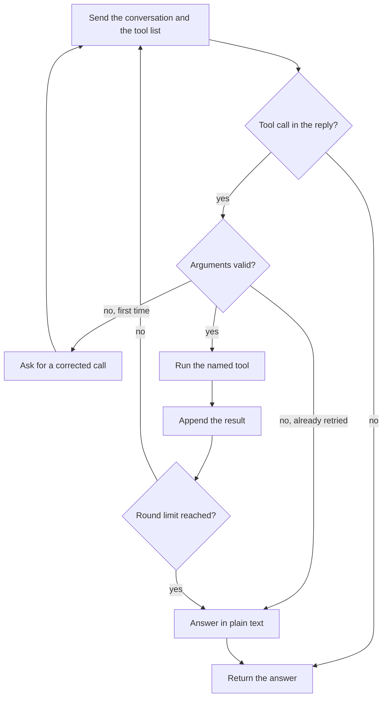

# Tool calling

The plain-language version is [Comprendre sans bagage](en-clair.md).
This page is the loop.

The agent can act on the mounted tree by calling the `tools` service:
build, test, compile one file, lint, format-check, static-analyze, search,
list, read, read-only git, read-only svn, and clangd (definition,
references, hover, symbols, outline, callers, types). Twenty-three names,
no shell. This page explains the bounded loop and what happens when the
model misbehaves. MCP `ask` does not receive this schema.

## When tools are offered

`services/agent/gate.py` runs before retrieval. `route: code` attaches the
tool schemas and the "verify before asserting" prompt. `route: direct`
sends the question alone, with a prompt that forbids proposing a compile
or a test.

Rules decide the obvious cases: arithmetic and greetings are `direct`; a
path, a C++ symbol, `build`, `test`, or `CMake` is `code`. A follow-up in
an existing conversation with no such signal stays on `code`. A first
message the rules do not classify is one short JSON call to the chat model
when `AGENT_GATE_CLASSIFY=1`. If that call fails or is unclear, the turn
stays on `code`.

## Why bound the loop at all

An LLM given tools and told "verify your claims" will, left unchecked,
happily call tools forever: build, then re-build, then search for something
it already found, then build again. Two problems follow from that: unbounded
latency/cost per request, and - if the model ever gets stuck in a call/result
loop it can't escape - a request that never returns. `tool_loop.py` bounds
the number of round-trips to the LLM via `AGENT_TOOL_LOOP_MAX_ITERATIONS`
(default `48`, per `CONTRACTS.md`), so every `/chat` request terminates in a
predictable number of LLM calls no matter what the model decides to do.

## The loop, step by step

Each round either returns an answer or runs a named tool. A bad call is
corrected once. After that, or after 48 rounds, the model answers in
plain text.

On each iteration, `tool_loop.py`:

1. Sends the conversation so far, plus the OpenAI-style `tools` schema, to
   `llm`'s `/v1/chat/completions`. The schema is not hand-written: it is
   generated by `model_json_schema()` from the pydantic argument models in
   `services/common/tool_models.py` - the very classes the `tools` service
   validates its HTTP requests with - so what the model is told and what the
   service accepts cannot drift apart.
2. If the response has **no tool calls**, that's the final answer - stop and
   return it (this is the common, happy-path exit).
3. If it has one or more tool calls, each one is validated (see below),
   executed against the matching `tools` HTTP endpoint, and the JSON result
   is appended back into the conversation as a `role: tool` message. Then the
   loop repeats with the LLM now able to see the tool's output.
4. If `AGENT_TOOL_LOOP_MAX_ITERATIONS` is reached without ever getting a
   tool-call-free response, the loop stops and forces one last
   plain-text-only completion (no `tools` attached) so the request still
   ends with a usable answer instead of hanging or erroring.

Every tool call made along the way - name, arguments, and a short
`result_summary` derived from the tool's stdout/stderr - is collected into
the `tool_calls` array of the final `/chat` response, so a caller can see
exactly what the agent checked.

## Malformed tool calls: retry once, then degrade

The chat model (`Qwen2.5-Coder-14B-Instruct`, Q5_K_M) is generally reliable at
emitting well-formed JSON tool calls, but not perfectly - sub-Q5 quants in
particular are known to occasionally emit invalid JSON arguments or invent a
function name that doesn't exist. `tool_loop.py` treats a tool call as
**malformed** if either is true:

- its `arguments` field isn't valid JSON (or isn't a JSON object), or
- its function `name` doesn't match one of the 23 registered tools
  (`TOOL_SPECS` in `services/common/tool_models.py`; the table below), or
- the arguments are rejected by the tool's pydantic model (wrong type, value
  out of the documented bounds such as `max_results > 100`, or a
  hallucinated parameter - the models forbid unknown keys).

The recovery policy is deliberately simple and bounded:

1. **First malformed response:** don't execute anything. Append a corrective
   system message that quotes the exact problem (e.g. `invalid arguments
   for search: max_results: Input should be less than or equal to 100`) and
   send the conversation back to the LLM for one retry.
2. **Second consecutive malformed response:** give up on tool-calling for
   this turn entirely. Send one final completion request with no `tools`
   attached at all, forcing a plain-text answer, and return that instead of
   raising an error or retrying indefinitely.

This means a `/chat` call can never fail purely because the model emitted
bad tool-call JSON - worst case, it degrades to an answer without tool
verification, which the model is instructed (via the system prompt) to
acknowledge rather than paper over.

## Tool name ↔️ HTTP endpoint mapping

The function names the LLM sees are valid identifiers (underscores, no
slashes); `tool_loop.py` maps them back to the real `tools` service HTTP
calls:

| Function name      | HTTP call                          |
|---------------------|-------------------------------------|
| `build`             | `POST /build`                       |
| `test`              | `POST /test`                        |
| `compile_file`      | `POST /compile`                     |
| `lint_clang_tidy`   | `POST /lint/clang-tidy`             |
| `format_check`      | `POST /format/check`                |
| `static_analysis`   | `POST /static-analysis`             |
| `search`            | `POST /search`                      |
| `list_files`        | `GET /list-files`                   |
| `git_log`           | `POST /git/log`                     |
| `git_blame`         | `POST /git/blame`                   |
| `git_diff`          | `POST /git/diff`                    |
| `git_show`          | `POST /git/show`                    |
| `svn_status`        | `POST /svn/status`                  |
| `svn_diff`          | `POST /svn/diff`                    |
| `svn_log`           | `POST /svn/log`                     |
| `lsp_definition`    | `POST /lsp/definition`              |
| `lsp_references`    | `POST /lsp/references`              |
| `lsp_hover`         | `POST /lsp/hover`                   |
| `lsp_symbols`       | `POST /lsp/symbols`                 |
| `lsp_outline`       | `POST /lsp/outline`                 |
| `lsp_calls`         | `POST /lsp/calls`                   |
| `lsp_types`         | `POST /lsp/types`                   |
| `read_file`         | `GET /read-file`                    |

Every read-type tool returns a **bounded observation**: `read_file` at most
400 lines (page with `start_line`/`end_line`), `search` at most
`max_results` matches (default 50, cap 100), `list_files` at most 500 paths.
When a result carries `truncated: true`, the accompanying `stderr` tells the
model how to narrow or continue. This is what stops a single tool call from
filling the context window of a small model.

See `services/common/tool_models.py` for the argument models (one `ToolSpec`
per row of the table above: name, method, path, description, model), and
[Tools API reference](../reference/tools-api.md) for the endpoints
themselves. `tests/common/test_tool_models.py` checks the generated schema
against the `tools` app's OpenAPI document, so a route added on one side
without the other fails CI.

## Further reading

- [RAG, explained](rag-explained.md) - how the context these tools operate
  alongside gets assembled in the first place.
- [Agent API reference](../reference/agent-api.md) - the `tool_calls` field
  in the `/chat` response.
