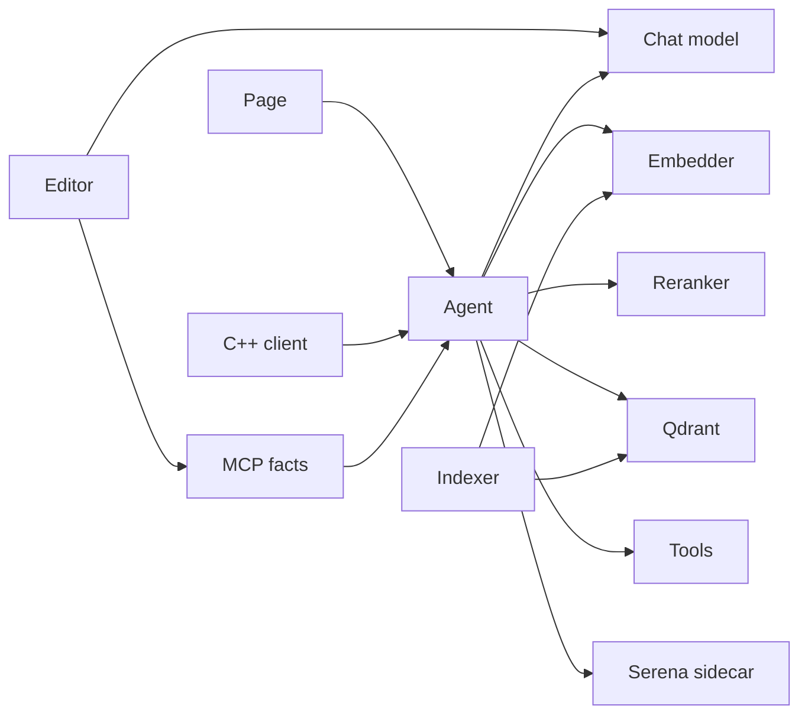

# Pumba

Pumba answers questions about a C++ and CMake repository that stays on the machine. The chat model, the embedder, Qdrant, the agent, the build sandbox, and the Serena sidecar each run in their own container. Podman is the default engine. Docker is the other one, chosen with `CONTAINER_RUNTIME`. The model has no shell. It acts through named tools.

## Read this first

1. [Plain-language overview](concepts/en-clair.md), if the words above are new.
2. [Prerequisites](getting-started/prerequisites.md), then [First run](getting-started/first-run.md).
3. [Using the assistant](guides/using-the-assistant.md) for a normal day.

## What each part of the manual is for

- **Getting started.** Install the stack and ask one question.
- **Concepts.** What retrieval, the index, and a tool call do in this repository.
- **Guides.** One task on each page: connect an editor, reindex, swap a model, use the GPU.
- **Architecture.** What each service does, which network it is on, and what one turn is allowed to do.

Ports, environment variables, and request schemas are in `CONTRACTS.md` at the repository root. [Contract notes](notes/contracts/index.md) restate that file for a reader. [Verification notes](notes/verification/index.md) record checks and research. Neither shelf is a chapter of this manual.

## Where a question goes

The page and the editor stay on the machine. The index and the sandbox do not call each other. The drawing of the networks is on [Networking](architecture/networking.md). What each box does is on [Architecture overview](architecture/overview.md).

`agent` is the only service attached to all three internal networks. The host reaches the page, MCP, and the chat model on `127.0.0.1` only. On the `evo-x5` profile the chat model is a process on the host. The embedder, Qdrant, `tools`, and Serena are not published.
