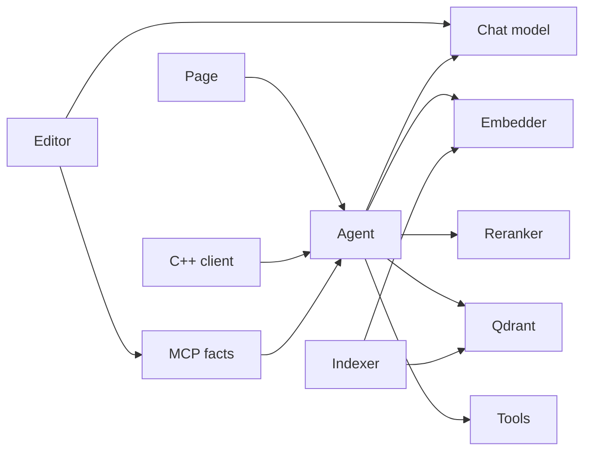

# Local LLM + C++/CMake Coding Assistant

A fully containerized, offline, retrieval-augmented coding assistant built
around a C++/CMake project. Every process - the chat model, the embedding
model, the vector database, the orchestrator, and the sandboxed build/lint
toolchain - runs in its own Podman container, wired together over network
segments that limit what each one can reach.

## Why this exists

Point a local LLM at a codebase and ask it questions, without sending any
code to a third party, and without giving the model unrestricted shell
access to run whatever it wants. Those two constraints - "fully offline" and
"the model doesn't get a shell" - shape almost every design decision in this
project.

Someone who knows C++ and does not know this vocabulary can start with
[Comprendre la stack sans bagage](concepts/en-clair.md) (French). It names
each piece, walks through one question, and lists the choices.

## Architecture at a glance

One orchestrator. The page and the editor stay on the machine. The index
and the sandbox never talk to each other. The network drawing is on
[Networking](architecture/networking.md).

`agent` is the only service on more than one internal network. The host
reaches the page, MCP, and the chat model on `127.0.0.1` only. Embedder
and Qdrant stay unpublished. See
[Architecture overview](architecture/overview.md).

## Where to go next

- New to the ideas? [Comprendre sans bagage](concepts/en-clair.md), then [First run](getting-started/first-run.md).
- Installing: [Prerequisites](getting-started/prerequisites.md).
- Day to day, including a large checkout and the context meter: [Using the assistant](guides/using-the-assistant.md).
- From an editor: [Using VS Code](guides/vscode.md).
- Why a mechanism works: [RAG](concepts/rag-explained.md), [indexing](concepts/indexing-pipeline.md), [tool calling](concepts/tool-calling.md).
- Exact request shapes: [Agent API](reference/agent-api.md), or `CONTRACTS.md` at the repo root.
