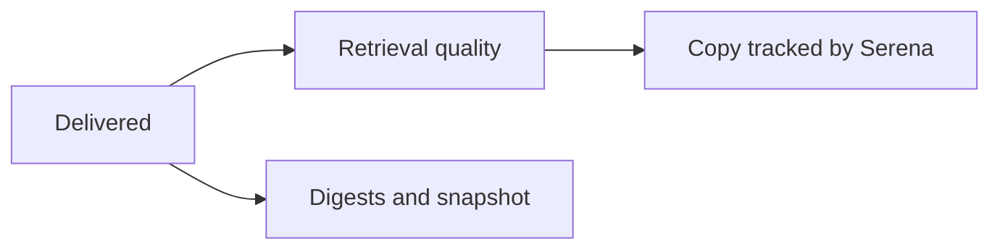
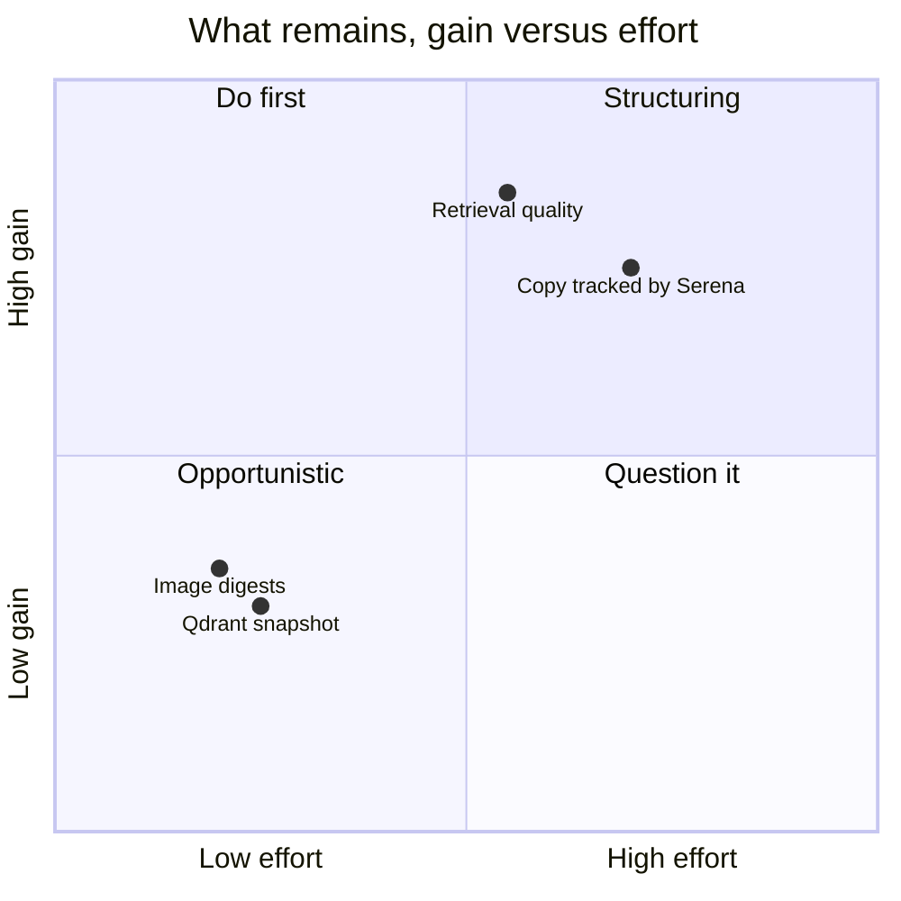
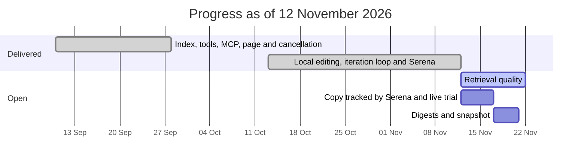

# Repository improvement areas

This document lists possible improvements to the stack, ranked by
gain / effort ratio, with for each one the observed problem, the proposed
solution, the files involved and the dependencies. It complements the
[stack presentation](stack-presentation.md) (§4 and §5.4
describe what remains; here we describe *how* to close the gap and in what
order).

Effort convention: **S** = less than a day, one component;
**M** = a few days, two components or an integration test;
**L** = a week or more, new service or contract change.

---

## 0. Progress

Updated at each delivered step. "Verified" = unit tests green +
functional check described in the column.

| #   | Item | Status | Verification |
| --- | ---- | ------ | ------------ |
| 2.1 | Bounded tool outputs (`read_file` 400-line window, `search` `max_results` ≤ 100, 300 columns), `tools` routes; the model now reads and searches through Serena (§11) | ✅ done | 20 handler tests + 7 HTTP tests (`tests/tools/test_main_api.py`) |
| 2.2 | `list_files` (`rg --files`, `.gitignore`, ≤ 500 paths), `tools` route; no longer a named tool of the model (replaced by Serena's `list_dir` / `find_file`, §11) | ✅ done | 17 tests, 3 of them with the real `rg`; system prompt and `tools_schema` updated |
| 2.3 | `LLM_THREADS` / `LLM_THREADS_BATCH` / `LLM_NUMA`, `EMBEDDER_THREADS` / `EMBEDDER_NUMA` | ✅ done | `sh -n` + both entrypoints run in WSL with a fake `llama-server`: flags `-t -tb --numa` added correctly; CRLF in `llm/entrypoint.sh` fixed along the way |
| 2.4 | CI (`.github/workflows/ci.yml` unit + nightly smoke), `pyproject.toml` (ruff E/F/W/B/I, mypy), `.gitattributes` LF, `.pre-commit-config.yaml` | ✅ done | `ruff check .` = 0 errors (92 fixed), `mypy` green on agent/tools, 302 tests green; YAML/TOML parsed; the workflow itself can only be run once pushed to GitHub |
| 2.5 | Index non-C++ files (CMake, Markdown, YAML, JSON, TOML, text) via `tree-sitter-language-pack` | ✅ done | 37 `test_text_chunker.py` tests (Markdown sections/setext/fences, CMake targets, multi-doc YAML keys, JSON, TOML, windowing); run on `app/`: `CMakeLists.txt` → `pumba_app, app, agent_client_test, …`, `CMakePresets.json` → `version, configurePresets`; 2 questions added to `eval_rag_questions.json`; trainer pinned to the C++ subset |
| 3.1 | Tombstoning + skip by `git_blob_hash` | ✅ done | 3 `test_index_incremental.py` tests + `listed_file_hashes` / `delete_by_file_paths` in `test_vector_store.py` |
| 3.2 | `compile_file` + `test --filter` (`ctest -R`) | ✅ done | `handlers/compile.py` + `filter` → `ctest -R`; argv / 400 HTTP tests in `test_compile_and_git.py` + `test_main_api.py` |
| 3.3 | Read-only Git tools | ✅ done | `git` CLI (argv, allow-listed refs, ≤ 200 lines); no GitPython, the binary is already in the `tools` image |
| 3.4 | Per-glob rules | ✅ done | `pathspec` + `rules/*.md`; `test_prompts.py` loads `cpp.md` for a `.hpp` and not for `CMakeLists.txt` |
| 3.5 | Token budget | ✅ done | `POST /tokenize` then `len/4`; collapse of old `tool` messages then RAG cut; 2 `test_token_budget.py` tests |
| 3.6 | Metrics | ✅ done | `prometheus-fastapi-instrumentator` + `tool_calls_total` / `tool_call_malformed_total` / `rag_used_context_total` counters; `/metrics`; `compose.observability.yaml` overlay; `llama-server --metrics` |
| 3.7 | `eval_tools.py` | ✅ done | `httpx` + 3 JSON scenarios; 3 `test_eval_tools.py` tests (mocked ask) |
| 3.8 | Review pass | ✅ done | `response_format` json_schema; `AGENT_REFLECT=0` by default; 3 `test_reflect.py` tests |
| 4.1 | Multi-turn memory (`conversation_id`, TTL, `deploy.py chat`) | ✅ done | in-memory store + 3 tests; `/chat` returns `conversation_id`; `llm-client --repl` |
| 4.2 | SSE streaming `POST /chat/stream` | ✅ done | events `route` / `rag` / `tool_call` / `tool_result` / `token` / `done` (then `nudge`, `context`, `activity`, `tool_delta`, `meta`, `error`); delta assembler tested; Catch2 SSE parser (13 `TEST_CASE` in ctest today); `/chat` unchanged for scripts |
| 4.3 | Hybrid search (RRF dense + BM25) + GGUF reranker | ✅ done | RRF `limit` 20 then `POST /v1/rerank` (`bge-reranker-v2-m3` Q8, `reranker` service :8082); falls back to RRF order if the service is absent; `--test` does not download the GGUF |
| 4.4 | clangd / LSP | ✅ done | `clangd` in `tools`; definition, references, hover, symbols, outline, calls, types routes. The model now only names `lsp_calls` and `lsp_types`; symbols come from Serena (§11) |
| 4.5 | Diff review mode | ✅ done | `POST /review`; snippet anchored to a diff line, otherwise `dropped`; 8 files max; `test_review.py` tests |
| 4.6 | Interface (MCP, then `/ui` page) | ✅ done | FastMCP 1.12: `lookup` / `check` / `calls` / `types` / `ask` (`outline` was removed from the server); `GET /ui` page on `127.0.0.1:8090`; `llm` on `127.0.0.1:8080`. No custom extension |
| 4.7 | `direct` / `code` gate before the index and the tools | ✅ done | `services/agent/gate.py`; rules (calculation, greeting, code signal); `AGENT_GATE_CLASSIFY=1` for the rest; SSE `route`; `test_gate.py` tests |
| 5   | Robustness: `/chat` semaphore, strict `tools` health, `rotate-token`, quotas, contract test | ✅ done | 503 if slots are full; `TOOLS_HEALTH_STRICT`; `deploy.py rotate-token`; `tools` cgroup; `test_contracts_sync.py`; **420 tests green**, ruff + mypy CI green |
| 6.1 | `openai` 2.54 SDK for `llm` and `embedder` (`requests` removed) | ✅ done | 40 agent tests + 13 `test_embeddings_client.py` tests on a mocked `httpx` transport; `AGENT_LLM_MAX_RETRIES` documented |
| 6.2 | Tool schema generated from pydantic (`services/common/tool_models.py`) | ✅ done | 20 `tests/common` tests including the OpenAPI contract, 7 parse tests + precise retry |
| 6.3 | `structlog` (`services/common/logging.py`, 5 `_log` replaced, `request_id` via contextvars) | ✅ done | 6 `test_logging.py` tests; indexer/trainer smoke |
| 6.4 | `hf_hub_download` in `fetch_models.py` (`ModelSpec.repo_id`, pinned SHA256 kept) | ✅ done | 14 `test_fetch_models.py` tests |
| 6.5 | Catch2 v3 (Ubuntu 24.04 apt, not FetchContent) for `app/tests` | ✅ done | 13 `TEST_CASE`s discovered individually (11 at delivery); `ctest -R json_round_trip` = 1 test; build+ctest green in WSL |
| 9   | Local editing without commit or push | ✅ done, then moved to Serena (§11) | First delivered by the `patch` service (`begin_plan` / `edit` / `apply`, budget of 200 / 500 files and 8 edits per file, always in `services/patch/edits.py`). Today: Serena's 11 write tools open editing; parallel `build_step` on the cache; `build`/`test`/`compile_file` refused during edits (`edit_policy.py`). The 200 / 500 / 8 budgets no longer apply to the model |
| 10  | Iteration loop ([AL-1 to AL-11](agent-loop-tickets.md)) | ✅ done | `tool_loop.py`, `edit_policy.py`, `conversations.py`; nudges, 12-call trace, per-conversation queue; `python -m pytest -q tests/agent` green. See [Iteration loop](../../architecture/agent-loop.md) |
| 11  | Serena sidecar (`.scratch/serena-sidecar/`, tickets 01 to 11) | ✅ done, except 08 | `serena` in `compose.yaml` (image `ghcr.io/oraios/serena:2.1.0`, `tools-net`); 39 named tools (16 HTTP + 23 Serena); `patch` removed from the model's tools. Ticket 08 (live trial on real Git and SVN repositories, without test doubles) remains `ready-for-human` |

Contracts touched so far: `CONTRACTS.md` (`tools` endpoints including
`/compile` and `/git/*`, bounded outputs, `AGENT_*` budget/reflection/
concurrency/conversation, `POST /chat/stream`, `TOOLS_HEALTH_STRICT`,
`/metrics`, `mcp` service `:8092`), `SECURITY.md`, `tools-api.md`,
`tool-calling.md`, `agent-api.md`, `mcp.md`, `troubleshooting-gpu.md`,
`indexing-pipeline.md`, `stack-presentation.md`.

### Principle: reuse before rewriting

When a maintained, proven open-source library does the job, we use it
rather than reimplement it (the first draft of 2.5 parsed Markdown/CMake
with regexes; it was replaced by the `tree-sitter-language-pack` grammars,
the same technique as for C++). What we write ourselves is limited to the
project's own *policy* (bounds, grouping, Qdrant contract). Choices made or
planned for the future:

| Item                                | Existing library / API                                                     | Status / what remains                                |
| ----------------------------------- | -------------------------------------------------------------------------- | ---------------------------------------------------- |
| 2.5 non-C++ files                   | `tree-sitter-language-pack` (markdown, cmake, yaml, json, toml grammars)   | ✅ grouping ≤ 60 lines, windowing, `symbol_name` |
| 3.1 tombstoning / skip              | `qdrant-client`: `scroll` + `delete` by `Filter` on `file_path`            | ✅ comparison loop |
| 3.2 `compile_file`, `test --filter` | native `cmake --build --target <obj>` and `ctest -R`                       | ✅ argument validation |
| 3.3 Read-only Git                   | `git` CLI (already in the image); allow-listed refs, no GitPython          | ✅ 200-line bounds |
| 3.4 per-glob rules                  | `pathspec` (gitignore patterns)                                            | ✅ `rules/*.md` + resolution |
| 3.5 token budget                    | `llama-server`'s `POST /tokenize`; `len/4` as fallback                     | ✅ truncation policy |
| 3.6 metrics                         | `prometheus-client` + `prometheus-fastapi-instrumentator`                  | ✅ `tool` / `ok` labels |
| 3.7 `eval_tools.py`                 | `httpx` + JSON fixtures (no LLM judge)                                     | ✅ 3 scenarios |
| 3.8 structured review               | `llama-server`'s `response_format: json_schema`                            | ✅ schema + decision |
| 4.1 multi-turn                      | `asyncio` + in-memory dict (read-only rootfs)                              | ✅ TTL + turn cap |
| 4.2 streaming                       | `openai` SDK `stream=True` + Starlette SSE                                 | ✅ rag/tool/token/done events |
| 4.3 hybrid + reranker               | Qdrant IDF + `llama-server --reranking` (not `fastembed`)                  | ✅ RRF then `bge-reranker-v2-m3` Q8 |
| 4.4 clangd                          | `clangd` binary (JSON-RPC stdio), not a third-party LSP client             | ✅ in `tools`, next to `compile_commands.json` |
| 4.6 MCP                             | Python MCP SDK (`mcp` 1.12, FastMCP)                                       | ✅ `ask` → `/chat`; loopback HTTP + stdio |
| 5 concurrency                       | `asyncio.Semaphore` (not `slowapi`: local, 2 slots are enough)             | ✅ 503 |
| 5 contract test                     | in-house test CONTRACTS / `.env.example` / compose (not `schemathesis`)    | ✅ `test_contracts_sync.py` |

### Audit of the existing code: what was written by hand when a library exists

Review of all the repository's code (`services/`, `scripts/`, `app/`)
with the same question. Verdict per component; the "replace" rows are
carried over as items **6.x** below and enter the roadmap.

| Component | What is written by hand | Proven library | Verdict |
| --------- | ----------------------- | -------------- | ------- |
| `agent/llm_client.py`, `indexer/embeddings_client.py` | raw HTTP calls to `llama-server`'s OpenAI-compatible endpoints, manual parsing of `choices[0].message` and `data[].embedding` (sorted by `index`), *two* different HTTP clients (`httpx` on the agent side, `requests` on the indexer side) | `openai` (official SDK, configurable `base_url`, async, built-in retries + backoff, typed `tool_calls`, streaming) | **Replaced** (6.1 ✅): `openai==2.54.0` (3.x depends on `httpx2`, incompatible with the rest of the repository on `httpx` 0.x); `requests` removed from the indexer |
| `agent/tools_schema.py` (200 lines) | JSON Schema of the 8 tools written by hand, duplicating the pydantic models of `tools/main.py` (`SearchRequest`, query parameters) | **pydantic** `model_json_schema()`, already a dependency | **Replaced** (6.2 ✅): `services/common/tool_models.py`, generated schema, pydantic validation in `tool_loop`, contract test against `tools`' OpenAPI |
| `_log()` × 5 modules | `print(json.dumps({...}))` redefined in `agent/main.py`, `rag.py`, `tool_loop.py`, `indexer/main.py`, `trainer/train.py` | `structlog` (JSON, levels, `request_id` bound via contextvars, timestamps) | **Replaced** (6.3 ✅): `structlog==26.1.0`, `services/common/logging.py` |
| `scripts/fetch_models.py::_download` | `urllib` download with `.partial` and percentage; no resume after interruption (5.4 GB) | `huggingface_hub.hf_hub_download`, already used *in the same file* for the training model; resume, retries, `tqdm` bar | **Replaced** (6.4 ✅): `hf_hub_download`; pinned SHA256 kept |
| `agent/main.py::verify_bearer_token` | `!=` comparison of the token | `secrets.compare_digest` (stdlib); `fastapi.security.HTTPBearer` for parsing + OpenAPI | `compare_digest` **done** (trivial, `test_auth.py` tests unchanged); `HTTPBearer` with 6.1/6.2 |
| `app/tests/*.cpp` | in-house test harness (`assert` + `main()` calling each function) | **Catch2** or **doctest** (single header, via `FetchContent`): test discovery, report, per-case `ctest -R`, required for 3.2 `test --filter` | **Replaced** (6.5 ✅): `catch2` 3.4 apt package (not FetchContent: `tools-net` is isolated); `catch_discover_tests`; 9 `ctest -R` cases |
| `scripts/container/eval_rag.py` | `urllib.request` | `httpx` (already in `eval_tools.py`) | Minor: `eval_tools.py` moved to `httpx`; `eval_rag.py` can follow |
| `agent/rag.py` | Qdrant REST via `httpx` instead of `qdrant-client` (which the indexer uses) | `qdrant_client.AsyncQdrantClient` | **Keep**: documented choice (`X-Request-Id` propagation, a single transport mocked in tests); to be reassessed if hybrid 4.x (BM25) requires the client |
| `agent/tool_loop.py` | bounded tool-calling loop, retry on malformed call | `pydantic-ai` (pydantic validation of arguments + automatic retry, bounded agents), LangGraph, smolagents | **Keep for now**: 170 tested lines, tools behind HTTP in another service. 6.2 already brings pydantic validation of arguments; reassess if planning / sub-agents are added |
| `tools/handlers/path_safety.py` | path validation (traversal, absolute, symlink) | `werkzeug.security.safe_join` (does not follow symlinks), `pathvalidate` | **Keep**: short security code, resolves symlinks, 100% tested; the libraries do less |
| `indexer/chunker.py::_git_style_blob_hash` | sha1(`blob <len>\0` + content) | GitPython / pygit2 | **Keep**: 3 lines, exact, no dependency |
| `tools/handlers/search.py`, `list_files.py` | `ripgrep` wrappers | none | Already reusing a tool; nothing to report |
| `scripts/deploy.py` (1,100 lines) | `podman compose` wrapper, doctor, CDI probe, CPU fallback | `python-on-whales` (docker/podman wrapper), `typer` + `rich` (CLI) | **Keep**: project-specific glue; `rich` would improve `status`/`doctor` but low gain |
| `trainer/` | none | `transformers` + `peft` + `trl` + `accelerate` already used | Nothing to report |
| `indexer --watch` | none | `watchdog` already used | Nothing to report |
| `app/` (C++) | HTTP client on raw libcurl + SSE parser | `cpr` (C++ wrapper for libcurl) | **Keep**: `/chat` + `/chat/stream` (write callback), tested; `cpr` does not bring SSE |

---

## 6. Debt: replace in-house code with libraries

Result of the audit above. Effort **S** each except 6.5 (**M**).

### 6.1 `openai` SDK for `llm` and `embedder`, done

`agent/llm_client.py`: `AsyncOpenAI(base_url=…/v1, api_key="local", http_client=<the app's httpx.AsyncClient>, max_retries=AGENT_LLM_MAX_RETRIES)`
(one SDK client per URL, cached by a `WeakKeyDictionary`);
`chat_completion()` keeps its signature and returns `completion.model_dump()`,
`embed_query()` replaces the `httpx.post` in `rag.py`; `X-Request-Id` goes
through `extra_headers`. `indexer/embeddings_client.py`: synchronous `OpenAI`,
explicit `encoding_format="float"` (the SDK's base64 default is not
guaranteed on the `llama-server` side), `requests` removed from the requirements and from the
mypy/CI config. **Version**: `openai==2.54.0` and not 3.x, 3.x depends on
`httpx2`, which would put two HTTP stacks in the agent (FastAPI TestClient,
`tools`/Qdrant calls and all test transports are on `httpx` 0.x).
Verification: the existing tests (single `httpx.MockTransport` transport)
pass without changes on the agent side (40); `test_embeddings_client.py`
rewritten on the same principle (13); `AGENT_LLM_MAX_RETRIES=0` in the
conftest so the backoff is not suffered in the "LLM unreachable" scenarios.

### 6.2 Tool schema generated from pydantic, done

`services/common/tool_models.py`: one `ToolArgs` (extras forbidden) per tool
with descriptions meant for the LLM and `ge`/`le` bounds, a `TOOL_SPECS`
registry (name, method, path, description, model), and derived
`openai_tools_schema()` / `endpoint_map()`. `tools/main.py` uses
these models as bodies (POST) and as query-string models (GET,
`Annotated[Model, Query()]`, FastAPI ≥ 0.115); the handler caps
(`search`, `list_files`, `read_file`) are imported from the same module.
`agent/tools_schema.py` no longer contains hand-written JSON;
`tool_loop._parse_tool_call` validates with `model_validate`, forwards
`model_dump(exclude_unset=True)` (defaults remain `tools`' decision)
and the correction message quotes the exact pydantic error.
Verification: `tests/common/test_tool_models.py` (flat schema without `title`
or `anyOf`, bounds present, **contract against `tools`' OpenAPI**:
route, method, each field accepted), 7 `TestParseToolCall` tests +
1 precise-retry scenario; 192 agent/tools/common tests green. Both
Containerfiles copy `services/common/`.

### 6.3 `structlog`, done

`services/common/logging.py`: `configure()` (idempotent, `LOG_LEVEL`,
injectable stream for tests), `get_logger(component)`,
`bind_request_id()` / `clear_request_context()` on
`structlog.contextvars`. Output: one JSON object per line on stdout with
`event`, `component`, `level`, ISO `timestamp` + free fields, same `event`
key as before, so `grep`/`jq` are unchanged. `agent/main.py` binds the
`request_id` at the start of `/chat`; `rag.py` and `tool_loop.py` keep their
`_log(event, request_id, **f)` (delegated to structlog) so they stay testable
outside a request; `indexer/main.py` moves `file_error`/`fatal` to `error`;
`trainer/train.py` replaces its `print(json.dumps)`. The three Containerfiles
(agent, indexer, trainer) copy `services/common/`; the trainer used to copy
only `chunker.py`, fixed to bundle `chunker_types.py` and
`text_chunker.py` (latent regression from 2.5). Verification: 6 tests
`tests/common/test_logging.py` (format, context binding, explicit
kwarg priority, level filtering, unknown level) + indexer/trainer logger smoke.

### 6.4 `hf_hub_download` in `fetch_models.py`, done

`ModelSpec(name, repo_id, filename, sha256)` (the `resolve/main` URL becomes
a derived property); `_download(spec, destination, force=)` calls
`hf_hub_download(repo_id, filename, local_dir=MODELS_DIR, force_download=force)`, resume of an interrupted transfer, retries, progress
bar provided by the hub. The pinned SHA256 check is kept
as is (the hub only guarantees the LFS ETag of the served file, not that it
is the one we audited). `huggingface_hub` is imported at the top of the
module (already in devtools; added to the CI install); `deploy.py doctor --verify-checksums` keeps its optional import and degrades cleanly if
the host does not have it. Verification: 14 tests (exact call to
`hf_hub_download`, defensive move if the hub writes elsewhere,
`--force` propagated, fast-path/mismatch/deletion unchanged).

### 6.5 Catch2 for `app/tests`, done

Ubuntu 24.04 package `catch2` (v3.4) via `find_package(Catch2 3)` +
`Catch2::Catch2WithMain` + `catch_discover_tests()`. **Not** FetchContent:
the `tools` service configures `app/` on an isolated network and cannot
download at `cmake` time. `sample_test.cpp` and `agent_client_test.cpp`
are `TEST_CASE` / `REQUIRE`; no more in-house `main()` or `-UNDEBUG`.
`catch2` added to the `app` / `tools` / `devtools` Containerfiles and to CI;
`tools` also receives `libcurl4-openssl-dev` and `nlohmann-json3-dev` (already
required by `find_package`, missing until now, `/build` failed at
configuration). Verification: configure+build+`ctest --preset release` =
11/11 (including the SSE parser and optional `conversation_id`);
`ctest -R json_round_trip` runs only one case. Concrete prerequisite of 3.2
(`test --filter` → `ctest -R`).

---

## 1. Overview

Green = delivered. Blue = remaining, unblocked by what is already in place.
The quadrant shows **only** what remains (the §0 table lists what was delivered).

The detail of what was delivered is the §0 table. Here, only what
remains, and in what order to tackle it.

The quadrant places each remaining item by effort and gain. At the top
right, what changes usage. At the bottom left, operations.

MCP, hybrid search, clangd (including calls and types), diff review,
the `/ui` page, GGUF hot-swap, the two editor gates and
`POST /chat/cancel` are delivered. The open work item that changes usage
is **retrieval quality** on a large tree, then the **copy tracked
by Serena**: writing is delivered (Serena writes, without commit or push), but
the sidecar is launched on `CODEBASE_PATH`, the agent does not pass it the
copy chosen by `workspace`, and `deploy.py` does not recreate it when the
mount changes (see §11). The remaining operations work is
image digests and the Qdrant snapshot. There is no custom editor
extension: Cursor and VS Code go through MCP.

---

## 2. Wave 1, delivered (effort S, high gain)

The caps in this chapter still apply to the `tools` routes
(`/read-file`, `/search`, `/list-files`). Since the Serena migration (§11),
the model no longer names them: it reads, lists and searches through
Serena's tools. The text that follows was written at the time of delivery.

### 2.1 Bound tool outputs

**Problem.** `read_file` returns up to 256 KiB at once and `search`
has no result cap. On a frequent pattern (`std::`, `include`),
a single observation can exceed the 7B's context window; the model
loses the thread or the next tool call is malformed. This is the guardrail
OpenCodeReview put first.

**Solution.**

- `GET /read-file?path=&start_line=&end_line=` with a cap of 400 lines
per call and, beyond that, a `"truncated: use start_line/end_line"` message.
- `POST /search {"pattern", "regex", "max_results": 50}`, hard cap at
100, truncated with a counter.
- Reflect this in `TOOLS_OPENAI_SCHEMA` so the model knows how to paginate.

**Files.** `services/tools/handlers/read_file.py`, `search.py`,
`services/agent/tools_schema.py`, `CONTRACTS.md` (tools section),
`tests/tools/`.

### 2.2 `list_files`

**Problem.** The model cannot discover the directory tree; it guesses
paths or misuses `search` with an empty pattern.

**Solution.** `GET /list-files?path=&glob=&max_results=200` on the mounted
root, via `rg --files` (already present in the `tools` image), same
`path_safety` validation. `list_files` entry in the schema.

**Files.** new `services/tools/handlers/list_files.py`,
`services/tools/main.py`, `tools_schema.py`, `CONTRACTS.md`,
`docs/notes/contracts/tools-api.md`.

### 2.3 `LLM_THREADS` and NUMA pinning

**Problem.** `entrypoint.sh` does not pass `-t`; on a dual-socket machine
llama.cpp takes all logical threads, which is slower than the
physical cores of a single node.

**Solution.** `LLM_THREADS` variables (default: empty = auto) and
`LLM_NUMA` (`distribute` / `isolate` / empty), propagated in
`entrypoint.sh` as `-t` and `--numa`. Same for
`EMBEDDER_THREADS`. Document the two settings to measure in
`troubleshooting-gpu.md`.

**Files.** `containers/llm/entrypoint.sh`,
`containers/embedder/entrypoint.sh`, `compose.yaml`, `config/compose/cpu.yaml`,
`.env.example`, `CONTRACTS.md`.

### 2.4 A CI

**Problem.** There is no `.github/` or equivalent: `pytest`,
`ctest`, `eval_rag.py` and the smoke test exist but nothing runs them
automatically.

**Solution.** A two-job workflow:

1. **unit**, `podman compose --profile dev run --rm devtools pytest` +
  `ctest` (no model required).
2. **smoke**, `python scripts/deploy.py test` with `.env.test` (0.5B CPU
  model) then `eval_rag.py`. Can run nightly if too long.

Add `ruff` and `mypy --strict` on `services/` and `scripts/` in the
unit job, the code is already typed, so we might as well check it.

**Files.** `.github/workflows/ci.yml`, `pyproject.toml` (ruff config),
`docs/guides/testing.md`.

### 2.5 Index non-C++ files

**Problem.** `CMakeLists.txt`, `CMakePresets.json`, `*.md`, `*.yaml` of the
target project are not indexed, even though "how is the
build configured?" is a typical question.

**Solution (delivered).** A second module `text_chunker.py` that reuses the
C++ chunker's technique with the `tree-sitter-language-pack` grammars
(no home-made parsing): one section per Markdown heading (own content,
subsections separate, preamble kept), top-level CMake commands
named after `project`/`add_executable`/`add_library`/`function`,
top-level YAML (multi-document) / JSON / TOML keys; windows of
60 lines with a 10-line overlap for INI/shell/`Containerfile`/text.
Small consecutive units are grouped up to 60 lines, units over
120 lines are windowed under their name. Payload `language` =
`markdown` / `cmake` / `yaml` / `json` / `toml` / …; `build/`, `.git/`,
`node_modules/` are ignored. Two golden questions added (CMake, presets).
The trainer stays on the C++ subset (`chunker.is_cpp_file`).

**Files.** `services/indexer/text_chunker.py`, `chunker.py`,
`chunker_types.py`, `requirements.txt`, `services/trainer/dataset.py`,
`tests/indexer/test_text_chunker.py`, `test_chunker.py`,
`scripts/container/eval_rag_questions.json`, `docs/concepts/indexing-pipeline.md`,
`CONTRACTS.md`.

---

## 3. Second wave (effort M)

### 3.1 Tombstoning and skip by `git_blob_hash`, done

`VectorStore.listed_file_hashes()` scrolls the payload only (`qdrant-client`).
A file whose hash matches is skipped (no embedder call); a
changed file first has its points deleted (`Filter` + `MatchAny` on
`file_path`); at the end of the run the `file_path`s absent from the traversal are
tombstoned. The JSON summary has `files_skipped` / `files_deleted`. `--watch`
also tombstones on `on_deleted`.

**Problem.** A deleted file leaves its points in Qdrant; an
unchanged file is re-embedded at every `index`.

**Solution.** At the start of a run, list the `file_path`s present in the
collection (scroll with payload only); at the end of the run, delete those
absent from the traversal. Before embedding a file, compare its
`git_blob_hash` to the stored one and skip if identical. Log
`skipped` / `deleted` in the final JSON summary.

**Files.** `services/indexer/vector_store.py`, `main.py`,
`docs/guides/reindexing-the-codebase.md` (remove the manual workaround).

### 3.2 `compile_file` and `ctest -R`, done

**Problem.** Verifying a change to one function costs a full
300 s `build`. On CPU only, the tool loop becomes unusable.

**Solution.** `POST /compile {"path": "src/foo.cpp", "preset": "release"}`
which configures once (build directory cached per preset in
`/workspace/scratch`) then runs `cmake --build --target <object>`. `POST /test`
accepts `"filter": "AgentClient.*"` translated to `ctest -R`. Both remain
allow-listed and shell-free.

**Files.** `services/tools/handlers/build.py`, `test.py`,
`tools_schema.py`, `CONTRACTS.md`, `tests/tools/test_build_handler.py`.

### 3.3 Read-only Git tools, done

`git` CLI (already in the image), not GitPython: allow-list of subcommands
and refs, outputs bounded to 200 lines. `CODEBASE_PATH` must be a
git repository for `.git` to be visible under `/workspace/app`.

**Problem.** No historical context: no "who changed this and
why", no diff.

**Solution.** Mount `${CODEBASE_PATH}/.git` as `:ro` in `tools` and
expose `git_log(path, max_count)`, `git_blame(path, start, end)`,
`git_diff(ref_a, ref_b, path)`, `git_show(ref, path)`. References validated
by a strict regex (`[0-9a-f]{7,40}|HEAD~?[0-9]*|[A-Za-z0-9_./-]+`), argv
without shell, bounded outputs (§2.1).

**Files.** `compose.yaml` (mount), new
`services/tools/handlers/git.py`, `tools_schema.py`, `SECURITY.md`.

### 3.4 Per-glob rules instead of the monolithic system prompt, done

**Problem.** `prompts.py` applies the same conventions to everything; a
`CMakeLists.txt` receives the RAII guidelines.

**Solution.** A `services/agent/rules/` folder with
`*.md` files carrying a `globs:` frontmatter. When building the prompt, we
resolve the rules that apply to the `file_path`s of the RAG sources and
concatenate them. The rules stay versioned with the repository and testable
(`test_prompts.py` checks that a `.hpp` path loads the ownership
rule).

**Files.** `services/agent/prompts.py`, `services/agent/rules/*.md`,
`tests/agent/test_prompts.py`.

### 3.5 Token budget, done

**Problem.** RAG context + tool results are concatenated without
counting; there is no truncation before the LLM call.

**Solution.** Count with `llama-server`'s `/tokenize` (already exposed) or
a `len/4` estimate. Reserve a budget (`AGENT_CONTEXT_BUDGET_TOKENS`,
default 6000 out of 8192 at the time; 28544 out of 32768 today): first the oldest tool results
are summarized into one line, then the lowest-ranked RAG chunks are
removed. Log `context_tokens` at each iteration.

**Files.** `services/agent/tool_loop.py`, `llm_client.py`,
`CONTRACTS.md`, `.env.example`.

### 3.6 Metrics, done

**Problem.** Only JSON logs on stdout; no per-service latency,
no tokens/s, no malformed tool-call rate.

**Solution.** `prometheus-fastapi-instrumentator` on `agent` and `tools`,
business counters (`tool_calls_total{name,ok}`,
`tool_call_malformed_total`, `rag_used_context_total`), and `/metrics`
exposure on `core-net` only. `llama-server` already exposes
`/metrics` with `--metrics`. An optional `compose.observability.yaml` with
Prometheus + Grafana on a dedicated network. The turn, budget,
search and tool-duration series, as well as the `Pumba analyse` ("Pumba analysis") dashboard,
are described in `docs/guides/observability.md`.

**Files.** `services/agent/main.py`, `services/tools/main.py`,
`containers/llm/entrypoint.sh` (`--metrics`), new
`compose.observability.yaml`.

### 3.7 Tool-calling evaluation, done

**Problem.** `eval_rag.py` measures retrieval; nothing measures whether the
model calls the right tools with the right arguments after a model,
quantization or prompt change.

**Solution.** `scripts/container/eval_tools.py` with scenarios
`{question, expected_tool, expected_args_subset}` (e.g. "does it
compile?" → `build`). Score = rate of correct first call + rate of
malformed calls. To be wired into nightly CI and run after each `train`.

**Files.** new `scripts/container/eval_tools.py`,
`scripts/container/eval_tools_scenarios.json`, `docs/guides/testing.md`.

### 3.8 Independent review pass, done

**Problem.** Nothing checks the content of the final answer; a
claim contradicted by the `sources` goes through.

**Solution.** Optional (`AGENT_REFLECT=1`), a second LLM call that
receives only the answer and the cited chunks, not the tool
results, with the instruction to **remove** directly contradicted
sentences, never to add any. Return `reflection: {removed: n}` in
the response. On CPU, disabled by default by the fallback.

**Files.** new `services/agent/reflect.py`, `main.py`,
`CONTRACTS.md`, `tests/agent/test_reflect.py`. Depends on §3.7 to measure
the effect.

---

## 4. Structuring work (effort L)

### 4.1 Multi-turn memory, done

**Problem.** `/chat` is stateless; it is impossible to say "and now
fix it".

**Solution.** `POST /chat {"query", "conversation_id"?}`; the history
is kept in memory in `agent` with a TTL (`AGENT_CONVERSATION_TTL_SECONDS`)
and a turn cap, then compressed by the token budget (§3.5). `app`
gains a REPL mode (`deploy.py chat`). No disk persistence at first, consistent with `agent`'s read-only rootfs.

**Depends on** §3.5. **Files.** `services/agent/main.py`,
`tool_loop.py`, `app/src/main.cpp`, `AgentClient.cpp`, `CONTRACTS.md`.

### 4.2 Streaming, done

**Problem.** On CPU, the user waits several minutes with no feedback.

**Solution.** `POST /chat/stream` over SSE: events `route`, `rag`, `tool_call`,
`tool_result`, `token`, `done`. `llm_client.py` switches to `stream: true`
on the `llama-server` side. `app` displays output as it arrives (libcurl write
callback). The non-streaming endpoint remains for scripts.

**Files.** `services/agent/main.py`, `llm_client.py`, `tool_loop.py`,
`app/src/AgentClient.cpp`, `docs/notes/contracts/agent-api.md`.

### 4.3 Hybrid search and reranker, done

**Problem.** Pure vector search misses exact identifiers (`m_bufferSize`)
and over-weights vague semantic proximity.

**Delivered.** `bm25` sparse vector (term frequencies, Qdrant 1.19's `Modifier.IDF`, no `fastembed` model). `POST /points/query` request:
dense + BM25 prefetch (20 each), RRF fusion, `limit` 5. The token hash
is shared (`services/common/sparse_text.py`). An old collection
without these two names is recreated by the indexer. If `/points/query` answers
400, the agent falls back to a named dense search.

**Also delivered.** `reranker` service (same image as `embedder`, a second
process: a `llama-server` loads only one model). Pinned GGUF
`bge-reranker-v2-m3-Q8_0.gguf`. `POST /v1/rerank`, `top_n` 5. CPU by default
(`RERANKER_NGL=0`). Empty URL or unreachable service: the RRF order is kept.
`fetch_models.py --test` does not download this file.

**Files.** `services/common/sparse_text.py`,
`services/indexer/vector_store.py`, `services/agent/rag.py`,
`CONTRACTS.md`.

### 4.4 clangd, done

**Problem.** `search` is textual; overloads, templates and
`using` aliases are poorly resolved.

**Delivered.** `clangd` runs **inside** `tools` (apt package), not in a
second container: `compile_commands.json` is `/compile`'s cache,
on that container's tmpfs. LLM tools `lsp_definition`,
`lsp_references`, `lsp_hover`, `lsp_symbols`. 1-based positions.
At most 40 locations, only under the mounted root. These four
tools can no longer be named by the model (Serena replaces them, §11); the
`/lsp/*` routes remain on `tools`.

**Files.** `services/tools/handlers/clangd_rpc.py`, `lsp.py`,
`services/common/tool_models.py`, `containers/tools/Containerfile`.

### 4.5 Diff review mode, done

**Problem.** The stack answers questions but cannot review a
change.

**Delivered.** `POST /review {"from", "to"}`. `git diff --name-only` (internal
endpoint `/git/diff-names`, not an LLM tool) lists the files, at most 8.
One LLM call per file, with the glob rule (§3.4). A comment is only
kept if its `snippet` appears on a line of the new file in
the diff; otherwise it counts in `dropped`. This filter replaces a separate
review pass.

**Files.** `services/agent/review.py`, `services/agent/main.py`,
`services/tools/handlers/git.py`.

### 4.6 Interface, done (MCP)

**Problem.** CLI only.

**Solution, in order of cost.** (1) A minimal MCP server in front of `agent`
to use it from Cursor / Claude Code / OpenCode without rewriting
anything; (2) a static web page served by `docs` that calls
`/chat/stream`; (3) an editor extension.

**Delivered.** Option 1: `mcp` service (`FastMCP` 1.12), `ask` tool →
`POST /chat`, Streamable HTTP on `127.0.0.1:8092/mcp`, stdio via
`MCP_TRANSPORT=stdio`. See `docs/notes/contracts/mcp.md`. Option 2: `GET /ui`
served by `agent` (not by `docs`: `docs` is not on `client-net`),
published on `127.0.0.1:8090` only. The token is entered in the page.
The VS Code suite (fact-only MCP + local model as writer) is §8.
No custom editor extension.

### 4.7 Gate before the index, done

**Problem.** The 7B always receives the chunks and the instruction "verify
with a tool". A calculation retrieves `arithmetic_sanity` and runs `ctest`.

**Solution.** `services/agent/gate.py` chooses `direct` or `code` before
the search. The rules cover calculation, greeting and code signals
(file, symbol, build, test). A conversation follow-up without a
signal stays in `code`. A first ambiguous question goes into a short
JSON call to the already-served model if `AGENT_GATE_CLASSIFY=1`; a failure
stays in `code`. `direct` attaches neither the index nor the tool schemas.
The UI shows the choice in `Déroulement` ("Trace") through the SSE `route` event.

**Files.** `services/agent/gate.py`, `main.py`, `prompts.py`,
`tool_loop.py`, `ui/index.html`, `CONTRACTS.md`.

---

## 5. Robustness and security

Delivered in this list: cgroup quotas, `AGENT_MAX_CONCURRENT` semaphore,
strict health, `rotate-token`, and cancellation (`POST /chat/cancel` stops
the current turn, model included). Still open: image digests,
hashed Python dependencies, Qdrant snapshot.

| Improvement | Problem | Solution | Effort |
| ----------- | ------- | -------- | ------ |
| cgroup quotas on `tools` | Timeouts do not stop a build from saturating RAM | ✅ `deploy.resources.limits` (cpus, memory) + `pids_limit` in `compose.yaml` | S |
| Image digests | Pins by tag only | Open: no `@sha256` in `compose.yaml`. Planned: replace with `@sha256:` after a pull; `scripts/pin_digests.py` script that collects them | S |
| Hashed Python dependencies | `requirements.txt` without hashes | Open. Planned: `pip-compile --generate-hashes` per service | S |
| Rate limit on `/chat` | One shared token, no limit | ✅ bounded asyncio semaphore (`AGENT_MAX_CONCURRENT`, default 2), enough locally and also protects `llm`; no `slowapi` | S |
| Request cancellation | A `Ctrl+C` on the `app` side leaves `llm` generating | ✅ `POST /chat/cancel`: the client names the `conversation_id`, the agent cancels the task and the model call | M |
| Stricter `tools` healthcheck | `/health` answers even if `cmake`/`clang-tidy` are missing | ✅ `shutil.which` of each required binary (`TOOLS_HEALTH_STRICT`, default 1); `serena` has the same switch (`SERENA_HEALTH_STRICT`) | S |
| Token rotation | Static token in `.env` | ✅ `deploy.py rotate-token` which regenerates, updates `.env` and recreates `agent`, `app` and `mcp` | S |
| Index backup | `qdrant-data` volume without snapshot | Open: no `deploy.py snapshot` command in the code. Planned: the `/collections/{c}/snapshots` API, documented restore | S |

---

## 6. Developer experience

- ✅ `pre-commit` (`.pre-commit-config.yaml` and `.gitattributes` exist; hooks `ruff`, `mypy` on `tools`/`common`, `clang-format`, CRLF guard): `ruff`, `mypy`, `clang-format --dry-run`, and a `sed` check of CRLFs on `*.sh` (the `entrypoint.sh: No such file` bug encountered on Windows must not happen again). A `.gitattributes` with `*.sh text eol=lf` as a complement.
- Open (not in the code), `deploy.py doctor --fix`: propose the trivial fixes (generate the token, create `.env`, convert CRLFs) instead of only reporting them.
- Open (not in the code), `deploy.py bench`: measure `llm`'s prefill and generation tok/s on the current machine (via `/completion` with a fixed `n_predict`) and show it in the `doctor` report. Essential to settle the `LLM_THREADS` / NUMA settings.
- **Model profiles** (open: only `.env.example` and `.env.test` exist; machine profiles go through `config/compose/`): `.env.fast` (Qwen2.5-3B Q4_K_M) and `.env.quality` (7B Q5_K_M) selectable with `deploy.py up --profile fast`, with the warning about tool-calling reliability.
- **Contract tests**: ✅ `tests/scripts/test_contracts_sync.py` loads `CONTRACTS.md`, extracts the env var block and checks that `.env.example` and `compose.yaml` declare them.

---

## 7. Sequencing

Waves 1 and 2 + streaming / multi-turn: **delivered** (September 2026).
Local editing, iteration loop and Serena sidecar: **delivered** (October
and early November 2026, according to the tickets). The Gantt chart below holds the
actual calendar for what was delivered and the suggested order for what follows. Remaining
durations are indicative, one person.

Delivered bars cover September to early November. Open bars
start on 12 November. Open durations are indicative, one person.

Hybrid search, clangd, diff review, the reranker, the `/ui` page, the
VS Code gates (§8.1 to §8.4) and cancellation (`POST /chat/cancel`) are delivered.
What remains, in §5, is image digests and the Qdrant snapshot. §8.6
(the 14B and the top 5 on a real tree) is the open quality gap.
§9 is the local editing plan (refactor more than a hundred files according to
a plan, without commit or push), delivered then taken over by Serena (§11). §10
(iteration loop) is delivered.

Each remaining item that changes an inter-service contract updates
`CONTRACTS.md` **before** the code, as the repository's convention requires.

---

## 8. VS Code

State as of 2026-09-28. §8.1 to §8.4 are in the code and in
[Using VS Code](../../guides/vscode.md). §8.6 remains open.

| # | Status | In the repository |
|---|---|---|
| 8.1 Local model gate | ✅ | `llm` published on `127.0.0.1:8080` |
| 8.2 clangd calls, types, outline | ✅ | `tools` routes `/lsp/outline`, `/lsp/calls`, `/lsp/types`; model tools `lsp_calls` and `lsp_types` (the file outline comes from Serena, §11) |
| 8.3 Repository map | ✅ | `services/agent/repo_map.py` |
| 8.4 MCP reduced to facts | ✅ | `lookup`, `check`, `calls`, `types`, `ask` (`outline` was removed) |
| 8.6 Holding the protocol across 16 questions | open | the top 5 and the 14B's discipline; campaign in [Functional tests](functional-checks.md) |

In place: `llm` on `127.0.0.1:8080`, MCP `lookup` / `check` /
`calls` / `types` / `ask`, clangd hierarchy, signature map in the
prompt. Guide: `docs/guides/vscode.md`. Jargon-free page:
`docs/concepts/en-clair.md`.

Two gates, one stack. The editor's model writes. The local model
writes when it is plugged in directly. We do not have both write
the same answer one after the other: that is what makes `ask` noisy.

Already in place and kept: workspace registry (`state/workspaces.json`),
one Qdrant collection per remote URL, unindexed local diff, `X-Workspace`
header, tool loop and CMake sandbox (`tools`, read-only
mount).

| Gate | Who writes | What this repository is for |
| --- | --- | --- |
| MCP in Copilot | VS Code's model | Facts: index, clangd symbols, build and tests |
| OpenAI client to `llama-server` | The local GGUF (14B) | Judgment, with the same facts as tools |

MCP servers that are already complete are not rewritten. File reading and
search: the Filesystem or Git server of the Model Context Protocol project.
Symbols already covered by a third-party clangd server: we do not copy them
as is, we extend the `tools` clangd session (§8.2), because Serena
only holds one active project and would break the multi-copy registry.
(This position has been reversed: the agent now calls Serena as a
sidecar, see §11, with the resulting multi-copy limit.)
Subversion: [svn-mcp](https://github.com/WillBrock/svn-mcp/), read-only
tools. The `find` / `read` draft placed in `services/mcp`
is not the target: `read` duplicates the Filesystem server.

### 8.1 Local model gate, delivered

**Problem, solved.** `llama-server` was not reachable from the host.
VS Code could only use it through `ask`, which returns an already
written answer. Port `127.0.0.1:8080` is published.

**Solution.** Publish `llm` on `127.0.0.1` only (same rule as
`8090` / `8092`). Document an OpenAI-compatible client (Continue):
`apiBase` pointing to this port, model identifier = GGUF name without `.gguf`.
The embedder and Qdrant stay internal. The 14B is the judgment model.
The 0.5B only serves to check that the gate answers.

**Files.** `compose.yaml`, `docs/notes/contracts/mcp.md` or a
`docs/guides/vscode.md` guide.

### 8.2 clangd: calls, types, file outline, delivered

**Problem.** `lsp_definition`, `lsp_references`, `lsp_hover` and
`lsp_symbols` do not say who calls a symbol, who derives from a
class, or what a header's outline is. This is the gap on a large C++ repository.

**Solution.** Extend the clangd session already in `tools`:
`textDocument/documentSymbol`, call hierarchy (incoming and outgoing),
type hierarchy. Bounded responses (paths and lines under the mounted
copy). Expose them to the local model and, over MCP, as facts, not
as a paragraph.

**Files.** `services/tools/handlers/lsp.py`, `clangd_rpc.py`,
`services/common/tool_models.py`, `services/mcp/server.py`.

### 8.3 Repository map, delivered

**Problem.** The index returns five chunks close to the question. It does not
show the signatures that structure a tree of ten thousand files.

**Solution.** Take up the idea of [Aider's repo map](https://aider.chat/docs/repomap.html):
tree-sitter (already used by the indexer) extracts the signatures, a
PageRank-style ranking keeps only what fits in a token
budget, and this block is added to the prompt when the question is about the
shape of the repository. Qdrant remains the fuzzy search. Not a second indexer.

**Files.** new module next to `services/indexer/chunker.py`,
`services/agent/prompts.py`.

### 8.4 MCP reduced to this stack's facts, delivered

**Problem.** A single `ask` forces VS Code to reread an essay. Hallucinations
add up.

**Solution.** Three tools, with descriptions that say to paste the text
as is:

| Tool | Calls | Does not do |
| --- | --- | --- |
| `lookup` | The copy's collection (`X-Workspace`) | No chat model. Path, lines, symbol, short chunk |
| `check` | `build`, `test` or `compile_file`, bounded log | No opinion on the result |
| `ask` | The local model, 400 tokens maximum | A short answer that cites, or says the code does not show it. No `conversation_id` in the text |

`read`, `search` and SVN status come from the MCP servers of §8, not
from here. The copy's `.vscode/mcp.json` lists `pumba` plus these servers,
with `X-Workspace` unchanged.

**Files.** `services/mcp/server.py`, `services/mcp/agent_client.py`,
`services/agent/main.py`, `docs/notes/contracts/mcp.md`.

### 8.5 Order

1. §8.1, to talk to the 14B from VS Code without going through an intermediate write-up.
2. §8.4, so Copilot queries the index and the build without rewriting an essay.
3. §8.2, then §8.3, for navigation and the map of large repositories.

§5 (digests, cancellation, snapshot) can move forward in parallel. It does not
block VS Code.

### 8.6 Holding the MCP protocol, in progress

A run of the 16 questions in a single Copilot message returned 6/16.
All sixteen answers carried `Sources:`, so the editor only called `ask`.
clangd and ctest did not run. Inside `ask`, the 14B wrote `lsp_calls` /
`compile_file` JSON into the text, and the 400 tokens were cut off
there. The Qdrant top 5 often kept `.vscode/mcp.json` and
`CMakePresets.json` instead of `src/calculator.hpp:9-17`.

What can be fixed in the tool, and is now in place:

- the description of `ask` forbids search, build, tests,
  compilation and symbol listing;
- `POST /chat` from `ask` sends `tools: false`, so no tool schema
  and no call JSON in the answer;
- a path cited in the question is read from the copy (3 files, 120
  lines) and pasted into the prompt;
- `CMakePresets.json` and `.vscode/` drop out of the top 5 unless the question
  names them.

What remains after that, and cannot be solved by changing a description:

- the 14B still has to compare the chunks with the contract. If it invents a
  line absent from the prompt, that is the model;
- `lookup` rereads dirty files (`svn status` / `git status`, 6 files,
  80 lines) and places them ahead of the index;
- clangd takes a `compile_commands.json` already present in the copy
  (`build/`, `out/`, `build*`) and rewrites host paths onto the mount.
  Otherwise it configures the preset in the sandbox.

---

## 9. Local editing, without commit or push

!!! note "Current state: writing goes through Serena"
    This chapter describes the **first implementation**, the `patch` service
    (`begin_plan` / `edit` / `apply`). It was delivered, then replaced
    (ticket 11 of the Serena work, §11): the model can no longer name these
    three tools. The `patch` service still runs (the agent waits for its health and
    sends it `/cancel`), with its budgets (200 files, hard cap 500,
    8 edits per file, `services/patch/edits.py`), but they no longer
    apply to what the model does. Today, Serena's 11 write
    tools open the editing phase, `build_step` closes it, and
    the loop enforces it (see [Iteration loop](../../architecture/agent-loop.md)).
    The principles below (no commit or push, one compilation per
    step) remain valid; the tool names and budgets are those of
    that time.

Delivered. The `patch` service (`tools-net` network, not published) is the only one
whose copy mount is writable. `agent` does not join
`publish-net`, so it cannot call a process on the host;
writing stays outside `agent` and `tools`. A request such as
"refactor X according to the plan in Y" must
modify the working copy, including beyond a hundred files. It does not
commit and does not push. The review's 8-file cap
(§4.5) does not apply here: it is a different tool.

The service containers (`agent`, `tools`) keep the sources read-only;
only the container that writes mounts them writable (`patch` at the
time, `serena` today). No shell. No `git commit`,
`git push`, or `svn commit`. The MCP server does not receive these tools.
The shared index is not recomputed: dirty files are already reread
live.

### 9.1 Two tools, one campaign

`edit` takes a path, an exact snippet present only once, and the
replacement text. It returns the unified diff and the result of
`git apply --check`. It does not write. `apply` takes that identifier back and
writes that copy. An approximate replacement is refused: the
model rereads the file.

A hundred files do not fit in a single chat loop. The
`AGENT_TOOL_LOOP_MAX_ITERATIONS` loop stays at **48** for an ordinary
question. Raising it to several hundred would let a short question
run for hours, and the 32768 context cannot
hold a hundred files.

The refactor is a **campaign** around this loop:

| Budget | Value | Role |
| --- | --- | --- |
| Files per campaign | 200, hard cap 500 | The "+100 files" request goes through. Beyond 500, the campaign stops and says so. |
| Tool turns per file | 8 | Read, `edit`, `apply`. No compilation in this turn. |
| Usual chat loop | 48, unchanged | Questions, search, review. Not the refactor. |

The allowed paths are those named in Y and the X of the request.
A file outside this list is refused. A plan step that exceeds
the cap stops cleanly, with the list of what has already been
written. Eight files at once in a single `edit` remain possible;
the campaign chains the steps up to the budget.

### 9.2 Compilation: once per step, in parallel

Compiling each file separately runs the compiler serially. On a hundred
files, the same work with `cmake --build -j` uses all the cores
and pays for configure only once. `/compile` remains the tool for a
question about a single file, and for a repair when the log
points to only one unit. It is not the campaign's rhythm.

`/build` and `/test` today start again from a fresh sandbox. The
campaign does not call them for every file: it reuses the cached
configure.

1. **During edits.** No compilation. `edit` and `apply`
   only.
2. **End of step.** A `cmake --build --target <name> -j` if the plan names
   a target, otherwise a build of the preset, always with the cache. The
   step's `.cpp` files and headers go together.
3. **End of plan.** A solution build only if the plan touched
   several targets. `/test` only if the user or the plan asks
   for it.

The error log is bounded, like the other tools. The campaign
stops. The next turn fixes only the files cited in that
log, then reruns **the same** target build. `compile_file` only
comes back if the log names a single `.cpp`. No solution build
as long as the target is red.

### 9.3 Order

1. `edit` and `apply` on a `sample` file, with refusal outside the
   copy and refusal of any commit command.
2. The campaign (200 / 500 budget, 8 turns per file), which reads Y before
   writing and accepts only the plan's paths.
3. End-of-step compilation (`cmake --build -j` on the cache), and
   the solution only if several targets were touched.

`CONTRACTS.md` is updated before the code, for the new host
endpoint and the two budgets.

---

## 10. Iteration loop

✅ Delivered (tickets [AL-1 to AL-11](agent-loop-tickets.md)). The contract and the
code are described in [Iteration loop](../../architecture/agent-loop.md).
What changed is the decision to continue a turn: a failure or an
unverified edit restarts the model, a repetition no longer removes the
tools, and the next message recovers the short trace of the calls. The
editing tools are Serena's (§11), no longer those of §9.

Still open, on the code side: `TRACE_ARG_KEYS` (`conversations.py`) does not list
Serena's own argument names; the trace passed to the next
turn therefore only keeps the keys it knows (`path`, `name`, `query`…).

## 11. Serena sidecar

Decision: [ADR-0001](../../adr/0001-serena-sidecar.md). Tracking: tickets 01 to 11
under `.scratch/serena-sidecar/`. Overview:
[The Serena sidecar](../../architecture/overview.md#the-serena-sidecar).

| Ticket | Subject | Status |
|---|---|---|
| 01 to 07 | `find_symbol`, forbidden paths, symbol facts, file listing and search, `rename_symbol` and other writes in the editing phase, service in `compose.yaml` | ✅ resolved |
| 08 | Live trial on real Git and SVN repositories (the transport is proven on a local server, not on the Serena image) | open, `ready-for-human` |
| 09 to 11 | Remove the redundant symbol and read tools (`lsp_definition`, `lsp_references`, `lsp_hover`, `lsp_symbols`, `lsp_outline`, `list_files`, `search`) and the `patch` writer from the model's list | ✅ resolved |

What remains, according to the code:

- Serena is not informed of the chosen copy (`workspace`): its
  `--project` is fixed to `/workspace/app`, hence to `CODEBASE_PATH`.
  `deploy.py` does not recreate it when the mount changes
  (`_MOUNT_DEPENDENT_SERVICES` does not list it).
- No `/cancel` is sent to Serena (only to `tools` and `patch`).
- §8 ruled out Serena because it only holds one active project and would break
  the multi-copy registry. [ADR-0001](../../adr/0001-serena-sidecar.md) retains
  Serena without addressing this limit; it remains open (first point).