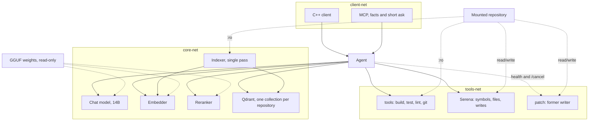
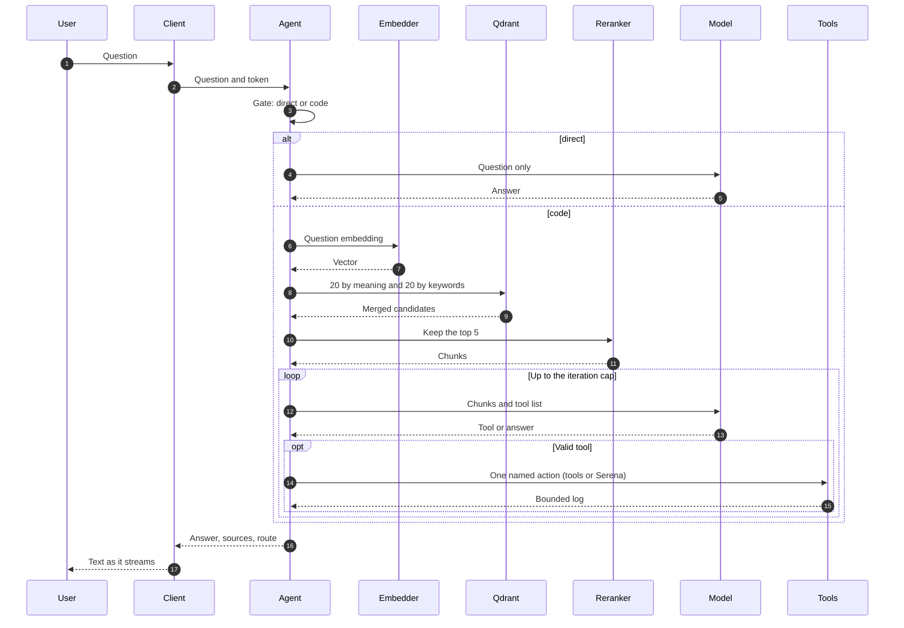
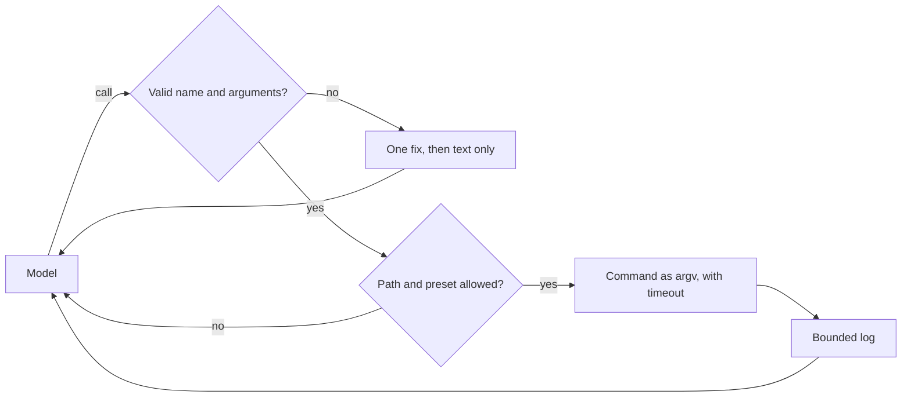
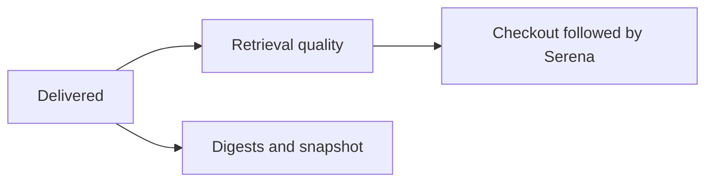
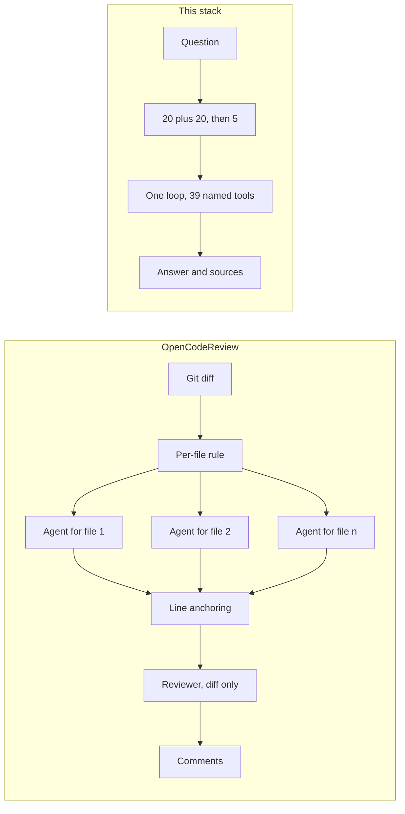
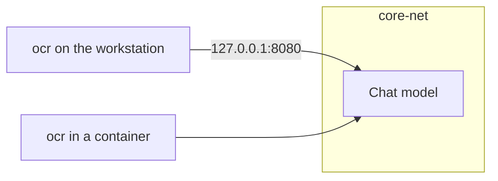

# Technical stack overview

This document presents the stack as it is actually implemented in this
repository (including the Serena sidecar), details the existing tooling,
lists what remains, then compares this approach with OpenCodeReview (`ocr`),
Alibaba's code review tool.

The "hard" facts (ports, versions, API schemas) stay pinned in
`CONTRACTS.md`; this page is a guided reading of them. The role of each
service is in the [overview](../../architecture/overview.md), the networks in
[Networking](../../architecture/networking.md), the tool loop in
[Iteration loop](../../architecture/agent-loop.md). Here, we only repeat what helps to read
the stack at a glance.

---

## 1. Overview

A **100% local, offline** coding assistant: a chat LLM, an embedding
model, a vector database indexing a C++ project (and its
CMake/Markdown/YAML/JSON/TOML files), a RAG + tool-calling orchestrator
with multi-turn memory and SSE streaming, a sandbox of
build/test/compile/git/lint tools (`tools`) and a code intelligence sidecar
(Serena: clangd symbols, file reads and writes). Everything runs
in containers (Podman or Docker, depending on `CONTAINER_RUNTIME`) on three
internal networks with no route to the outside.

`agent` is the only service on the three internal networks. Dotted arrows
are mounted files, not calls. The per-network detail is in
[Networking](../../architecture/networking.md).

The repository is mounted `:ro` in `agent`, `indexer` and `tools` (the diagram
only shows the last two), and read-write in
`serena` (and `patch`, which the model can no longer name). The write
server is therefore no longer `patch` but Serena; see
[The Serena sidecar](../../architecture/overview.md#the-serena-sidecar).

Outside the serving path: profiles `setup` (`fetch-models`, the only internet access),
`train` (QLoRA), `test` (smoke), `dev` (`devtools`), `docs` (mkdocs `:8000`),
`obs` (`config/compose/observability.yaml`: Prometheus + Grafana). `mcp` is
on `client-net` (to reach `agent`) and on `publish-net`, published on
loopback (`127.0.0.1:8092`).

### Request flow

The `direct` path consults neither the catalog nor the tools. The `code` path
merges 20 neighbors by meaning and 20 by keywords, then keeps only 5. If the
reranker is stopped, those 5 are the top ones of the merge.

The gate (`services/agent/gate.py`) chooses before the index. The rules
send a calculation or a greeting to `direct` (no search, no
tools). A file, a symbol, a build or a test goes to `code`.
A conversation follow-up with no signal stays on `code`. A first
ambiguous question is classified by a short call to the model already served
(`AGENT_GATE_CLASSIFY=1`); a failure or a doubt stays on `code`.

`/chat` remains for scripts. `/chat/stream` (SSE: `route`, `rag`,
`tool_call`, `tool_result`, `token`, `done`, plus `nudge`, `context`,
`activity`, `tool_delta`, `meta` and `error`) is the default path of
`llm-client`. The `rag` event is absent when `route` is `direct`.
`conversation_id` keeps the history **in memory** (TTL, turn cap,
no disk: `agent` has a read-only rootfs); the detail is in
[Iteration loop](../../architecture/agent-loop.md#conversation-and-trace).

---

## 2. The stack layers

| Layer | Technology | Version / pin | Role |
|---|---|---|---|
| Container runtime | Podman or Docker + Compose (`CONTAINER_RUNTIME`), WSL2 on Windows | none | Isolation, 3 `internal: true` networks + `publish-net` closed to egress by an overlay, healthchecks, profiles |
| GPU access | NVIDIA CDI (`nvidia.com/gpu=all`) | CUDA 12.6.3 | Offload `llm`/`embedder`/`trainer`; automatic CPU fallback via `config/compose/cpu.yaml` |
| Inference | `llama.cpp` `llama-server` | tag `b10216` | OpenAI-compatible server for chat and embeddings |
| Chat model | Qwen2.5-Coder-14B-Instruct | Q5_K_M (~9.8 GB) | Review and tool-calling; a LoRA trained on the Mistral-Small-4 base does not load here. On the EVO-X5, another GGUF runs as a host process |
| Embedding model | nomic-embed-text-v1.5 | Q8_0, 768-d | Vectorization of code and queries (mandatory prefixes) |
| Test model | Qwen2.5-0.5B-Instruct | Q4_K_M | CI smoke test, CPU only (profile `test`) |
| Training base | mistralai/Mistral-Small-4-119B-2603 (HF) | safetensors | QLoRA only, never served |
| Vector database | Qdrant | `v1.19.0` | Collection `code_chunks`, cosine, uuid5 upsert, hash skip, tombstones |
| Orchestrator | Python 3.11, FastAPI 0.115, `openai` SDK 2.54, structlog, prometheus | none | `/chat` + `/chat/stream`, `direct`/`code` gate, RAG, tool loop (39 named tools), token budget, TTL memory, optional review, semaphore, `/metrics` |
| Indexing | tree-sitter-cpp + `tree-sitter-language-pack`, qdrant-client, watchdog | none | C++ + CMake/Markdown/YAML/JSON/TOML; `git_blob_hash` skip; tombstones |
| Tool sandbox | FastAPI, subprocess `shell=False`, Ubuntu 24.04 | gcc 13, cmake 3.28, clang-tools-18, clangd, cppcheck 2.13, ripgrep, git, subversion | 16 named tools (build, test, lint, git/svn, `lsp_calls`/`lsp_types`), `path_safety`, bounded outputs, cgroups, strict health |
| Serena sidecar | `ghcr.io/oraios/serena` (MCP Streamable HTTP, LSP/clangd backend) | `2.1.0` | 23 named tools on the model side (12 reads, 11 writes); sole writer; `tools-net`, no published port |
| Client | C++20/CMake, libcurl, nlohmann_json, Catch2 v3 (apt) | none | `app` CLI: SSE by default, `--repl`, `--no-stream`; 13 ctest `TEST_CASE`s |
| MCP | `mcp` SDK 1.12 (`FastMCP`) | none | `lookup`, `check`, `calls`, `types`, `ask`; Streamable HTTP `127.0.0.1:8092/mcp` or stdio; `X-Workspace` selects the checkout |
| Fine-tuning | transformers, peft, trl, bitsandbytes | none | QLoRA rank 16, dataset from tree-sitter chunks, `adapter.gguf` conversion |
| Documentation | mkdocs-material (offline, mermaid) | none | Local site `:8000` |
| Operations | `scripts/deploy.py` (host), pytest, `eval_rag.py`, `eval_tools.py`, `fetch_models.py` | none | Lifecycle, `chat` / `ask` / `rotate-token`, diagnostics, model SHA256 |

---

## 3. Existing tools

### 3.1 Tools exposed to the LLM

These are the **only** actions the model can trigger: **39 named
tools**, in two families. There is no generic `exec`.

- **16 HTTP tools**, served by `tools`: the table below. The argument
  contract of each tool is a single pydantic model
  (`services/common/tool_models.py`): `tools` validates its requests with it,
  `agent` derives the function-calling schema from it (`model_json_schema()`) and
  validates the LLM's arguments before the HTTP call. A test compares this
  registry with the OpenAPI of `tools` (anti-drift).
- **23 Serena tools** (12 reads, 11 writes), declared in
  `services/agent/serena_named_tools.py` and relayed over MCP to the sidecar.
  The full list and the phase rules are in
  [Iteration loop](../../architecture/agent-loop.md). The 11 writes (`create_text_file`,
  `replace_content`, `replace_symbol_body`, `rename_symbol`, etc.) are the
  only ones that modify the checkout.

The `search`, `list_files`, `read_file`, `lsp_definition`,
`lsp_references`, `lsp_hover`, `lsp_symbols` and `lsp_outline` routes still exist
on `tools` (the agent's editor routes, such as `/lsp/outline` or
reading a file from the checkout, use them), but **the model can no
longer name them**: Serena replaces them. Likewise, the agent no longer offers
`begin_plan`, `edit` or `apply`.

| Name seen by the LLM | Endpoint | Arguments | What it does | Safeguards |
|---|---|---|---|---|
| `build` | `POST /build` | `preset` | `cmake --preset` + build in a `mkdtemp()` scratch directory discarded afterwards | allow-listed preset, timeout `TOOLS_BUILD_TIMEOUT_SECONDS` (14400 s) |
| `test` | `POST /test` | `preset`, `filter?` | build + `ctest` (`-R` if `filter`) | allow-listed filter regex |
| `compile_file` | `POST /compile` | `path`, `preset` | configures once (cache `/workspace/scratch/cmake-cache/<root>/<preset>`, one root per mounted tree) then one TU | C/C++ sources only, `compile_commands.json` |
| `lint_clang_tidy` | `POST /lint/clang-tidy` | `paths[]` | `clang-tidy` on the given files | `path_safety` (no `..`, absolute path or null byte; symlinks resolved before the check), timeout `TOOLS_BUILD_TIMEOUT_SECONDS` |
| `format_check` | `POST /format/check` | `paths[]` | `clang-format --dry-run` (modifies nothing) | same |
| `static_analysis` | `POST /static-analysis` | `paths[]` | `cppcheck` | same |
| `build_step` | `POST /build-step` | `preset`, `target?` | parallel `cmake --build` on the configured cache; to be called once when a step's writes are done | the only compilation tool allowed during the editing phase (`build`, `test`, `compile_file` are refused there); see [Iteration loop](../../architecture/agent-loop.md) |
| `git_log` / `git_blame` / `git_diff` / `git_show` | `POST /git/*` | path / refs / window | read-only git (CLI, no shell) | allow-listed refs, **≤ 200 lines**, same timeout |
| `svn_status` / `svn_diff` / `svn_log` | `POST /svn/*` | path / revisions | read-only Subversion on the mounted checkout | **≤ 200 lines**, same timeout; `svn log` may contact the repository server |
| `lsp_calls` / `lsp_types` | `POST /lsp/calls`, `/lsp/types` | `path`, `line`, `character`, `direction` | callers/callees, bases/derived via clangd (JSON-RPC); `compile_commands.json` already in the checkout, otherwise configured from the preset | 1-based positions, `name path:line`, **≤ 40** locations, paths under the root, file ≤ 256 KiB |

All `tools` responses share the shape `{ok, stdout, stderr,
exit_code}` (`exit_code = -1` = refused before any execution). `tools` mounts
the repository **read-only**: it cannot write anything there. Writes
go through Serena (11 tools), with no commit or push; see
[The Serena sidecar](../../architecture/overview.md#the-serena-sidecar).

A tool call is refused before any command if the name, the
arguments or the path are not in the contract.

### 3.2 Operator tooling (outside the LLM)

**`scripts/deploy.py`**, the command to run on the host. The implementation is in `scripts/host/`. The scripts in `scripts/container/` are only run through Compose.

| Command | Effect |
|---|---|
| `up` | fetch models → NVIDIA CDI probing/generation (fallback `config/compose/cpu.yaml` + extended timeouts) → build → up → wait for healthy → index |
| `down [--volumes]` | stop (option: purge the Qdrant index) |
| `status` / `logs <svc>` | `compose ps` / `logs` (Podman or Docker) |
| `index` | recreates the `CODEBASE_PATH` mount then relaunches the indexer on the default collection |
| `workspace <path> [--update]` | registers a checkout (one collection per remote URL), mounts all checkouts, indexes only the first time |
| `ask "..."` / `ask --file p.md` / `ask -` | question via `app` (SSE by default; `llm-client --no-stream` for JSON) |
| `chat` | multi-turn REPL (`llm-client --repl`): reuses `conversation_id` |
| `rotate-token` | regenerates `AGENT_BEARER_TOKEN` and recreates `agent`, `app` and `mcp` |
| `train [--incremental] [--dry-run]` | dataset from chunks → QLoRA (profile `train`) → `adapter.gguf` → `LLM_LORA_PATH` → recreate `llm` → re-index |
| `test` | CI smoke test (profile `test`, 0.5B CPU model) |
| `doctor [--gpu] [--verify-checksums] [--html]` | Podman/Compose, `.env` + token, `CODEBASE_PATH`, models (+SHA256), HF base, LoRA adapter, trained commit, disk, service health, GPU build vs `.env` consistency, in-container `nvidia-smi` |

**Other scripts** (run in a container): `fetch_models.py` (download
via `huggingface_hub.hf_hub_download`, resume, retries, + pinned SHA256,
fatal on mismatch, `--hf-train-base`), `eval_rag.py` (golden
questions: *is the right file/symbol in `sources`?*, exit ≠ 0 in CI),
`eval_tools.py` (3 JSON scenarios: `build`, `compile_file`, `test` +
`filter`), `convert_lora.py`, `install_train_hook.py`.

**Tests**: pytest (`tests/agent`, `indexer`, `tools`, `mcp`, `trainer`,
`scripts`, `tests/integration`), 13 C++ `ctest`s, ruff + mypy in
`.github/workflows/ci.yml`.

### 3.3 Applied security

- Networks `client-net`, `core-net` and `tools-net` are `internal: true`, `tools` and `serena` are invisible from `llm`/`qdrant` and vice versa; `agent` is the only service on all three. `publish-net` is not internal: its egress is closed by the runtime overlay (see [Networking](../../architecture/networking.md)).
- All services: `cap_drop: ALL`; `no-new-privileges` on those that set it (including `serena`); repository images run as non-root; read-only rootfs for `agent`, `tools`, `mcp`, `patch`, `ui-proxy` and `app`, with targeted tmpfs mounts. Serena, an upstream image, keeps a writable rootfs (it rewrites its config at startup).
- Entry points: `/chat` and `/chat/stream`, bearer token (`deploy.py rotate-token`).
- `AGENT_MAX_CONCURRENT` semaphore (default 2); `/health` + `/metrics` on `agent` and `tools` (`TOOLS_HEALTH_STRICT`). `POST /chat/cancel` cuts the in-flight model request.
- cgroup `cpu`/`memory` quotas on `tools` (compose) in addition to the timeouts.
- Pins: images, `llama.cpp`, models (SHA256 taken from the LFS metadata).

---

## 4. What is still missing

Waves 1 to 2 + streaming + multi-turn are **delivered**. What remains is sorted
by layer: **gap** vs **design choice**. The detailed figures are in
the [roadmap](roadmap.md).

### 4.1 Tools the LLM does not have

| Missing | Impact | Note |
|---|---|---|
| Sanitizer presets (ASan/UBSan/TSan), coverage | The model cannot prove the absence of the UB it claims | Depends on the target project's `CMakePresets.json` |
| `run_binary` with controlled arguments | Impossible to reproduce a runtime bug outside `ctest` | Sensitive even with cgroups |
| Free shell, commit, push | No action outside the named tools | Design choice. Writes exist, via Serena's 11 write tools, without commit |
| Offline docs (cppreference, CMake docs) | Answers from memory on standard APIs | Static dump + Qdrant collection |
| Web access / `fetch_url` | None | Choice: stay offline |

Already delivered (no longer to be treated as gaps): reading, file and
symbol search (Serena), writes (Serena),
`git_log` / `blame` / `diff` / `show`, `svn_status` / `diff` / `log`,
`compile_file`, `build_step`, `test` + `ctest -R`, `lsp_calls`, `lsp_types`.

### 4.2 Agent side

- **Reranker delivered**: `bge-reranker-v2-m3` Q8, 20 RRF candidates then top 5.
  No query rewriting (HyDE, multi-query). The only payload filter
  is the active checkout's identifier (`checkouts`).
- **No sub-agents**: a flat loop, bounded by
  `AGENT_TOOL_LOOP_MAX_ITERATIONS` (8 by default in the code, 48 in
  `.env.example`, which `compose.yaml` passes through). It reruns the model when
  a tool fails, when a code question has not called any tool yet,
  and as long as an edit is not verified by `build_step`; see
  [Iteration loop](../../architecture/agent-loop.md).
- **Diff review delivered**: `POST /review` anchors each comment on a line of the diff.
- **Repository map delivered**: tree-sitter signatures, budget
  `AGENT_REPO_MAP_CHARS`, pasted into the prompt when the question is about the shape of the tree.
- **Checkouts delivered**: `state/workspaces.json`, one collection per remote URL,
  `X-Workspace` header, dirty files re-read in front of the index.
- **Auth**: a single shared token, no per-user quotas
  (`SECURITY.md`). The semaphore only bounds global concurrency.

Delivered on the interface side: MCP (`lookup`, `check`, `calls`, `types`,
`ask`) on `127.0.0.1:8092`. Page `GET /ui` on `127.0.0.1:8090` via
`ui-proxy`. The chat model is published on `127.0.0.1:8080`. There is no
in-house editor extension: Cursor and VS Code go through MCP, Continue
talks to the 14B directly. See [VS Code](../../guides/vscode.md).

Delivered: `conversation_id` + TTL, SSE `/chat/stream`, `POST /chat/cancel`,
token budget (`/tokenize` + `len/4`), pydantic validation of args before
HTTP, optional `AGENT_REFLECT` review, `/metrics` + Prometheus/Grafana
overlay.

### 4.3 Indexing side

- C++ + CMake/Markdown/YAML/JSON/TOML + text windows: **delivered**.
- Tombstoning + `git_blob_hash` skip: **delivered**.
- **`--watch` unreliable** on Windows → WSL2 → bind mount (inotify).
- `eval_rag.py` / `eval_tools.py` exist; GitHub CI runs ruff, mypy,
  pytest and ctest, the `smoke` job runs `eval_rag` outside pull requests.
  No gitleaks.

### 4.4 Runtime and model side

- `LLM_THREADS` / `LLM_NUMA` + `tools` cgroups: **delivered**.
- Images pinned by tag, not yet by `@sha256` digest.
- Hot-swap of a chat GGUF: delivered (`LLM_ROUTER=1`, a single model loaded, selector on `/ui`).
- The page (`127.0.0.1:8090`) and MCP (`127.0.0.1:8092`) are on loopback. So is the `llm` container (`127.0.0.1:8080`), except on `evo-x5` where the host process listens on `0.0.0.0:8080`. The embedder and Qdrant stay internal.

What remains, once the first circle is delivered. Retrieval blocks
answer quality. The delivered writing goes through Serena (without commit);
what remains is making it follow the chosen checkout. Operations can move forward alongside.

---

## 5. Comparison with OpenCodeReview (`ocr`)

[OpenCodeReview](https://github.com/alibaba/open-code-review) is Alibaba's
AI code review tool, open-sourced in May 2026 (Apache-2.0) after
two years of internal use. It is a CLI (`ocr`, installed via npm) that reads a
Git diff, sends each modified file to a configurable LLM through a
tool-using agent, and produces **line-anchored review comments**.
Its thesis, formalized in the paper
[*Determinism over Non-Determinism*](https://arxiv.org/abs/2608.09290):
inject determinism at three specific points of the pipeline rather than
giving the agent maximum freedom.

Both projects share an intuition, **no generic shell, a fixed and bounded
tool set**, but do not solve the same problem.

### 5.1 Two pipelines side by side

OpenCodeReview starts from a diff and parallelizes one agent per file.
This stack starts from a question and keeps a single loop.

### 5.2 What they do, what they don't

| Axis | OpenCodeReview | This stack |
|---|---|---|
| **Goal** | Find defects in a *change* (or audit files via `ocr scan`) | Answer a *question* about a repository and verify the answer |
| **Input** | Git diff (workspace, `--from/--to`, `--commit`) or whole files | Free text (+ `conversation_id` history); `POST /review` takes `from` / `to` |
| **Output** | Comments `{file, line, text, suggestion}`; JSON; web viewer | Free text + `sources[]` + SSE; `/review` returns `{path, line, snippet, text}` |
| **Context selection** | Deterministic: glob rules per file type, extension allow-list, fixtures/generated exclusion, cap at 80% of the window | Dense + BM25 (RRF, 20) then reranker, top-5; glob rules (`rules/*.md`) |
| **Parallelism** | One SubAgent per file, concurrent | One sequential loop |
| **Loop bounds** | 30 iterations; context compression at 60% / 80% | Configurable iteration cap (`AGENT_TOOL_LOOP_MAX_ITERATIONS`); token budget, extractive compression, 39 named tools, per-tool caps |
| **Anti-hallucination** | Independent reviewer, diff only, veto if contradicted | Retry ×1 tool-call + optional `AGENT_REFLECT` (json_schema) |
| **Code execution** | **None**, never a build, test or lint | `build`, `build_step`, `test`, `compile_file`, read-only git, tidy / format / cppcheck; writes through Serena |
| **Semantic index** | None (on-demand text search) | Qdrant + tree-sitter (C++ and docs) |
| **Business rules** | 4 levels, natural language, per glob; built-in NPE, thread-safety, XSS, SQLi | `rules/*.md` files resolved by glob + system prompt |
| **Model** | OpenAI/Anthropic-compatible endpoint; benchmarks with frontier models | Local Qwen2.5-Coder-14B Q5 (GPU), swappable with the other GGUFs in `./models/` |
| **Network** | Runs on the dev workstation, calls a provider (or delegates to Claude Code / Codex / Cursor / OpenCode) | Everything in containers, `internal` networks, zero egress |
| **Integrations** | GitHub Actions, GitLab CI, Gerrit, MCP server, OpenTelemetry, session viewer | `deploy.py`, SSE/`--repl` CLI, MCP (`lookup`, `check`, `calls`, `types`, `ask`), GitHub Actions, Prometheus |
| **Evaluation** | AACR-Bench: 200 PRs, 10 languages, 1,505 annotated defects; higher precision and F1 than Claude Code for ~1/9 of the tokens, **lower recall** | `eval_rag.py` + `eval_tools.py`; unit CI, no LLM golden set yet |

### 5.3 Tool by tool

Both tool sets are closed and shell-free. The difference is in what
they bound and what they allow.

| Need | OpenCodeReview | This stack |
|---|---|---|
| Read a file | `file_read`, **line range**, max 500 lines/call | `read_file` (Serena), line range; the response size is capped by `max_answer_chars` |
| Find a file | `file_find`, keyword, max 100 results | `find_file`, `list_dir` (Serena) |
| Search text | `code_search`, max 100 matches, 10 s timeout | `search_for_pattern` (Serena) |
| Search a symbol | none | `find_symbol`, `find_referencing_symbols`, `get_symbols_overview` (Serena); `lsp_calls` / `lsp_types` (`tools`) |
| See another change | `file_read_diff`, precomputed diff of another file in the PR | `git_diff` / `git_log` / `git_show` / `git_blame` (read-only) |
| Emit a structured result | `code_comment`, `{text, existing_code, suggestion_code}` then line resolution | `POST /review`, snippet copied from a line of the diff, otherwise `dropped` |
| Finish explicitly | `task_done` | implicit: answer without `tool_calls` |
| Build / test / lint | none | `build`, `test` (`-R`), `compile_file`, tidy / format / cppcheck |

Reading: OpenCodeReview bounded the **size of each observation** because
its problem is the "token snowball" on large PRs. This stack
bounds the **type of action** (never a shell; writes go through
11 named tools, without commit) *and* the size (200 Git/SVN lines, 40
clangd locations, `max_answer_chars` on the Serena side + global budget via
`/tokenize`).
`POST /review` reuses the per-file dispatch and the line anchoring.
`ocr` keeps the independent reviewer, the viewer and the CI integrations.

### 5.4 What this stack can borrow

Tool caps, file search, glob rules, review, MCP (facts + `ask`)
and the dense + BM25 hybrid are **delivered**. Cursor and VS Code go through
this socket. An in-house extension is not the next project.

What remains, by gain for someone who uses it:

1. **Retrieval quality** on a tree of several thousand files
   (the top 5 that prefers a `CMakePresets.json` over the named symbol).
2. **Writing to the right checkout**: only Serena writes, but it is started
   on the default tree (`CODEBASE_PATH`); the agent does not pass it the
   checkout chosen by `workspace`, and `deploy.py` does not recreate it when the
   mount changes. Reviewing the diff remains manual (no commit).
3. **Operations**: image digests, Qdrant snapshot. Cancellation
   (`POST /chat/cancel`) is delivered.

### 5.5 Plugging them together

`ocr` accepts a custom OpenAI-compatible provider, and `llm` exposes
exactly that API (`/v1/chat/completions`). It is therefore possible to run
OpenCodeReview **entirely locally** on this stack's model,
under two conditions.

Two ways to reach the same model. The loopback port is already in
place. The container keeps the call inside the networks.

- **Network**: `llm` is already published on `127.0.0.1:8080` (`publish-net` network, loopback only). The embedder and Qdrant are not. An `ocr` on the workstation can therefore talk to that port. The other option, an `ocr` container on `core-net` with the repository read-only, keeps the call inside the containers.
- **Quality**: the AACR-Bench figures are obtained with frontier models. A Qwen2.5-Coder-14B Q5_K_M holds the tool protocol (that is why Q5_K_M is pinned) and sees more defects than a 7B, while remaining far from a frontier model; the independent reviewer will at least limit false positives. On the CPU-only Xeon machine, a PR review with one SubAgent per file and 30 iterations is not realistic.

Conversely, OpenCodeReview will never replace the "execution" part of
this stack: it does not compile, test or lint. The natural combination
is **`ocr` for diff review, this stack for
verification** (build/test/tidy of the files `ocr` commented on).

---

## 6. In summary

- The stack is **coherent and safe**: offline, segmented, pinned, with 39
  named tools (16 in `tools`, 23 in Serena) as the model's only action
  surface. Only one service writes to the checkout (Serena), never a commit.
- The **first circle is delivered**: tool caps, read-only Git and SVN,
  clangd (symbols, references, calls, types), `compile_file`,
  `build_step`, `ctest -R`, named writes, multi-file indexing, tombstones, token budget,
  metrics, multi-turn + SSE, cancellation, glob rules, optional review,
  checkout registry, signature map, CI.
- What remains: retrieval quality on a large tree, making Serena follow the
  chosen checkout, and operations (image digests,
  Qdrant snapshot). The detail is in the [roadmap](roadmap.md).
  MCP, `/ui`, the 14B loopback port, the hybrid, the reranker and
  `POST /review` are delivered.
- Compared with **OpenCodeReview**, both refuse the generic shell. This
  stack runs build/test/lint/git/clangd and anchors `/review`'s comments on
  a line of the diff. The two combine by pointing `ocr`
  at `llm` via a container on `core-net`.
