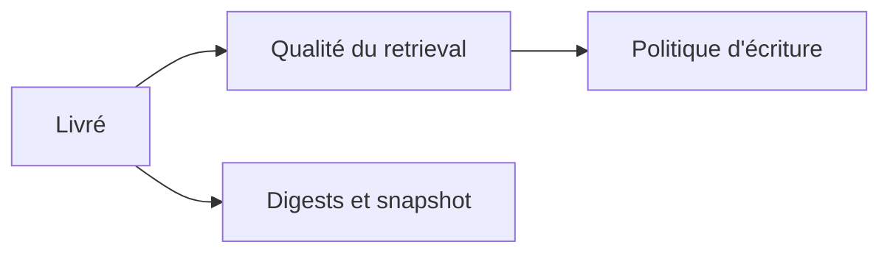
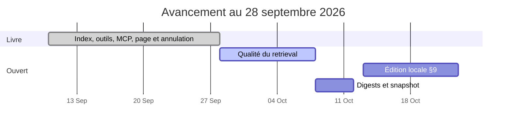

# Axes d'amélioration du dépôt

Ce document liste les améliorations possibles de la stack, classées par
rapport gain / effort, avec pour chacune le problème constaté, la solution
proposée, les fichiers concernés et les dépendances. Il complète la
[présentation de la stack](architecture/stack-presentation.md) (§4 et §5.4
décrivent ce qui reste ; ici on décrit *comment* le combler et dans quel
ordre).

Convention d'effort : **S** = moins d'une journée, un composant ;
**M** = quelques jours, deux composants ou un test d'intégration ;
**L** = une semaine ou plus, nouveau service ou changement de contrat.

---

## 0. Avancement

Mis à jour à chaque étape livrée. « Vérifié » = tests unitaires verts +
contrôle fonctionnel décrit dans la colonne.

| #   | Item                                                                                                                                          | Statut | Vérification                                                                                                                                                                                                                                                                                                                                            |
| --- | --------------------------------------------------------------------------------------------------------------------------------------------- | ------ | ------------------------------------------------------------------------------------------------------------------------------------------------------------------------------------------------------------------------------------------------------------------------------------------------------------------------------------------------------- |
| 2.1 | Sorties d'outils bornées (`read_file` fenêtre 400 lignes, `search` `max_results` ≤ 100, 300 colonnes)                                         | ✅ fait | 20 tests handlers + 7 tests HTTP (`tests/tools/test_main_api.py`)                                                                                                                                                                                                                                                                                       |
| 2.2 | `list_files` (`rg --files`, `.gitignore`, ≤ 500 chemins)                                                                                      | ✅ fait | 17 tests dont 3 avec le vrai `rg` ; prompt système et `tools_schema` mis à jour                                                                                                                                                                                                                                                                         |
| 2.3 | `LLM_THREADS` / `LLM_THREADS_BATCH` / `LLM_NUMA`, `EMBEDDER_THREADS` / `EMBEDDER_NUMA`                                                        | ✅ fait | `sh -n` + exécution des deux entrypoints en WSL avec un `llama-server` factice : flags `-t -tb --numa` correctement ajoutés ; CRLF de `llm/entrypoint.sh` corrigé au passage                                                                                                                                                                            |
| 2.4 | CI (`.github/workflows/ci.yml` unit + smoke nightly), `pyproject.toml` (ruff E/F/W/B/I, mypy), `.gitattributes` LF, `.pre-commit-config.yaml` | ✅ fait | `ruff check .` = 0 erreur (92 corrigées), `mypy` vert sur agent/tools, 302 tests verts ; YAML/TOML parsés ; le workflow lui-même ne peut être exécuté qu'une fois poussé sur GitHub                                                                                                                                                                     |
| 2.5 | Indexer fichiers non-C++ (CMake, Markdown, YAML, JSON, TOML, texte) via `tree-sitter-language-pack`                                           | ✅ fait | 37 tests `test_text_chunker.py` (sections/setext/fences Markdown, cibles CMake, clés YAML multi-doc, JSON, TOML, fenêtrage) ; run sur `app/` : `CMakeLists.txt` → `pumba_app, app, agent_client_test, …`, `CMakePresets.json` → `version, configurePresets` ; 2 questions ajoutées à `eval_rag_questions.json` ; trainer pinné au sous-ensemble C++ |
| 3.1 | Tombstoning + skip par `git_blob_hash`                                                                                                        | ✅ fait | 3 tests `test_index_incremental.py` + `listed_file_hashes` / `delete_by_file_paths` dans `test_vector_store.py`                                                                                                                                                                                                                                         |
| 3.2 | `compile_file` + `test --filter` (`ctest -R`)                                                                                                 | ✅ fait | `handlers/compile.py` + `filter` → `ctest -R` ; tests argv / 400 HTTP dans `test_compile_and_git.py` + `test_main_api.py`                                                                                                                                                                                                                               |
| 3.3 | Outils Git lecture seule                                                                                                                      | ✅ fait | CLI `git` (argv, refs allow-listées, ≤ 200 lignes) ; pas GitPython — le binaire est déjà dans l'image `tools`                                                                                                                                                                                                                                           |
| 3.4 | Règles par glob                                                                                                                               | ✅ fait | `pathspec` + `rules/*.md` ; `test_prompts.py` charge `cpp.md` pour un `.hpp` et pas pour `CMakeLists.txt`                                                                                                                                                                                                                                               |
| 3.5 | Budget de tokens                                                                                                                              | ✅ fait | `POST /tokenize` puis `len/4` ; collapse des vieux `tool` puis coupe RAG ; 2 tests `test_token_budget.py`                                                                                                                                                                                                                                               |
| 3.6 | Métriques                                                                                                                                     | ✅ fait | `prometheus-fastapi-instrumentator` + compteurs `tool_calls_total` / `tool_call_malformed_total` / `rag_used_context_total` ; `/metrics` ; overlay `compose.observability.yaml` ; `llama-server --metrics`                                                                                                                                              |
| 3.7 | `eval_tools.py`                                                                                                                               | ✅ fait | `httpx` + 3 scénarios JSON ; 3 tests `test_eval_tools.py` (ask mocké)                                                                                                                                                                                                                                                                                   |
| 3.8 | Passe de relecture                                                                                                                            | ✅ fait | `response_format` json_schema ; `AGENT_REFLECT=0` par défaut ; 3 tests `test_reflect.py`                                                                                                                                                                                                                                                                |
| 4.1 | Mémoire multi-tour (`conversation_id`, TTL, `deploy.py chat`)                                                                                 | ✅ fait | store in-memory + 3 tests ; `/chat` renvoie `conversation_id` ; `llm-client --repl`                                                                                                                                                                                                                                                                     |
| 4.2 | Streaming SSE `POST /chat/stream`                                                                                                             | ✅ fait | events `route` / `rag` / `tool_call` / `tool_result` / `token` / `done` ; assembleur de deltas testé ; parser SSE Catch2 (11/11 ctest) ; `/chat` inchangé pour les scripts                                                                                                                                                                               |
| 4.3 | Recherche hybride (RRF dense + BM25) + reranker GGUF                                                                                          | ✅ fait | RRF `limit` 20 puis `POST /v1/rerank` (`bge-reranker-v2-m3` Q8, service `reranker` :8082) ; repli sur l'ordre RRF si le service est absent ; `--test` ne télécharge pas le GGUF |
| 4.4 | clangd / LSP                                                                                                                                  | ✅ fait | `clangd` dans `tools` ; definition, references, hover, symbols, outline, calls, types |
| 4.5 | Mode revue de diff                                                                                                                            | ✅ fait | `POST /review` ; snippet ancré sur une ligne du diff sinon `dropped` ; 8 fichiers max ; tests `test_review.py` |
| 4.6 | Interface (MCP, puis page `/ui`)                                                                                                              | ✅ fait | FastMCP 1.12 : `lookup` / `check` / `outline` / `calls` / `types` / `ask` ; page `GET /ui` sur `127.0.0.1:8090` ; `llm` sur `127.0.0.1:8080`. Pas d'extension maison |
| 4.7 | Porte `direct` / `code` avant l'index et les outils                                                                                           | ✅ fait | `services/agent/gate.py` ; règles (calcul, salutation, signal code) ; `AGENT_GATE_CLASSIFY=1` pour le reste ; SSE `route` ; tests `test_gate.py` |
| 5   | Robustesse : sémaphore `/chat`, health strict `tools`, `rotate-token`, quotas, test de contrat                                                | ✅ fait | 503 si slots pleins ; `TOOLS_HEALTH_STRICT` ; `deploy.py rotate-token` ; cgroup `tools` ; `test_contracts_sync.py` ; **420 tests verts**, ruff + mypy CI verts                                                                                                                                                                                          |
| 6.1 | SDK `openai` 2.54 pour `llm` et `embedder` (`requests` supprimé)                                                                              | ✅ fait | 40 tests agent + 13 tests `test_embeddings_client.py` sur transport `httpx` mocké ; `AGENT_LLM_MAX_RETRIES` documenté                                                                                                                                                                                                                                   |
| 6.2 | Schéma d'outils généré depuis pydantic (`services/common/tool_models.py`)                                                                     | ✅ fait | 20 tests `tests/common` dont contrat OpenAPI, 7 tests parse + retry précis                                                                                                                                                                                                                                                                              |
| 6.3 | `structlog` (`services/common/logging.py`, 5 `_log` remplacés, `request_id` par contextvars)                                                  | ✅ fait | 6 tests `test_logging.py` ; smoke indexer/trainer                                                                                                                                                                                                                                                                                                       |
| 6.4 | `hf_hub_download` dans `fetch_models.py` (`ModelSpec.repo_id`, SHA256 épinglé conservé)                                                       | ✅ fait | 14 tests `test_fetch_models.py`                                                                                                                                                                                                                                                                                                                         |
| 6.5 | Catch2 v3 (apt Ubuntu 24.04, pas FetchContent) pour `app/tests`                                                                               | ✅ fait | 11 `TEST_CASE` découverts individuellement ; `ctest -R json_round_trip` = 1 test ; build+ctest verts en WSL                                                                                                                                                                                                                                             |
| 9   | Édition locale sans commit ni push                                                                                                            | ✅ fait | service `patch` (montage rw, non publié) ; `begin_plan` / `edit` / `apply` ; budget 200 / 500 et 8 éditions par fichier ; `build_step` parallèle sur le cache ; `build`/`test`/`compile_file` bloqués pendant les éditions |

Contrats touchés jusqu'ici : `CONTRACTS.md` (endpoints `tools` y compris
`/compile` et `/git/*`, sorties bornées, `AGENT_*` budget/réflexion/
concurrence/conversation, `POST /chat/stream`, `TOOLS_HEALTH_STRICT`,
`/metrics`, service `mcp` `:8092`), `SECURITY.md`, `tools-api.md`,
`tool-calling.md`, `agent-api.md`, `mcp.md`, `troubleshooting-gpu.md`,
`indexing-pipeline.md`, `stack-presentation.md`.

### Principe : réutiliser avant de réécrire

Quand une bibliothèque open source maintenue et éprouvée fait le travail, on
l'utilise plutôt que de réimplémenter (le premier jet de 2.5 parsait le
Markdown/CMake à la regex ; il a été remplacé par les grammaires
`tree-sitter-language-pack`, même technique que le C++). Ce que l'on écrit
soi-même se limite à la *politique* propre au projet (bornes, regroupement,
contrat Qdrant). Choix retenus ou prévus pour la suite :

| Item                                | Bibliothèque / API existante                                               | Statut / ce qui reste                                |
| ----------------------------------- | -------------------------------------------------------------------------- | ---------------------------------------------------- |
| 2.5 fichiers non-C++                | `tree-sitter-language-pack` (grammaires markdown, cmake, yaml, json, toml) | ✅ regroupement ≤ 60 lignes, fenêtrage, `symbol_name` |
| 3.1 tombstoning / skip              | `qdrant-client` : `scroll` + `delete` par `Filter` sur `file_path`         | ✅ boucle de comparaison                              |
| 3.2 `compile_file`, `test --filter` | `cmake --build --target <obj>` et `ctest -R` natifs                        | ✅ validation des arguments                           |
| 3.3 Git lecture seule               | CLI `git` (déjà dans l'image) ; refs allow-listées, pas GitPython          | ✅ bornes 200 lignes                                  |
| 3.4 règles par glob                 | `pathspec` (motifs gitignore)                                              | ✅ `rules/*.md` + résolution                          |
| 3.5 budget de tokens                | `POST /tokenize` de `llama-server` ; `len/4` en repli                      | ✅ politique de troncature                            |
| 3.6 métriques                       | `prometheus-client` + `prometheus-fastapi-instrumentator`                  | ✅ labels `tool` / `ok`                               |
| 3.7 `eval_tools.py`                 | `httpx` + fixtures JSON (pas de LLM juge)                                  | ✅ 3 scénarios                                        |
| 3.8 relecture structurée            | `response_format: json_schema` de `llama-server`                           | ✅ schéma + décision                                  |
| 4.1 multi-tour                      | `asyncio` + dict en mémoire (rootfs RO)                                    | ✅ TTL + plafond de tours                             |
| 4.2 streaming                       | SDK `openai` `stream=True` + SSE Starlette                                 | ✅ événements rag/tool/token/done                     |
| 4.3 hybride + reranker              | Qdrant IDF + `llama-server --reranking` (pas `fastembed`)                  | ✅ RRF puis `bge-reranker-v2-m3` Q8                   |
| 4.4 clangd                          | binaire `clangd` (JSON-RPC stdio), pas un client LSP tiers                 | ✅ dans `tools`, à côté de `compile_commands.json`    |
| 4.6 MCP                             | SDK MCP Python (`mcp` 1.12, FastMCP)                                       | ✅ `ask` → `/chat` ; HTTP loopback + stdio            |
| 5 concurrence                       | `asyncio.Semaphore` (pas `slowapi` : local, 2 slots suffisent)             | ✅ 503                                                |
| 5 test de contrat                   | test maison CONTRACTS / `.env.example` / compose (pas `schemathesis`)      | ✅ `test_contracts_sync.py`                           |

### Audit de l'existant : ce qui a été écrit à la main alors qu'une bibliothèque existe

Passage en revue de tout le code du dépôt (`services/`, `scripts/`, `app/`)
avec la même question. Verdict par composant ; les lignes « remplacer » sont
reprises comme items **6.x** ci-dessous et entrent dans la roadmap.

| Composant                                             | Ce qui est écrit à la main                                                                                                                                                                                                                 | Bibliothèque éprouvée                                                                                                                                   | Verdict                                                                                                                                                                                                |
| ----------------------------------------------------- | ------------------------------------------------------------------------------------------------------------------------------------------------------------------------------------------------------------------------------------------ | ------------------------------------------------------------------------------------------------------------------------------------------------------- | ------------------------------------------------------------------------------------------------------------------------------------------------------------------------------------------------------ |
| `agent/llm_client.py`, `indexer/embeddings_client.py` | appels HTTP bruts vers les endpoints OpenAI-compatibles de `llama-server`, parsing manuel de `choices[0].message` et de `data[].embedding` (tri par `index`), *deux* clients HTTP différents (`httpx` côté agent, `requests` côté indexer) | `openai` (SDK officiel, `base_url` configurable, async, retries + backoff intégrés, `tool_calls` typés, streaming)                                      | **Remplacé** (6.1 ✅) : `openai==2.54.0` (la 3.x dépend de `httpx2`, incompatible avec le reste du dépôt sur `httpx` 0.x) ; `requests` retiré de l'indexer                                              |
| `agent/tools_schema.py` (200 lignes)                  | > JSON Schema des 8 outils écrit à la main, en double des modèles pydantic de `tools/main.py` (`SearchRequest`, paramètres de query)                                                                                                       | **pydantic** `model_json_schema()` — déjà une dépendance                                                                                                | **Remplacé** (6.2 ✅) : `services/common/tool_models.py`, schéma généré, validation pydantic dans `tool_loop`, test de contrat contre l'OpenAPI de `tools`                                              |
| `_log()` × 5 modules                                  | `print(json.dumps({...}))` redéfini dans `agent/main.py`, `rag.py`, `tool_loop.py`, `indexer/main.py`, `trainer/train.py`                                                                                                                  | `structlog` (JSON, niveaux, `request_id` lié par contextvars, timestamps)                                                                               | **Remplacé** (6.3 ✅) : `structlog==26.1.0`, `services/common/logging.py`                                                                                                                               |
| `scripts/fetch_models.py::_download`                  | téléchargement `urllib` avec `.partial` et pourcentage ; pas de reprise sur coupure (5,4 Go)                                                                                                                                               | `huggingface_hub.hf_hub_download` — déjà utilisée *dans le même fichier* pour le modèle d'entraînement ; reprise, retries, barre `tqdm`                 | **Remplacé** (6.4 ✅) : `hf_hub_download` ; SHA256 épinglé conservé                                                                                                                                     |
| `agent/main.py::verify_bearer_token`                  | comparaison `!=` du token                                                                                                                                                                                                                  | `secrets.compare_digest` (stdlib) ; `fastapi.security.HTTPBearer` pour le parsing + OpenAPI                                                             | `compare_digest` **fait** (trivial, tests `test_auth.py` inchangés) ; `HTTPBearer` avec 6.1/6.2                                                                                                        |
| `app/tests/*.cpp`                                     | harnais de test maison (`assert` + `main()` qui appelle chaque fonction)                                                                                                                                                                   | **Catch2** ou **doctest** (single header, via `FetchContent`) : découverte des tests, rapport, `ctest -R` par cas — nécessaire pour 3.2 `test --filter` | **Remplacé** (6.5 ✅) : paquet apt `catch2` 3.4 (pas FetchContent : `tools-net` est isolé) ; `catch_discover_tests` ; 9 cas `ctest -R`                                                                  |
| `scripts/eval_rag.py`                                 | `urllib.request`                                                                                                                                                                                                                           | `httpx` (déjà dans `eval_tools.py`)                                                                                                                     | Mineur : `eval_tools.py` est passé à `httpx` ; `eval_rag.py` peut suivre                                                                                                                               |
| `agent/rag.py`                                        | REST Qdrant via `httpx` au lieu de `qdrant-client` (que l'indexer utilise)                                                                                                                                                                 | `qdrant_client.AsyncQdrantClient`                                                                                                                       | **Garder** : choix documenté (propagation `X-Request-Id`, un seul transport mocké en tests) ; à réévaluer si 4.x hybride (BM25) impose le client                                                       |
| `agent/tool_loop.py`                                  | boucle d'appel d'outils bornée, retry sur appel malformé                                                                                                                                                                                   | `pydantic-ai` (validation pydantic des arguments + retry automatique, agents bornés), LangGraph, smolagents                                             | **Garder pour l'instant** : 170 lignes testées, outils derrière HTTP dans un autre service. 6.2 apporte déjà la validation pydantic des arguments ; réévaluer si on ajoute planification / sous-agents |
| `tools/handlers/path_safety.py`                       | validation de chemins (traversal, absolu, symlink)                                                                                                                                                                                         | `werkzeug.security.safe_join` (ne suit pas les symlinks), `pathvalidate`                                                                                | **Garder** : code de sécurité court, résout les symlinks, 100 % testé ; les libs font moins                                                                                                            |
| `indexer/chunker.py::_git_style_blob_hash`            | sha1(`blob <len>\0` + contenu)                                                                                                                                                                                                             | GitPython / pygit2                                                                                                                                      | **Garder** : 3 lignes, exact, sans dépendance                                                                                                                                                          |
| `tools/handlers/search.py`, `list_files.py`           | wrappers de `ripgrep`                                                                                                                                                                                                                      | —                                                                                                                                                       | Déjà la réutilisation d'un outil ; RAS                                                                                                                                                                 |
| `scripts/deploy.py` (1 100 lignes)                    | wrapper `podman compose`, doctor, sonde CDI, repli CPU                                                                                                                                                                                     | `python-on-whales` (wrapper docker/podman), `typer` + `rich` (CLI)                                                                                      | **Garder** : glue spécifique au projet ; `rich` améliorerait `status`/`doctor` mais faible gain                                                                                                        |
| `trainer/`                                            | —                                                                                                                                                                                                                                          | `transformers` + `peft` + `trl` + `accelerate` déjà utilisés                                                                                            | RAS                                                                                                                                                                                                    |
| `indexer --watch`                                     | —                                                                                                                                                                                                                                          | `watchdog` déjà utilisé                                                                                                                                 | RAS                                                                                                                                                                                                    |
| `app/` (C++)                                          | client HTTP sur libcurl brut + parseur SSE                                                                                                                                                                                                 | `cpr` (wrapper C++ de libcurl)                                                                                                                          | **Garder** : `/chat` + `/chat/stream` (write callback), testé ; `cpr` n'apporte pas le SSE                                                                                                             |

---

## 6. Dette : remplacer du code maison par des bibliothèques

Issu de l'audit ci-dessus. Effort **S** chacun sauf 6.5 (**M**).

### 6.1 SDK `openai` pour `llm` et `embedder` — ✅ fait

`agent/llm_client.py` : `AsyncOpenAI(base_url=…/v1, api_key="local", http_client=<le httpx.AsyncClient de l'app>, max_retries=AGENT_LLM_MAX_RETRIES)`
(un client SDK par URL, mis en cache par `WeakKeyDictionary`) ;
`chat_completion()` garde sa signature et renvoie `completion.model_dump()`,
`embed_query()` remplace le `httpx.post` de `rag.py` ; `X-Request-Id` passe
par `extra_headers`. `indexer/embeddings_client.py` : `OpenAI` synchrone,
`encoding_format="float"` explicite (le défaut base64 du SDK n'est pas
garanti côté `llama-server`), `requests` supprimé des requirements et de la
config mypy/CI. **Version** : `openai==2.54.0` et non 3.x — la 3.x dépend de
`httpx2`, ce qui mettrait deux piles HTTP dans l'agent (TestClient FastAPI,
appels `tools`/Qdrant et tous les transports de test sont sur `httpx` 0.x).
Vérification : les tests existants (transport `httpx.MockTransport` unique)
passent sans modification côté agent (40) ; `test_embeddings_client.py`
réécrit sur le même principe (13) ; `AGENT_LLM_MAX_RETRIES=0` dans la
conftest pour ne pas subir le backoff dans les scénarios « LLM injoignable ».

### 6.2 Schéma d'outils généré depuis pydantic — ✅ fait

`services/common/tool_models.py` : un `ToolArgs` (extra interdit) par outil
avec descriptions destinées au LLM et bornes `ge`/`le`, un registre
`TOOL_SPECS` (nom, méthode, chemin, description, modèle), et
`openai_tools_schema()` / `endpoint_map()` dérivés. `tools/main.py` utilise
ces modèles comme corps (POST) et comme modèles de query-string (GET,
`Annotated[Model, Query()]`, FastAPI ≥ 0.115) ; les plafonds des handlers
(`search`, `list_files`, `read_file`) sont importés du même module.
`agent/tools_schema.py` ne contient plus de JSON écrit à la main ;
`tool_loop._parse_tool_call` valide avec `model_validate`, transmet
`model_dump(exclude_unset=True)` (les défauts restent la décision de
`tools`) et le message de correction cite l'erreur pydantic exacte.
Vérification : `tests/common/test_tool_models.py` (schéma plat sans `title`
ni `anyOf`, bornes présentes, **contrat contre l'OpenAPI de** `tools` :
route, méthode, chaque champ accepté), 7 tests `TestParseToolCall` +
1 scénario de retry précis ; 192 tests agent/tools/common verts. Les deux
Containerfiles copient `services/common/`.

### 6.3 `structlog` — ✅ fait

`services/common/logging.py` : `configure()` (idempotent, `LOG_LEVEL`,
flux injectable pour les tests), `get_logger(component)`,
`bind_request_id()` / `clear_request_context()` sur
`structlog.contextvars`. Sortie : un objet JSON par ligne sur stdout avec
`event`, `component`, `level`, `timestamp` ISO + champs libres — même clé
`event` qu'avant, donc `grep`/`jq` inchangés. `agent/main.py` lie le
`request_id` au début de `/chat` ; `rag.py` et `tool_loop.py` gardent leur
`_log(event, request_id, **f)` (délégué à structlog) pour rester testables
hors requête ; `indexer/main.py` passe `file_error`/`fatal` en `error` ;
`trainer/train.py` remplace son `print(json.dumps)`. Les trois Containerfiles
(agent, indexer, trainer) copient `services/common/` ; le trainer copiait
seulement `chunker.py`, corrigé pour embarquer `chunker_types.py` et
`text_chunker.py` (régression latente de 2.5). Vérification : 6 tests
`tests/common/test_logging.py` (format, liaison de contexte, priorité du
kwarg explicite, filtrage de niveau, niveau inconnu) + smoke des loggers
indexer/trainer.

### 6.4 `hf_hub_download` dans `fetch_models.py` — ✅ fait

`ModelSpec(name, repo_id, filename, sha256)` (l'URL `resolve/main` devient
une propriété dérivée) ; `_download(spec, destination, force=)` appelle
`hf_hub_download(repo_id, filename, local_dir=MODELS_DIR, force_download=force)` — reprise d'un transfert interrompu, retries, barre de
progression fournis par le hub. La vérification SHA256 épinglée est conservée
telle quelle (le hub ne garantit que l'ETag LFS du fichier servi, pas qu'il
est celui que nous avons audité). `huggingface_hub` est importé en tête de
module (déjà dans devtools ; ajouté à l'install CI) ; `deploy.py doctor --verify-checksums` garde son import optionnel et se dégrade proprement si
l'hôte ne l'a pas. Vérification : 14 tests (appel exact à
`hf_hub_download`, déplacement défensif si le hub écrit ailleurs,
`--force` propagé, fast-path/mismatch/suppression inchangés).

### 6.5 Catch2 pour `app/tests` — ✅ fait

Paquet Ubuntu 24.04 `catch2` (v3.4) via `find_package(Catch2 3)` +
`Catch2::Catch2WithMain` + `catch_discover_tests()`. **Pas** FetchContent :
le service `tools` configure `app/` sur un réseau isolé et ne peut pas
télécharger à `cmake` time. `sample_test.cpp` et `agent_client_test.cpp`
sont des `TEST_CASE` / `REQUIRE` ; plus de `main()` maison ni de `-UNDEBUG`.
`catch2` ajouté aux Containerfiles `app` / `tools` / `devtools` et à la CI ;
`tools` reçoit aussi `libcurl4-openssl-dev` et `nlohmann-json3-dev` (déjà
exigés par `find_package`, absents jusqu'ici — `/build` échouait à la
configuration). Vérification : configure+build+`ctest --preset release` =
11/11 (dont parseur SSE et `conversation_id` optionnel) ;
`ctest -R json_round_trip` n'exécute qu'un cas. Prérequis concret de 3.2
(`test --filter` → `ctest -R`).

---

## 1. Vue d'ensemble

Vert = livré. Bleu = reste, débloqué par ce qui est déjà en place.
Le quadrant ne montre **que** ce qui reste (le tableau §0 liste le livré).

Le détail de ce qui est livré est le tableau du §0. Ici, seulement ce
qui reste, et dans quel ordre le traiter.

Le quadrant place chaque reste selon l'effort et le gain. En haut à
droite, ce qui change l'usage. En bas à gauche, l'exploitation.

MCP, le hybride, clangd (y compris appels et types), la revue de diff,
la page `/ui`, le hot-swap de GGUF, les deux portes éditeur et
`POST /chat/cancel` sont livrés. Le chantier ouvert qui change l'usage
est la **qualité du retrieval** sur un gros arbre, puis la **politique
d'écriture** (le montage est encore `:ro`). L'exploitation restante est
les digests d'images et le snapshot Qdrant. Il n'y a pas d'extension
éditeur maison : Cursor et VS Code passent par MCP.

---

## 2. Vague 1 — livrée (effort S, gain élevé)

### 2.1 Borner les sorties des outils

**Problème.** `read_file` renvoie jusqu'à 256 KiB d'un coup et `search`
n'a aucun plafond de résultats. Sur un motif fréquent (`std::`, `include`),
une seule observation peut dépasser la fenêtre de contexte du 7B ; le modèle
perd le fil ou le tool-call suivant est malformé. C'est le garde-fou
qu'OpenCodeReview a mis en premier.

**Solution.**

- `GET /read-file?path=&start_line=&end_line=` avec un plafond de 400 lignes
par appel et, au-delà, un message `"truncated: use start_line/end_line"`.
- `POST /search {"pattern", "regex", "max_results": 50}` — plafond dur à
100, tronqué avec compteur.
- Répercuter dans `TOOLS_OPENAI_SCHEMA` pour que le modèle sache paginer.

**Fichiers.** `services/tools/handlers/read_file.py`, `search.py`,
`services/agent/tools_schema.py`, `CONTRACTS.md` (section tools),
`tests/tools/`.

### 2.2 `list_files`

**Problème.** Le modèle ne peut pas découvrir l'arborescence ; il devine des
chemins ou détourne `search` avec un motif vide.

**Solution.** `GET /list-files?path=&glob=&max_results=200` sur la racine
montée, via `rg --files` (déjà présent dans l'image `tools`), même validation
`path_safety`. Entrée `list_files` dans le schéma.

**Fichiers.** nouveau `services/tools/handlers/list_files.py`,
`services/tools/main.py`, `tools_schema.py`, `CONTRACTS.md`,
`docs/reference/tools-api.md`.

### 2.3 `LLM_THREADS` et pinning NUMA

**Problème.** `entrypoint.sh` ne passe pas `-t` ; sur une machine bi-socket
llama.cpp prend tous les threads logiques, ce qui est plus lent que les
cœurs physiques d'un seul nœud.

**Solution.** Variables `LLM_THREADS` (défaut : vide = auto) et
`LLM_NUMA` (`distribute` / `isolate` / vide), propagées dans
`entrypoint.sh` sous forme de `-t` et `--numa`. Même chose pour
`EMBEDDER_THREADS`. Documenter les deux réglages à mesurer dans
`troubleshooting-gpu.md`.

**Fichiers.** `containers/llm/entrypoint.sh`,
`containers/embedder/entrypoint.sh`, `compose.yaml`, `compose.cpu.yaml`,
`.env.example`, `CONTRACTS.md`.

### 2.4 Une CI

**Problème.** Il n'y a pas de `.github/` ni d'équivalent : `pytest`,
`ctest`, `eval_rag.py` et le smoke test existent mais rien ne les exécute
automatiquement.

**Solution.** Un workflow en deux jobs :

1. **unit** — `podman compose --profile dev run --rm devtools pytest` +
  `ctest` (aucun modèle requis).
2. **smoke** — `python scripts/deploy.py test` avec `.env.test` (modèle
  0.5B CPU) puis `eval_rag.py`. Peut tourner en nightly si trop long.

Ajouter `ruff` et `mypy --strict` sur `services/` et `scripts/` dans le
job unit — le code est déjà typé, autant le vérifier.

**Fichiers.** `.github/workflows/ci.yml`, `pyproject.toml` (config ruff),
`docs/guides/testing.md`.

### 2.5 Indexer les fichiers non-C++

**Problème.** `CMakeLists.txt`, `CMakePresets.json`, `*.md`, `*.yaml` du
projet cible ne sont pas indexés, alors que « comment est configuré le
build ? » est une question typique.

**Solution (livrée).** Un second module `text_chunker.py` qui réutilise la
technique du chunker C++avec les grammaires de++ `tree-sitter-language-pack`
++(pas de parsing maison) : une section par titre Markdown (contenu propre,
sous-sections à part, préambule conservé), les commandes CMake de premier
niveau nommées d'après++ `project`++/++`add_executable`++/++`add_library`++/++`function`++,
les clés de premier niveau YAML (multi-document) / JSON / TOML ; fenêtres de
60 lignes avec chevauchement de 10 pour INI/shell/++`Containerfile`++/texte.
Les petites unités consécutives sont regroupées jusqu'à 60 lignes, les
unités > 120 lignes fenêtrées sous leur nom. Payload++ `language` ++=++
`markdown` ++/++ `cmake` ++/++ `yaml` ++/++ `json` ++/++ `toml` ++/ … ;++ `build/`++,++ `.git/`++,++
`node_modules/` ++ignorés. Deux questions dorées ajoutées (CMake, presets).
Le trainer reste sur le sous-ensemble C++ (`chunker.is_cpp_file`).

**Fichiers.** `services/indexer/text_chunker.py`, `chunker.py`,
`chunker_types.py`, `requirements.txt`, `services/trainer/dataset.py`,
`tests/indexer/test_text_chunker.py`, `test_chunker.py`,
`scripts/eval_rag_questions.json`, `docs/concepts/indexing-pipeline.md`,
`CONTRACTS.md`.

---

## 3. Deuxième vague (effort M)

### 3.1 Tombstoning et skip par `git_blob_hash` — ✅ fait

`VectorStore.listed_file_hashes()` scrolle le payload seul (`qdrant-client`).
Un fichier dont le hash coincide est sauté (pas d'appel embedder) ; un
fichier changé voit d'abord ses points supprimés (`Filter` + `MatchAny` sur
`file_path`) ; en fin de run les `file_path` absents du parcours sont
tombstonés. Le résumé JSON a `files_skipped` / `files_deleted`. `--watch`
tombstone aussi à `on_deleted`.

**Problème.** Un fichier supprimé laisse ses points dans Qdrant ; un
fichier inchangé est ré-embeddé à chaque `index`.

**Solution.** En début de run, lister les `file_path` présents dans la
collection (scroll avec payload seul) ; en fin de run, supprimer ceux
absents du parcours. Avant d'embedder un fichier, comparer son
`git_blob_hash` à celui stocké et sauter si identique. Journaliser
`skipped` / `deleted` dans le résumé JSON final.

**Fichiers.** `services/indexer/vector_store.py`, `main.py`,
`docs/guides/reindexing-the-codebase.md` (retirer le contournement manuel).

### 3.2 `compile_file` et `ctest -R` — ✅ fait

**Problème.** Vérifier une modification d'une fonction coûte un `build`
complet de 300 s. En CPU-only la boucle d'outils devient inutilisable.

**Solution.** `POST /compile {"path": "src/foo.cpp", "preset": "release"}`
qui configure une fois (cache du répertoire de build par preset dans
`/workspace/scratch`) puis `cmake --build --target <objet>`. `POST /test`
accepte `"filter": "AgentClient.*"` traduit en `ctest -R`. Les deux restent
allow-listés et sans shell.

**Fichiers.** `services/tools/handlers/build.py`, `test.py`,
`tools_schema.py`, `CONTRACTS.md`, `tests/tools/test_build_handler.py`.

### 3.3 Outils Git en lecture seule — ✅ fait

CLI `git` (déjà dans l'image), pas GitPython : allow-list de sous-commandes
et de refs, sorties bornées à 200 lignes. `CODEBASE_PATH` doit être un
dépôt git pour que `.git` soit visible sous `/workspace/app`.

**Problème.** Aucun contexte historique : pas de « qui a changé ça et
pourquoi », pas de diff.

**Solution.** Monter `${CODEBASE_PATH}/.git` en `:ro` dans `tools` et
exposer `git_log(path, max_count)`, `git_blame(path, start, end)`,
`git_diff(ref_a, ref_b, path)`, `git_show(ref, path)`. Références validées
par regex stricte (`[0-9a-f]{7,40}|HEAD~?[0-9]*|[A-Za-z0-9_./-]+`), argv
sans shell, sorties bornées (§2.1).

**Fichiers.** `compose.yaml` (montage), nouveau
`services/tools/handlers/git.py`, `tools_schema.py`, `SECURITY.md`.

### 3.4 Règles par glob à la place du system prompt monolithique — ✅ fait

**Problème.** `prompts.py` applique les mêmes conventions à tout ; un
`CMakeLists.txt` reçoit les consignes RAII.

**Solution.** Un dossier `services/agent/rules/` avec des fichiers
`*.md` portant un frontmatter `globs:`. À la construction du prompt, on
résout les règles applicables aux `file_path` des sources RAG et on les
concatène. Les règles restent versionnées avec le dépôt et testables
(`test_prompts.py` vérifie qu'un chemin `.hpp` charge la règle
ownership).

**Fichiers.** `services/agent/prompts.py`, `services/agent/rules/*.md`,
`tests/agent/test_prompts.py`.

### 3.5 Budget de tokens — ✅ fait

**Problème.** Contexte RAG + résultats d'outils sont concaténés sans
comptage ; il n'y a aucune troncature avant l'appel LLM.

**Solution.** Compter avec `/tokenize` de `llama-server` (déjà exposé) ou
une estimation `len/4`. Réserver un budget (`AGENT_CONTEXT_BUDGET_TOKENS`,
défaut 6000 sur 8192) : d'abord les résultats d'outils les plus anciens
sont résumés en une ligne, puis les chunks RAG les moins bien classés sont
retirés. Journaliser `context_tokens` à chaque itération.

**Fichiers.** `services/agent/tool_loop.py`, `llm_client.py`,
`CONTRACTS.md`, `.env.example`.

### 3.6 Métriques — ✅ fait

**Problème.** Seuls des logs JSON sur stdout ; pas de latence par service,
pas de tokens/s, pas de taux de tool-calls malformés.

**Solution.** `prometheus-fastapi-instrumentator` sur `agent` et `tools`,
compteurs métier (`tool_calls_total{name,ok}`,
`tool_call_malformed_total`, `rag_used_context_total`), et exposition
`/metrics` sur `core-net` seulement. `llama-server` expose déjà
`/metrics` avec `--metrics`. Un `compose.observability.yaml` optionnel avec
Prometheus + Grafana sur un réseau dédié.

**Fichiers.** `services/agent/main.py`, `services/tools/main.py`,
`containers/llm/entrypoint.sh` (`--metrics`), nouveau
`compose.observability.yaml`.

### 3.7 Évaluation du tool-calling — ✅ fait

**Problème.** `eval_rag.py` mesure le retrieval ; rien ne mesure si le
modèle appelle les bons outils avec les bons arguments après un changement
de modèle, de quantisation ou de prompt.

**Solution.** `scripts/eval_tools.py` avec des scénarios
`{question, expected_tool, expected_args_subset}` (ex. « est-ce que ça
compile ? » → `build`). Score = taux de premier appel correct + taux de
malformés. À brancher en CI nightly et à lancer après chaque `train`.

**Fichiers.** nouveau `scripts/eval_tools.py`,
`scripts/eval_tools_scenarios.json`, `docs/guides/testing.md`.

### 3.8 Passe de relecture indépendante — ✅ fait

**Problème.** Rien ne vérifie le contenu de la réponse finale ; une
affirmation contredite par les `sources` passe.

**Solution.** Optionnelle (`AGENT_REFLECT=1`), un second appel LLM qui
reçoit uniquement la réponse et les chunks cités — pas les résultats
d'outils — avec la consigne de **supprimer** les phrases directement
contredites, jamais d'en ajouter. Retourner `reflection: {removed: n}` dans
la réponse. Sur CPU, désactivé par défaut par le fallback.

**Fichiers.** nouveau `services/agent/reflect.py`, `main.py`,
`CONTRACTS.md`, `tests/agent/test_reflect.py`. Dépend de §3.7 pour mesurer
l'effet.

---

## 4. Chantiers structurants (effort L)

### 4.1 Mémoire multi-tour — ✅ fait

**Problème.** `/chat` est stateless ; impossible de dire « et maintenant
corrige-le ».

**Solution.** `POST /chat {"query", "conversation_id"?}` ; l'historique
est gardé en mémoire dans `agent` avec TTL (`AGENT_CONVERSATION_TTL_SECONDS`)
et plafond de tours, puis compressé par le budget de tokens (§3.5). `app`
gagne un mode REPL (`deploy.py chat`). Pas de persistance disque au départ
— cohérent avec le rootfs read-only de `agent`.

**Dépend de** §3.5. **Fichiers.** `services/agent/main.py`,
`tool_loop.py`, `app/src/main.cpp`, `AgentClient.cpp`, `CONTRACTS.md`.

### 4.2 Streaming — ✅ fait

**Problème.** Sur CPU, l'utilisateur attend plusieurs minutes sans retour.

**Solution.** `POST /chat/stream` en SSE : événements `route`, `rag`, `tool_call`,
`tool_result`, `token`, `done`. `llm_client.py` passe en `stream: true`
côté `llama-server`. `app` affiche au fil de l'eau (libcurl write
callback). L'endpoint non-stream reste pour les scripts.

**Fichiers.** `services/agent/main.py`, `llm_client.py`, `tool_loop.py`,
`app/src/AgentClient.cpp`, `docs/reference/agent-api.md`.

### 4.3 Recherche hybride et reranker — ✅ fait

**Problème.** Le vectoriel pur rate les identifiants exacts (`m_bufferSize`)
et sur-pondère la proximité sémantique vague.

**Livré.** Vecteur creux `bm25` (fréquences de termes, `Modifier.IDF` de
Qdrant 1.19 — pas de modèle `fastembed`). Requête `POST /points/query` :
prefetch dense + BM25 (20 chacun), fusion RRF, `limit` 5. Le hash de token
est partagé (`services/common/sparse_text.py`). Une collection ancienne
sans ces deux noms est recréée par l'indexer. Si `/points/query` répond
400, l'agent retombe sur une recherche dense nommée.

**Livré aussi.** Service `reranker` (même image que `embedder`, un second
processus : un `llama-server` ne charge qu'un modèle). GGUF pinné
`bge-reranker-v2-m3-Q8_0.gguf`. `POST /v1/rerank`, `top_n` 5. CPU par défaut
(`RERANKER_NGL=0`). URL vide ou service injoignable : l'ordre RRF est gardé.
`fetch_models.py --test` ne télécharge pas ce fichier.

**Fichiers.** `services/common/sparse_text.py`,
`services/indexer/vector_store.py`, `services/agent/rag.py`,
`CONTRACTS.md`.

### 4.4 clangd — ✅ fait

**Problème.** `search` est textuel ; surcharges, templates et
`using`-aliases sont mal résolus.

**Livré.** `clangd` tourne **dans** `tools` (paquet apt), pas dans un
second conteneur : `compile_commands.json` est le cache de `/compile`,
sur le tmpfs de ce conteneur. Outils LLM `lsp_definition`,
`lsp_references`, `lsp_hover`, `lsp_symbols`. Positions 1-based.
Au plus 40 emplacements, uniquement sous la racine montée.

**Fichiers.** `services/tools/handlers/clangd_rpc.py`, `lsp.py`,
`services/common/tool_models.py`, `containers/tools/Containerfile`.

### 4.5 Mode revue de diff — ✅ fait

**Problème.** La stack répond à des questions mais ne sait pas relire un
changement.

**Livré.** `POST /review {"from", "to"}`. `git diff --name-only` (endpoint
interne `/git/diff-names`, pas un outil LLM) liste les fichiers, au plus 8.
Un appel LLM par fichier, avec la règle glob (§3.4). Un commentaire n'est
gardé que si son `snippet` apparaît sur une ligne du nouveau fichier dans
le diff ; sinon il compte dans `dropped`. Ce filtre remplace une passe de
relecture séparée.

**Fichiers.** `services/agent/review.py`, `services/agent/main.py`,
`services/tools/handlers/git.py`.

### 4.6 Interface — ✅ fait (MCP)

**Problème.** CLI seule.

**Solution, par ordre de coût.** (1) Un serveur MCP minimal devant `agent`
pour l'utiliser depuis Cursor / Claude Code / OpenCode sans rien
réécrire ; (2) une page web statique servie par `docs` qui appelle
`/chat/stream` ; (3) une extension éditeur.

**Livré.** Option 1 : service `mcp` (`FastMCP` 1.12), outil `ask` →
`POST /chat`, Streamable HTTP sur `127.0.0.1:8092/mcp`, stdio via
`MCP_TRANSPORT=stdio`. Voir `docs/reference/mcp.md`. Option 2 : `GET /ui`
servi par `agent` (pas par `docs` : `docs` n'est pas sur `client-net`),
publié en `127.0.0.1:8090` seulement. Le jeton est saisi dans la page.
La suite VS Code (MCP de faits + modèle local en rédacteur) est le §8.
Pas d'extension éditeur maison.

### 4.7 Porte avant l'index — ✅ fait

**Problème.** Le 7B reçoit toujours les extraits et la consigne « vérifie
avec un outil ». Un calcul récupère `arithmetic_sanity` et lance `ctest`.

**Solution.** `services/agent/gate.py` choisit `direct` ou `code` avant
la recherche. Les règles couvrent le calcul, la salutation et les signaux
de code (fichier, symbole, build, test). Une suite de conversation sans
signal reste en `code`. Une première question ambiguë part dans un appel
JSON court au modèle déjà servi si `AGENT_GATE_CLASSIFY=1` ; un échec
reste en `code`. `direct` n'attache ni l'index ni les schémas d'outils.
L'UI montre le choix dans « Déroulement » via l'événement SSE `route`.

**Fichiers.** `services/agent/gate.py`, `main.py`, `prompts.py`,
`tool_loop.py`, `ui/index.html`, `CONTRACTS.md`.

---

## 5. Robustesse et sécurité

Livré dans cette liste : quotas cgroup, sémaphore `AGENT_MAX_CONCURRENT`,
health strict, `rotate-token`, et l'annulation (`POST /chat/cancel` coupe
le tour en cours, modèle compris). Encore ouverts : digests d'images,
dépendances Python hashées, snapshot Qdrant.

| Amélioration                       | Problème                                                | Solution                                                                                                            | Effort |
| ---------------------------------- | ------------------------------------------------------- | ------------------------------------------------------------------------------------------------------------------- | ------ |
| Quotas cgroup sur `tools`          | Les timeouts n'empêchent pas un build de saturer la RAM | `deploy.resources.limits` (cpus, memory) + `pids_limit` dans `compose.yaml`                                         | S      |
| Digests d'images                   | Pins par tag seulement                                  | Remplacer par `@sha256:` après un pull ; script `scripts/pin_digests.py` qui les relève                             | S      |
| Dépendances Python hashées         | `requirements.txt` sans hash                            | `pip-compile --generate-hashes` par service                                                                         | S      |
| Rate-limit sur `/chat`             | Un token partagé, aucune limite                         | `slowapi` ou un sémaphore asyncio borné (`AGENT_MAX_CONCURRENT`) — le second suffit en local et protège aussi `llm` | S      |
| Annulation de requête              | Un `Ctrl+C` côté `app` laisse `llm` générer             | ✅ `POST /chat/cancel` : le client nomme le `conversation_id`, l'agent annule la tâche et l'appel modèle | M      |
| Healthcheck de `tools` plus strict | `/health` répond même si `cmake`/`clang-tidy` manquent  | Vérifier `shutil.which` de chaque binaire au démarrage, exposer `/health` détaillé                                  | S      |
| Rotation du token                  | Token statique en `.env`                                | `deploy.py rotate-token` qui regénère, met à jour `.env` et recrée `agent` + `app`                                  | S      |
| Sauvegarde de l'index              | Volume `qdrant-data` sans snapshot                      | `deploy.py snapshot` via l'API `/collections/{c}/snapshots`, restauration documentée                                | S      |

---

## 6. Expérience développeur

- `pre-commit` : `ruff`, `mypy`, `clang-format --dry-run`, et `sed`-check des CRLF sur `*.sh` (le bug `entrypoint.sh: No such file` rencontré sur Windows ne doit plus arriver). Un `.gitattributes` avec `*.sh text eol=lf` en complément.
- `deploy.py doctor --fix` : proposer les corrections triviales (générer le token, créer `.env`, convertir les CRLF) au lieu de seulement les signaler.
- `deploy.py bench` : mesurer prefill et génération tok/s de `llm` sur la machine courante (via `/completion` avec `n_predict` fixe) et l'afficher dans le rapport `doctor`. Indispensable pour trancher les réglages `LLM_THREADS` / NUMA.
- **Profils de modèle** : `.env.fast` (Qwen2.5-3B Q4_K_M) et `.env.quality` (7B Q5_K_M) sélectionnables par `deploy.py up --profile fast`, avec l'avertissement sur la fiabilité du tool-calling.
- **Tests de contrat** : ✅ `tests/scripts/test_contracts_sync.py` charge `CONTRACTS.md`, en extrait le bloc d'env vars et vérifie que `.env.example` et `compose.yaml` les déclarent.

---

## 7. Séquencement

Vagues 1 et 2 + streaming / multi-tour : **livrées** (septembre 2026).
Le Gantt ci-dessous tient le calendrier réel pour le livré et l'ordre
suggéré pour la suite. Durées restantes = indicatives, une personne.

Les barres livrées couvrent septembre. Les barres ouvertes partent du
28 septembre. Les durées ouvertes sont indicatives, une personne.

Hybride, clangd, la revue de diff, le reranker, la page `/ui`, les portes
VS Code (§8.1 à §8.4) et l'annulation (`POST /chat/cancel`) sont livrés.
Il reste, au §5, les digests d'images et le snapshot Qdrant. Le §8.6
(le 14B et le top 5 sur un vrai arbre) est le trou de qualité ouvert.
Le §9 est le plan d'édition locale : refactorer plus de cent fichiers
selon un plan, sans commit ni push.

Chaque item restant qui change un contrat inter-services met à jour
`CONTRACTS.md` **avant** le code, comme le veut la convention du dépôt.

---

## 8. VS Code

État au 2026-09-28. §8.1 à §8.4 sont dans le code et dans
[Using VS Code](guides/vscode.md). §8.6 reste ouvert.

| # | Statut | Dans le dépôt |
|---|---|---|
| 8.1 Porte modèle local | ✅ | `llm` publié `127.0.0.1:8080` |
| 8.2 clangd appels, types, plan | ✅ | `lsp_outline`, `lsp_calls`, `lsp_types` |
| 8.3 Carte du dépôt | ✅ | `services/agent/repo_map.py` |
| 8.4 MCP réduit aux faits | ✅ | `lookup`, `check`, `outline`, `calls`, `types`, `ask` |
| 8.6 Tenir le protocole sur 16 questions | ouvert | le top 5 et la discipline du 14B ; campagne dans [Tests fonctionnels](guides/prompt-tests-fonctionnels.md) |

En place : `llm` sur `127.0.0.1:8080`, MCP `lookup` / `check` / `outline` /
`calls` / `types` / `ask`, hiérarchie clangd, carte de signatures dans le
prompt. Guide : `docs/guides/vscode.md`. Page sans jargon :
`docs/concepts/en-clair.md`.

Deux portes, une seule stack. Le modèle de l'éditeur rédige. Le modèle
local rédige quand on le branche directement. On ne met pas les deux à
écrire la même réponse l'un après l'autre : c'est ce qui rend `ask` bruyant.

Déjà en place et conservé : registre des copies (`state/workspaces.json`),
une collection Qdrant par URL distante, diff local non indexé, en-tête
`X-Workspace`, boucle d'outils et bac à sable CMake en lecture seule.

| Porte | Qui rédige | À quoi sert ce dépôt |
| --- | --- | --- |
| MCP dans Copilot | Le modèle de VS Code | Faits : index, symboles clangd, build et tests |
| Client OpenAI vers `llama-server` | Le GGUF local (14B) | Le jugement, avec les mêmes faits en outils |

Les serveurs MCP déjà complets ne sont pas réécrits. Lecture et recherche
de fichiers : serveur Filesystem ou Git du projet Model Context Protocol.
Symboles déjà couverts par un serveur clangd tiers : on ne les recopie pas
tels quels, on étend la session clangd de `tools` (§8.2), parce que Serena
ne tient qu'un projet actif et casserait le registre multi-copies.
Subversion : [svn-mcp](https://github.com/WillBrock/svn-mcp/), outils de
lecture seulement. Le brouillon `find` / `read` posé dans `services/mcp`
n'est pas la cible : `read` double le serveur Filesystem.

### 8.1 Porte modèle local — ✅ livré

**Problème, résolu.** `llama-server` n'était pas joignable depuis l'hôte.
VS Code ne pouvait l'utiliser que via `ask`, qui renvoie une rédaction
déjà faite. Le port `127.0.0.1:8080` est publié.

**Solution.** Publier `llm` sur `127.0.0.1` uniquement (même règle que
`8090` / `8092`). Documenter un client OpenAI compatible (Continue) :
`apiBase` vers ce port, identifiant de modèle = nom du GGUF sans `.gguf`.
L'embedder et Qdrant restent internes. Le 14B est le modèle de jugement.
Le 0.5B ne sert qu'à vérifier que la porte répond.

**Fichiers.** `compose.yaml`, `docs/reference/mcp.md` ou un guide
`docs/guides/vscode.md`.

### 8.2 clangd : appels, types, plan de fichier — ✅ livré

**Problème.** `lsp_definition`, `lsp_references`, `lsp_hover` et
`lsp_symbols` ne disent pas qui appelle un symbole, qui dérive d'une
classe, ni le plan d'un en-tête. C'est le trou sur un gros dépôt C++.

**Solution.** Étendre la session clangd déjà dans `tools` :
`textDocument/documentSymbol`, call hierarchy (entrants et sortants),
type hierarchy. Réponses bornées (chemins et lignes sous la copie
montée). Les exposer au modèle local et, en MCP, comme des faits, pas
comme un paragraphe.

**Fichiers.** `services/tools/handlers/lsp.py`, `clangd_rpc.py`,
`services/common/tool_models.py`, `services/mcp/server.py`.

### 8.3 Carte du dépôt — ✅ livré

**Problème.** L'index renvoie cinq morceaux proches de la question. Il ne
montre pas les signatures qui structurent un arbre de dix mille fichiers.

**Solution.** Reprendre l'idée de la [repo map d'Aider](https://aider.chat/docs/repomap.html) :
tree-sitter (déjà utilisé par l'indexeur) extrait les signatures, un
classement type PageRank ne garde que ce qui tient dans un budget de
tokens, et ce bloc est ajouté au prompt quand la question porte sur la
forme du dépôt. Qdrant reste la recherche floue. Pas un second indexeur.

**Fichiers.** nouveau module à côté de `services/indexer/chunker.py`,
`services/agent/prompts.py`.

### 8.4 MCP réduit aux faits de cette stack — ✅ livré

**Problème.** Un seul `ask` force VS Code à relire une dissertation. Les
hallucinations s'ajoutent.

**Solution.** Trois outils, descriptions qui disent de coller le texte
tel quel :

| Outil | Appelle | Ne fait pas |
| --- | --- | --- |
| `lookup` | La collection de la copie (`X-Workspace`) | Pas de modèle de chat. Chemin, lignes, symbole, extrait court |
| `check` | `build`, `test` ou `compile_file`, journal borné | Pas d'avis sur le résultat |
| `ask` | Le modèle local, 400 tokens maximum | Une réponse courte qui cite, ou qui dit que le code ne le montre pas. Pas de `conversation_id` dans le texte |

`read`, `search` et le statut SVN viennent des serveurs MCP du §8, pas
d'ici. `.vscode/mcp.json` de la copie liste `pumba` plus ces serveurs,
avec `X-Workspace` inchangé.

**Fichiers.** `services/mcp/server.py`, `services/mcp/agent_client.py`,
`services/agent/main.py`, `docs/reference/mcp.md`.

### 8.5 Ordre

1. §8.1, pour parler au 14B depuis VS Code sans passer par une rédaction intermédiaire.
2. §8.4, pour que Copilot interroge l'index et le build sans réécrire un essai.
3. §8.2, puis §8.3, pour la navigation et la carte des gros dépôts.

Le §5 (digests, annulation, snapshot) peut avancer en parallèle. Il ne
bloque pas VS Code.

### 8.6 Tenir le protocole MCP — en cours

Un passage des 16 questions dans un seul message Copilot a renvoyé 6/16.
Les seize réponses portaient `Sources:`, donc l'éditeur n'a appelé qu'`ask`.
clangd et ctest n'ont pas tourné. Dans `ask`, le 14B a écrit des JSON
`lsp_calls` / `compile_file` dans le texte, et les 400 tokens ont été
coupés là. Le top 5 Qdrant a souvent gardé `.vscode/mcp.json` et
`CMakePresets.json` à la place de `src/calculator.hpp:9-17`.

Ce qui se corrige dans l'outil, et qui est posé maintenant :

- la description d'`ask` interdit la recherche, le build, les tests, la
  compilation et la liste de symboles ;
- `POST /chat` depuis `ask` envoie `tools: false`, donc pas de schéma
  d'outils et pas de JSON d'appel dans la réponse ;
- un chemin cité dans la question est lu sur la copie (3 fichiers, 120
  lignes) et collé au prompt ;
- `CMakePresets.json` et `.vscode/` sortent du top 5 tant que la question
  ne les nomme pas.

Ce qui reste après ça, et qui ne se règle pas en changeant une description :

- le 14B doit encore comparer les extraits au contrat. S'il invente une
  ligne absente du prompt, c'est le modèle ;
- `lookup` relit les fichiers sales (`svn status` / `git status`, 6 fichiers,
  80 lignes) et les place devant l'index ;
- clangd prend un `compile_commands.json` déjà présent dans la copie
  (`build/`, `out/`, `build*`) et réécrit les chemins hôte sur le montage.
  Sinon il configure le preset dans le bac à sable.

---

## 9. Édition locale, sans commit ni push

Livré. Le service `patch` (réseau `tools-net`, non publié) est le seul
dont le montage de la copie est en écriture. `agent` ne joint pas
`publish-net`, donc il ne peut pas appeler un processus sur l'hôte ;
l'écriture reste hors de `agent` et de `tools`. Une demande du type
« refactorise X selon le plan dans Y » doit
modifier la copie de travail, y compris au-delà de cent fichiers. Elle
ne commit pas et ne pousse pas. Le plafond de 8 fichiers de la revue
(§4.5) ne s'applique pas ici : c'est un autre outil.

Les conteneurs gardent les sources en lecture seule. L'écriture est un
programme sur l'hôte, publié seulement sur `127.0.0.1`, limité aux
copies enregistrées. Pas de shell. Pas de `git commit`, `git push`, ni
`svn commit`. Le serveur MCP ne reçoit pas ces outils. L'index partagé
n'est pas recalculé : les fichiers sales sont déjà relus en direct.

### 9.1 Deux outils, une campagne

`edit` prend un chemin, un extrait exact présent une seule fois, et le
texte de remplacement. Il renvoie le diff unifié et le résultat de
`git apply --check`. Il n'écrit pas. `apply` reprend cet identifiant et
écrit cette copie-là. Un remplacement approximatif est refusé : le
modèle relit le fichier.

Cent fichiers ne tiennent pas dans une seule boucle de chat. La boucle
`AGENT_TOOL_LOOP_MAX_ITERATIONS` reste à **48** pour une question
ordinaire. La monter à plusieurs centaines laisserait une question
courte tourner pendant des heures, et le contexte 32768 ne peut pas
garder cent fichiers.

Le refactor est une **campagne** autour de cette boucle :

| Budget | Valeur | Rôle |
| --- | --- | --- |
| Fichiers par campagne | 200, plafond dur 500 | La demande « +100 fichiers » passe. Au-delà de 500, la campagne s'arrête et le dit. |
| Tours d'outils par fichier | 8 | Lire, `edit`, `apply`. Pas de compilation dans ce tour. |
| Boucle de chat habituelle | 48, inchangée | Questions, recherche, revue. Pas le refactor. |

Les chemins autorisés sont ceux nommés dans Y et le X de la demande.
Un fichier hors de cette liste est refusé. Un pas du plan qui dépasse
le plafond s'arrête proprement, avec la liste de ce qui a déjà été
écrit. Huit fichiers d'un coup dans un seul `edit` restent possibles ;
la campagne enchaîne les pas jusqu'au budget.

### 9.2 Compilation : une fois par pas, en parallèle

Compiler chaque fichier à part lance le compilateur en série. Sur cent
fichiers, le même travail en `cmake --build -j` utilise tous les cœurs
et ne paie le configure qu'une fois. `/compile` reste l'outil d'une
question sur un seul fichier, et celui d'une réparation quand le journal
ne désigne qu'une unité. Ce n'est pas le rythme de la campagne.

`/build` et `/test` repartent aujourd'hui d'un bac à sable neuf. La
campagne ne les appelle pas à chaque fichier : elle réutilise le
configure en cache.

1. **Pendant les éditions.** Aucune compilation. `edit` et `apply`
   seulement.
2. **Fin de pas.** Un `cmake --build --target <nom> -j` si le plan nomme
   une cible, sinon un build du preset, toujours avec le cache. Les
   `.cpp` et les en-têtes du pas partent ensemble.
3. **Fin de plan.** Un build de solution seulement si le plan a touché
   plusieurs cibles. `/test` seulement si l'utilisateur ou le plan le
   demande.

Le journal d'erreur est borné, comme les autres outils. La campagne
s'arrête. Le tour suivant ne corrige que les fichiers cités dans ce
journal, puis relance **le même** build de cible. `compile_file` ne
revient que si le journal ne nomme qu'un seul `.cpp`. Pas de build de
solution tant que la cible est rouge.

### 9.3 Ordre

1. `edit` et `apply` sur un fichier de `sample`, avec refus hors de la
   copie et refus de toute commande de commit.
2. La campagne (budget 200 / 500, 8 tours par fichier), qui lit Y avant
   d'écrire et n'accepte que les chemins du plan.
3. La compilation en fin de pas (`cmake --build -j` sur le cache), et
   la solution seulement si plusieurs cibles ont été touchées.

`CONTRACTS.md` est mis à jour avant le code, pour le nouvel endpoint
hôte et les deux budgets.